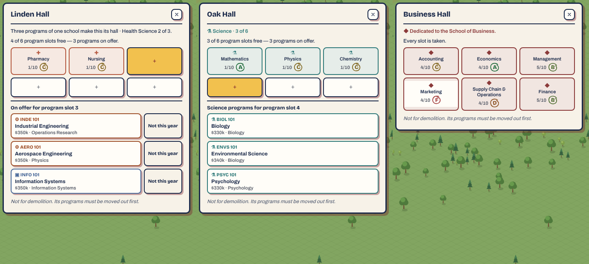

# Plan 100 — Halls claimed by three

*Planning document only — no gameplay code is changed by this file. The
owner's answer on the backlog's "hide other schools' offers in a claimed
hall" (12 October 2026), which reworks how a hall is claimed. A purchased
hall keeps offering the three weighted-random programs until it holds three
programs of one school. Then it is that school's hall, and it offers the
rest of that school's programs in place of the random offers.*

**Status: Done (13 October 2026). B and C merged (#355, #357); D in the PR that carries this line.**

---

## 0. The owner's words, and what the code does today

> Right now, moving English into a new hall immediately makes that hall set
> for the school of social sciences. I think halls should continue to offer
> the 3 weighted-random "on offer" programs until it has 3 of one school,
> and then it is claimed for that school and will show the rest of the
> programs in that school instead of the random on offer courses.

English (`ENGL`) is in **Social Sciences & Humanities**
(`data/techData.ts:175–177`), so the owner read the claim correctly. Read
against `main` at `9cec56b` plus PR #341:

- **The claim is worked out on every call and never stored.**
  `claimedSchool(s, hallId)` (`systems/techtree/schools.ts:91–107`):
  - Founders Hall never has a claim;
  - otherwise the first program in the hall sets the school, and a program of any other school makes the claim `null`.

  So **one program claims an empty hall**, whether it was founded there
  (`foundProgram`, `techSystem.ts:493`) or moved in (`relocateProgram`,
  `:557`; programs in transit count).
- **The offers** (`systems/techtree/programOffers.ts`):
  - `refillOffers` (:170–212) keeps three global offers: two from schools already started, weighted by `max(1, housed)²`, and one from an unstarted school;
  - `schoolOffers` (:131–136) is every unhoused program of a claimed hall's school;
  - `offeredIn` (:140) lets a hall found from either list;
  - one offer a year can be declined (`declineOffer`, :158, "Not this year").
- **The panel** (`BuildingInfoPanel.tsx:404–410, 602–616`) shows a claimed
  hall's own school first, then "Other schools, from the offers". Founding
  one of those asks first ("Confirm — this takes one of the six program
  slots X needs", `claimCutBy`, :440, about :655–670).
- **Other readers of the claim:**
  - the map label "Elm Hall · School · 3 of 6" (`campusLayout.ts:74–79`) and the map's offer marker (`CampusMap.tsx:1108`);
  - the panel lines (`BuildingInfoPanel.tsx:433, 501–504`);
  - the next-step line (`nextStep.ts:149, 162–191`), and guidance (`establish.ts:126`, `seating.ts:50`);
  - `schoolHall`, `claimedHalls`, `schoolToMerge` (Plan 72L), `programsAwayFromHome` and `suggestedMove` in `schools.ts`;
  - the harness: `homeFor`, `foundable`, `offersFor` and `siteNextHall` in `sim/harness/moves.ts`, and `guided.ts:296`;
  - the tests `sorting.test.ts:135–149`, `offer-decline.test.ts:78–83, 160–165` and `split-school.test.ts:132–138`.
- **The letter "A school takes shape"** (`eventData.ts:1225–1240`) already
  fires at three programs of one school (`closestSchool.housed >= 3`). The
  new rule makes the letter and the claim the same moment.
- `dedicatedSchool` (six of one school, nothing in transit) names the hall
  "<School> Hall" and is unchanged.

## 1. The rule

- **A purchased hall is claimed by a school when it holds three or more of
  that school's programs** (in transit counting, as now). Founders Hall is
  never claimed.
- **Until then it is open:** it offers the three global offers, and
  nothing asks before founding into it.
- **Once claimed:**
  - it offers **only** the claiming school's unhoused programs;
  - the global offers don't show in it;
  - programs of other schools already in it stay;
  - `programsAwayFromHome` and `suggestedMove` go on suggesting they move home, as they do for a mixed hall today.
- **A claim can be lost.** If moves bring the school under three, the hall
  is open again. The claim is still derived, never stored.

## 2. Decisions for the owner

| # | Question | Proposed |
|---|---|---|
| 1 | Two schools with three each (six slots, 3 + 3) | **The school that reached three first** keeps the claim. That needs a small record (§3). If the owner prefers no record: a 3–3 hall is open until one school has four. |
| 2 | In a claimed hall, can the player still found another school's program at all? | **No.** The owner said the school's programs show "instead of" the offers. Another school's program can still be *moved* in, by the same move as today. |
| 3 | A claimed hall whose school has no unhoused programs left | It shows "Every Science program is housed", and nothing to found. |
| 4 | Saves where a hall holds one or two programs of a school, claimed today | They become open on load. No migration, and nothing moves. The player sees offers again in that hall. |

## 3. State

- With decision 1 as proposed, a hall records **when** each school reached
  three: `HallState.claimedAt?: { schoolId; week }`. It's set when a school
  first reaches three, and cleared when that school drops below three.
  The field is optional, so a migration isn't needed, but a sanitize rule
  and a load step derive it for existing saves:
  - the school with the most programs claims;
  - on a tie, the school whose earliest program in the hall was founded first.
- If the owner picks "open until four", nothing is stored and
  `claimedSchool` stays a pure function.

## Rules for every PR in this plan

- **It changes play, so the harness is re-measured.** The harness's moves
  follow the claim. B runs `npm run sim` before and after on the standard
  seeds, and the scorecard must pass. The baseline is re-recorded with
  the reasons.
- **The rule's words are rewritten** (Plan 95E). Grep `src/` and
  `docs/design/curriculum.md` for "claims", "claimed", "a school's hall",
  "first program" and rewrite each.
- **Each PR runs `npm run check` and `npm run test:slow`.**

## The map

| PR | Subject | Depends on |
|---|---|---|
| A | This plan | — |
| B | The claim at three | — |
| C | The panel and the map | B |
| D | The harness and the guidance | B |

### PR 100B — The claim at three

- `claimedSchool` returns the school with three or more programs in a
  purchased hall, settled per decision 1. Otherwise `null`.
- **The helpers are re-checked against the new rule:**
  - `claimCutBy` asks only before *moving* another school into a claimed hall (decision 2);
  - `claimedHalls` and `schoolHall`: a school with two programs in a hall has no hall yet;
  - `schoolToMerge`: a school split over two halls, with at least three in one, is suggested to merge into that one;
  - `programsAwayFromHome`, `suggestedMove` and `closestSchool`.
- `offeredIn(hall)`: an open hall founds from the global offers, and a
  claimed hall founds from its school's list.
- The letter "A school takes shape" reads the claim, not its own count, so
  the two can't disagree.
- **Tests:**
  - `sorting.test.ts`: one program doesn't claim, three do, and 3+1 claims;
  - 3–3, by decision 1;
  - losing a claim by a move;
  - an old save with a one-program hall loads as open;
  - `offer-decline` and `split-school` updated.

**As implemented.**

- `claimedSchool` returns the school with `CLAIM_AT` (3) or more programs
  in a purchased hall, whatever else is in it, and its count. At three
  each, `s.hallClaims` settles it: the school recorded first keeps it, else
  the one with more programs, then the first in slot order.
  `settleClaims` keeps the record, after every founding and move and on
  load, where a malformed record is dropped.
- **The sorting reads a "home", not the claim.** `homeSchool` is the
  claiming school, else the only school in the hall (the claim before this
  plan). `schoolHall`, `schoolToMerge`, `programsAwayFromHome` and
  `suggestedMove` read it, through `homeHalls`.
  - On the new claim alone, a school's first one or two programs in a hall
    would count as away from home, and the suggestions would move them on
    out of the hall they are filling.
  - The guidance's own reads (`nextStep`, `seating`, `establish`) were
    switched to the home in this PR too, so its behaviour waits for 100D.
- `offeredIn`: an open hall founds the global offers; a claimed hall only
  its school's (decision 2).
- `claimCutBy` keeps its meaning. Since a claimed hall founds only its
  own, it can only apply to a move.
- The letter "A school takes shape" arrives when the closest school's hall
  is claimed by it, and its words say the hall is now that school's.
- **Tests:**
  - `sorting.test.ts`: one or two don't claim, three do, 3+1 claims, 3–3
    goes to the first, a move under three loses the claim, an old save's
    one-program hall loads open.
  - `offer-decline.test.ts`: the fixture holds three of the school, a
    claimed hall no longer founds the global offers, one program leaves a
    hall open.
  - The step case: at three Science programs beside History, Elm Hall is
    claimed and the next step is founding there, not another move.
- **Balance** (`npm run sim`): ranks within 5 places and prestige within
  3.9 points of the baseline; Lean founds four schools by year 50, not
  five. The scorecard: 79 of 115 met, against 78 on `main` measured the
  same day. The natural player founds its first school in year 10, where
  it was year 6, now inside its target (years 8–13). The baseline is
  re-recorded.
- `docs/design/curriculum.md` has the rule.

### PR 100C — The panel and the map

- **An open hall's panel:** the three offers, as Founders Hall shows them
  today, with a line under the slots: "Three programs of one school make
  this its hall", plus the count toward it when one school leads ("Science
  2 of 3").
- **A claimed hall's panel:**
  - its school's unhoused programs only;
  - "Other schools, from the offers" and its confirmation go (`BuildingInfoPanel.tsx:404–410, 602–616, 655–670`);
  - "Not this year" goes too, since it declines a global offer and a claimed hall shows none;
  - decision 3's empty state.
- **The map label:** "Elm Hall · Science · 4 of 6" when claimed, and "Elm
  Hall · 3 of 6" when open. The offer marker (`CampusMap.tsx:1108`) shows
  on an open hall when an offer is foundable there, and on a claimed hall
  when its school has a program left.
- **Checks:** a screenshot of an open, a just-claimed and a full hall.

**As implemented.**

- **The panel** (`BuildingInfoPanel.tsx`):
  - A claimed hall offers its school's programs and nothing else. "Other
    schools, from the offers" is gone, and so is the confirmation for
    founding into another school's claim; `claimCutBy` is no longer read
    by the panel.
  - "Not this year" shows only under the global offers, so a claimed hall
    has none.
  - Decision 3's empty state reads "Every Science program is housed."
  - An open purchased hall carries the line "Three programs of one school
    make this its hall", plus "· Science 2 of 3" when one school leads
    alone.
- **The map label** (`campusLayout.ts`): "Elm Hall · Science · 4 of 6" when
  claimed, and "Elm Hall · 3 of 6" for an open purchased hall.
- **The offer marker** (`CampusMap.tsx`): a claimed hall shows it while its
  school has a foundable program, and an open hall shows it while the
  global offers hold one.
- **Checks:** `npm run check`. The screenshot shows an open hall (one
  school short of three), a hall claimed at three, and a full hall:

  

### PR 100D — The harness and the guidance

- **The harness** (`sim/harness/moves.ts`):
  - `homeFor` sends a new program to the hall where its school leads, or an empty hall;
  - `foundable` and `offersFor` follow `offeredIn`;
  - `siteNextHall` buys a hall when no open hall has a slot.

  `guided.ts:296` is re-read.
- **The next-step line** (`nextStep.ts:149, 162–191`) and the guidance
  (`establish.ts:126`, `seating.ts:50`): "found two more Science programs
  here to make it Science's hall" in place of today's claim wording.
- **The opening walkthrough and Plan 78's school letters** are read for
  the old rule ("a hall is claimed by its first program") and rewritten.
- `docs/design/curriculum.md` (:7–90, 165–177) gets the rule.

**As implemented.**

- **The harness** (`sim/harness/moves.ts`):
  - `homeFor` sends a new program to its school's own hall, then to a hall
    the school leads, then to an open hall (no claim and no home).
  - `foundable` and `offersFor` read `offeredIn`.
  - `siteNextHall` waits while an open purchased hall has a free slot.
  - `guided.ts`'s "last school home in Founders Hall" reads `homeSchool`,
    since Founders Hall is never claimed.
- **The guidance:**
  - The next-step line for a school's hall short of three adds "— found
    two more Science programs here to make it Science's hall".
  - `establish`'s founding step says the program makes the hall the
    school's, or is one of the programs that will.
  - The closing step counts claimed halls.
- **The letters:** the Elm Hall letter states the rule, and "A school takes
  shape" (from 100B) says the hall is now the school's. The opening
  walkthrough never spoke of claims, so it is unchanged.
- **Tests:** `sorting.test.ts` adds a hall short of a claim: the next step
  says how many more programs claim it, and names the last of them.
- **Balance** (`npm run sim`, against 100B's baseline): ranks within 3
  places, prestige within 3.6 points. Lean founds five schools by year 50
  again, one more than under 100B. The scorecard: 85 of 115 met, against 79
  under 100B. The natural player founds its first school in years 9–10;
  its fourth, in years 11–13, runs early of its target (14–23). The
  baseline is re-recorded and `npm run test:slow` passes.
