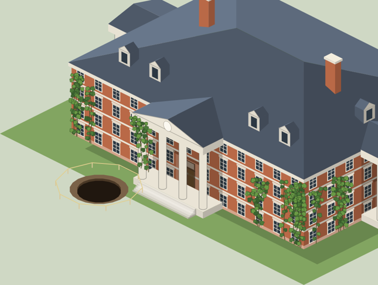

# Plan 101 — Events that do what they say

*Planning document only — no gameplay code is changed by this file. The
owner picked "events that do what they say" for 0.1.1 (12 October 2026).
Plan 76D relabelled the event choices whose truth needs a system the
events couldn't reach, so each says what its effect does. This plan builds
those systems, so the choices can say what a college would really do.*

**Status: Approved (13 October 2026): every decision as proposed. In progress.**

---

## 0. What stands today

Read against `main` at `9cec56b` plus PR #341.

- **The catalogue** is 159 events in `data/eventCatalogue.ts`, plus the
  festival and the charter. Its types are in `eventCatalogueTypes.ts`:
  - `EffectKey` (:35–48) has 17 keys: cash, endowment, debt, backlog, mood, warmth, quality, enrollment, trees, replant, departs, buildingFund, historic, charter, goodwill, festival;
  - a choice has `effects`, `promise` and `mascot` (:56–65);
  - an event has `when`, `needs`, `favours`, `names`, `cooldownYears`, `timeoutWeeks` and `default`.
- **The engine:**
  - effects are applied by `applyEffects` (`systems/events/catalogue.ts:394`);
  - `backlog` spreads over every building by cost (`spreadBacklog`, :335), and `enrollment` touches freshmen only (`changeEnrollment`, :350);
  - `resolveCatalogueEvent` (`catalogueEngine.ts:177`) applies and journals an answer;
  - recurrence is `offCooldown` (:42) alone.
- **The saved state** (`CatalogueState`, `types.ts:553`) keeps
  `lastFired`, `lastVariant`, `letters` (seismic answers with their choice
  ids) and `answered` (inline **counts only**). An inline event's choice
  isn't remembered.
- **One event already hires:** `rival-passed` (`eventData.ts:858`) rolls the
  best of N `generateCandidate` at fire time and appoints through
  `appointFaculty` (:908). It lives outside the catalogue.
- **The lever test** (`test/event-truth.test.ts`, `LEVERS` :49) checks that
  a choice's label matches what its effects can do.

What 76D left (`076-ui-and-text.md:434–444`), with the second review's
update (`reviews/2026-10-game-review-ii/2b-flavor-and-mechanics.md:70–100`),
sorted by the hook each needs:

| # | Item | Events | Hook today | Size |
|---|---|---|---|---|
| 1 | **A memory of answers** | the-boiler, the-master-key, the-writing-requirement, the-grade-medians, the-closing-bell, the-term-limits, the-flood, the-land-offer | none (cooldown only) | M |
| 2 | **Backlog onto the named building** | roof-goes, boiler-condemned, ivy-structural, roof-slates, derelict-notice, asbestos, the-burst-pipe, the-buckets, the-lift, the-sinkhole | `vars.buildingId` already rolled (`catalogue.ts:229`); `Buildable.backlog` per building | S |
| 3 | **The essay ring's cost over its classes** | the-essay-ring | `students.classes` per class | S |
| 4 | **The draw rate** | draw-questioned, recession, thin-fund | `SET_DRAW_RATE`, `s.finance.drawRate` | S |
| 5 | **The library lever** | library-acquisition | `RENOVATE_LIBRARY`, `nextLibraryFloor` | S–M |
| 6 | **A hire** | frozen-post, contract-visiting-chair, two-body, the-board-secretary, trustee-resigns | `appointFaculty`, `generateCandidate`, the rival-passed pattern | M |
| 7 | **Retirements that remove someone** | the-last-lecture, founding-faculty-last, emeritus-office | `tickRetirements` (`facultySystem.ts:135`), `names.faculty: 'longest'` | M |
| 8 | **A real campaign** | annual-fund-drive, the-matching-challenge | `launchCampaign` (`alumni/campaigns.ts:58`): needs the Advancement VP, one at a time | M |
| 9 | **A statue placed, a path paved** | the-statue-donor, desire-path | `PLACE_BUILDABLE` with `gift`, `PAINT_PATH_TILES` | M |
| 10 | **The booster club's gift to athletics** | the-booster-club | `athleticsBudget`, team `scholarships` | M |
| 11 | **Named funds** (scholarships, chairs) | tuition-letter, the-statue-donor, the-last-lecture, founding-faculty-last, the-name-on-the-prize | only `restrictedBuilding` | L |
| 12 | **Closing a program** | program-thin | **none**: no action closes a program | L |
| 13 | **The sinkhole and the ivy on the map** | the-sinkhole, ivy-structural | ivy only on historic buildings (`ageMarks.tsx`); no sinkhole art | M |
| 14 | **Levers that don't exist** | endowment-manager, two-body ("nothing is possible"), anonymous-gift | — | read each |
| 15 | **Clocks never installed** | the-reunion-gift, the-championship-run's scoreboard | — | read each |

Two of the brief's quotes have already moved:
- the boiler's "installed in the college's first decade" is no longer in
  its text (only `the-history` says "first decade");
- the guidebook fires once (`cooldownYears: 99`, 76D).

## 1. Decisions for the owner

| # | Question | Proposed |
|---|---|---|
| 1 | Closing a program (12): build it? | **Yes, as a player action first**, then the event uses it. Closing frees the program's slot, ends its courses, and lets its faculty go or reassign (as `CUT_TEAM` does for a team). It's the one large piece, so it's the plan's last PR and can move to 0.1.2 without holding the rest. |
| 2 | Named funds (11): a fund type or a label? | **A fund type:** `advancement.funds`, each `{name, purpose: 'scholarship' \| 'chair', principal}`. It pays its income to its purpose (aid for a scholarship, a professor's salary for a chair), shown in the Treasury. |
| 3 | A memory of answers (1): what does a remembered answer do? | **It retires or changes the event.** An answer that settles a matter (the boiler replaced, term limits adopted, the strip sold) stops the event. One that doesn't (*tarp it*) lets it come back, with a telling that remembers ("The boiler you patched in Year 12 has failed again"). |
| 4 | A hire from an event (6): from the market or rolled? | **Rolled**, the rival-passed way: the best of N candidates at fire time, named in the letter, appointed on the choice, at the market rate. |

## Rules for every PR in this plan

- **Each choice's label says what its effects do.** `event-truth.test.ts`'s
  `LEVERS` grows with every new effect, and the test stays green.
- **Balance is measured on the harness.** Events fire in harness runs, so
  every PR runs `npm run sim` before and after. The scorecard must pass,
  and any drift goes in the PR with its cause.
- **Saved state is optional and sanitized.** New `CatalogueState` fields
  are optional, so no migration is needed, only a sanitize rule. A new
  `GameState` field (the funds, a closed program) ships a migration
  (Plan 70B).
- **No new randomness in the run's stream without a reason.** A roll at
  fire time uses the event's own seeded roll, as `rival-passed` does.
- **Each PR runs `npm run check` and `npm run test:slow`.**

## The map

| PR | Subject | Items | Depends on |
|---|---|---|---|
| A | This plan | — | — |
| B | A memory of answers | 1 | — |
| C | Effects that land where they say | 2, 3, 4, 5 | — |
| D | Hires and retirements | 6, 7 | — |
| E | Campaigns, gifts and things on the map | 8, 9, 10, 13 | — |
| F | Named funds | 11 | — |
| G | The levers and clocks that don't exist | 14, 15 | B–F |
| H | Closing a program | 12 | — |

### PR 101B — A memory of answers

- `CatalogueState.settled?: Record<eventId, {choiceId, year}>`, written in
  `resolveCatalogueEvent` for inline and seismic answers alike.
- **An event declares which choices settle it:** `settles?: choiceId[]`.
  - `eligible` skips an event whose settling answer is on record.
  - A non-settling answer lets the event recur on its cooldown, with a `recalls` telling that names the year and the answer (decision 3).
- **The eight events** get their `settles` lists and their recall
  tellings. `the-term-limits` stops naming "the trustee of twenty-six
  years" once term limits are adopted.
- **A test** for each of the eight: answer, advance past the cooldown, and
  check it doesn't recur, or recurs with the recall telling.

**As implemented.**

- **The record** is `CatalogueState.lastAnswer` (not `settled`, since it
  holds every last answer, settling or not), written in
  `resolveCatalogueEvent` whoever answers: the player, a seat or the clock.
  The charter and the spring festival are recorded too, though neither
  settles nor recalls. Load drops a malformed entry, or one naming an
  event the catalog no longer has.
- **The draw:** `settled(s, e)` reads it against the event's `settles`,
  and `drawable` (the draw's filter, now exported) skips a settled event.
- **The recall:** an event back after an answer listed in its `recalls`
  saves that answer on the firing (`PendingCatalogueEvent.recall`) and
  reads that telling, with `{answeredYear}` filled, in place of its own.
- **The eight:**

  | Event | Settles it | Recalled |
  |---|---|---|
  | the-boiler | replace | nurse, defer |
  | the-master-key | key cards | rekey, keep looking |
  | the-writing-requirement | require | leave it |
  | the-grade-medians | publish the median | leave them |
  | the-closing-bell | open all night | keep to midnight |
  | the-term-limits | adopt | for new trustees only |
  | the-flood | the defenses | dry out, move upstairs |
  | the-land-offer | sell, lease | keep |

  Since adopting term limits settles the event, the trustee of
  twenty-six years is never named again.
- **Tests:** `event-memory.test.ts` covers each settling answer and each
  recall, the clock's answer as well as the player's, an event with no
  memory, and the save.
- **Balance** (`npm run sim`): every median matches the baseline. The
  harness's answers rarely settle an event, and a settled one is only
  absent from a draw that has plenty of others. The baseline is unchanged.

### PR 101C — Effects that land where they say

- **Backlog on the named building:** an effect `backlogOn: amount` loads
  `vars.buildingId`'s `Buildable.backlog`, for the ten repair events. The
  letter already names the building.
- **The essay ring:** `enrollmentSpread: n` takes its cost from every
  class, by size, not only from the freshmen.
- **The draw rate:** `drawRate: delta` moves `s.finance.drawRate` within
  `DRAW_RATE_*`. *Defend the rate* holds it, and *Put a year's excess draw
  back* lowers it for a year. The Treasury's draw line shows the change.
- **The library:** `libraryFloor: true` builds the library's next floor
  (`nextLibraryFloor`) at the acquisition's price, or, at the top floor,
  the event's cash effect as now.

**As implemented.**

- **`backlogOn`** (a money key, scaled like `backlog`) is used by the ten
  repair events. The sinkhole's *Survey and grout the whole campus* keeps
  `backlog`, since the campus is what it repairs.
  - **Damage** lands on the named building, priced for its size: the
    amount times the building's cost over the campus's mean cost
    (`namedDamage`), and smaller under Facilities Management as before.
    The catalog's sums are campus-scale. Unscaled, they sank the
    worst-kept building, often a small one, and with it the mean
    condition that prestige reads; the first scorecard lost two targets.
    Scaled, the mean condition falls as far as the spread took it.
  - **A repair** clears the named building first and spreads the rest.
  - A firing that names no standing building spreads, as before.
  - The answer reads "$X of repairs deferred on {building}" or
    "$X of repairs done, {building} first".
- **`enrollmentSpread`:** the essay ring's *Rescind the degrees* takes its
  forty-in-two-thousand from every class by size, each class's cohort mix
  kept (`setClassSize`, shared with `enrollment`).
- **`drawRate`:** draw-questioned's *Put a year's excess draw back* and
  thin-fund's *Put a year's draw back* now say "and lower the rate", and
  lower it half a point (one slider step) within the Treasury's bounds.
  - The plan said "for a year". The rate is the player's slider, so the
    answer moves the slider and the player can move it back; no hidden
    timer.
  - *Defend the rate* holds it, as its effects always did.
  - The recession's choices already say what they do, so they are
    unchanged.
  - The lever test's "cut the draw" check now passes on a `drawRate` cut,
    where before it always failed.
- **`libraryFloor`:** *Buy the collection* also raises the library's next
  floor (estate.ts's `startLibraryFloor`, now shared with
  `RENOVATE_LIBRARY`), paid for by the answer's own cash. With no library
  standing, at its top floor or under a construction freeze, it does
  what it did. The label stays "Buy the collection", since the floor is
  conditional; the answer's phrase names it when it applies.
- **Tests:** `event-truth.test.ts` adds the named building (alone, priced
  for its size, cleared first), the spread over the classes, the draw
  rate's floor, and the library's floor and top.
- **Balance** (`npm run sim`): ranks within 2 places and prestige within
  0.4 points of the baseline. The harness answers these events with their
  defaults, so only the named building's damage reaches it. The
  scorecard reads 82 of 115, against 85 on `main`. The lost targets are
  the Guided and Completionist players' "first #1" and "rank at Y50",
  each a seed or two away (a #1 in Y49, or never). 102B, which changes
  nothing in the sim but the random stream, flips the same rows and
  reads 81, so this is within the scorecard's noise. The baseline is
  re-recorded.
- **`archetypes.test.ts`'s variety check** fell to 38 era names in 64,
  one short of its 60%, on the new stream. Every chronicle opens on its
  founding era, which reads "The Founding" in each run and says nothing
  about sameness. The check now counts the eras after the founding: 37
  names in 56. The 60% bar is unchanged.

### PR 101D — Hires and retirements

- **A hire** (decision 4): an effect `hire: {field?, strength}`. At fire
  time the event rolls the candidate into `vars.candidate`
  (`generateCandidate`, best of N), and the letter names them. The choice
  calls `appointFaculty`. This is used by:
  - frozen-post (cover);
  - contract-visiting-chair (*make the post permanent*);
  - two-body (a courtesy post);
  - the-board-secretary (*appoint a successor*: an office hire, through Plan 89's office seat).

  trustee-resigns is read and left if it isn't a hire.
- **Retirements:** the-last-lecture and founding-faculty-last fire from
  the real retirement notice (`tickRetirements`), naming that professor,
  not on a year gate. Their choices act on that person (a last lecture,
  an emeritus title, a fund in their name once F lands).
  emeritus-office follows the same notice.

**As implemented.**

- **A hire:** an event with `hires: 'taught' | 'untaught'` rolls its
  candidate when it fires (`rollCandidate`: the best of five from the
  market at the college's standing, the rival-passed way). It keeps the
  candidate on the firing (`PendingCatalogueEvent.candidate`) and names
  them as `{candidate}` and `{candidateField}`. A choice with `hire: 1`
  appoints them through `appointFaculty`, logged as any appointment is.
  The answer reads "appoints {candidate} ({field}), $X/yr" at this
  college's pay. Load drops a malformed candidate.
  - **frozen-post** (taught): *Appoint {candidate} to the post*, in place
    of temporary cover.
  - **contract-visiting-chair** (taught): *Make the post permanent:
    appoint {candidate} to the faculty*. The visitor is named in the
    letter.
  - **two-body** (untaught): *Appoint {candidate} to a courtesy post*. The
    spouse is in a field the college does not teach, so they teach
    nothing until a program in their field is founded.
  - **Read and left:** the-board-secretary and trustee-resigns. Neither
    is a faculty post, and the college has no seat for a board
    secretary or a trustee. Their labels already say what they cost;
    101G reads them again.
  - All three tellings of frozen-post and contract-visiting-chair name the
    candidate.
- **Retirements:** two new professor kinds. `'retiring'` is the
  longest-serving professor in the year's notice before retirement
  (`careerWeeks`). `'founding-retiring'` is that professor when they are
  the last of the founding faculty (appointed in the first three years)
  on the roster.
  - **the-last-lecture** names its retiring professor in place of "the
    longest-serving teacher in {program}" and loses its year gate.
  - **founding-faculty-last** names the last founding professor in their
    notice year, in place of a year 29–31 window.
  - **emeritus-office** keeps its year gate and adds the retiring
    professor ("would make five").
  - The fund in their name waits for 101F.
- **Tests:** `event-hires.test.ts` covers the three hires (named, field,
  appointed or not), the save, and the retirement names. `event-catalogue`
  fills a hiring event's `{candidate}` when it checks every telling.
- **Balance** (`npm run sim`): ranks within 4 places and prestige within
  1.3 points of 101C's baseline. Rolling the candidate draws on the run's
  stream when a hiring event fires; the harness takes the defaults, which
  hire nobody. The scorecard reads 85 of 115, against 82 under 101C. The
  baseline is re-recorded.

### PR 101E — Campaigns, gifts and things on the map

- **A real campaign:** annual-fund-drive and the-matching-challenge call
  `launchCampaign` when the college has an Advancement VP and no campaign
  running. Otherwise the choice says so and does what it does today.
- **The statue:** the-statue-donor's promise places an `AMENITY-STATUE`
  as a gift (`PLACE_BUILDABLE` with `gift`) on a free 2×2 site the player
  picks, through the existing placement flow, with "Place the donor's
  statue" in the inbox until it's placed. Plan 99's gazebo could be a
  second gift here; that's a note, not this PR.
- **The desire path:** *Pave it* paints the path tiles from the worn line
  to the nearest walk, the way the path tool would.
- **The booster club:** the gift goes to the athletics budget (or a named
  team's scholarships) instead of plain cash.
- **The sinkhole and the ivy:** a sinkhole mark on the named building's
  doorstep tile until it's repaired, and ivy on the named building
  whatever its historic status, both drawn in `ageMarks.tsx` and cleared
  when the backlog is paid.

**As implemented.**

- **A real campaign** (`campaign: 1`): *Run the campaign* (annual-fund-drive)
  and *Announce the challenge and campaign for it* (the-matching-challenge)
  launch the endowment campaign the alumni would answer best
  (`eventCampaign`). This needs a VP of Advancement in the seat and no
  campaign running. Otherwise the answer does what its other effects say,
  and its phrase names no campaign. The lever test's "run a campaign" check
  now passes on this effect.
- **The statue** (`statue: 1`): *Accept the gift, and promise a statue*
  puts the statue's price in the building fund, opens the statue if the
  ladder had not, and records the pledge (`Advancement.statuePledged`).
  The fund pays for it first when it is built.
  - The inbox keeps "Place the donor's statue" in the decide tier, with
    *Open Build*, until it is going up. It never lights the badge.
  - A statue already going up or standing is not pledged again.
  - The statue is the catalog's "The Founder's Statue"; a donor's name on
    it is a note for later.
- **The booster club** (`boosterGift`, money): both gifts go into the
  athletics department's pot for the year (`StudentOrgState.boosterGift`,
  read by `departmentPot`), not into cash.
- **The desire path** (`paveLine: 1`): *Pave the line they have worn*, in
  place of *Stop reseeding it*, lays the longest run of lawn the busiest
  walks cross (`wornLine`, from walkRoutes.ts's `desireLines`, the line
  the map draws) as path tiles. It lives in `systems/estate/paths.ts`,
  which joins the invariants test's short list of systems allowed to read
  the layout, as the events' trees go through `woodland.ts`.
- **The ivy and the sinkhole** (`ivy: 1`, `sinkhole: 1`): ivy-structural's
  *Leave the ivy* and the-sinkhole's *Fence it* mark the named building
  (`Buildable.ivy`, `.sinkhole`). `tickEstate` clears both once its
  backlog is paid.
  - The ivy is the historic buildings' ivy, now drawn as runners with
    lobed leaves, not round blobs, and trimmed to about a third of the
    first redesign's points (3.8 ms a hall to draw, against 1.5 ms before
    and 6.4 ms for the first redesign). Buildings are kept as drawings, so
    this is paid only when one is drawn again.
  - The sinkhole is a pit in a rim of earth with a ring of posts and a
    rail, out from the front wall beside the steps. It shows while the
    camera sees that front.

  
- **Saves:** the pledge and the gift are optional fields, and load drops
  a malformed one.
- **Tests:** `event-gifts.test.ts` covers the campaign (with and without a
  VP, not while one runs), the statue (fund, inbox, cleared once it is
  going up, not pledged twice), the booster pot (this year only, summed,
  sanitized), the worn line on a built campus, and the marks (kept while
  repairs wait, cleared when paid).
- **Balance** (`npm run sim`, against 101D's baseline): ranks within 3
  places and prestige within 2 points. The harness takes the defaults: the
  booster club's *Take the money* now funds the athletics pot, where gate
  money it leaves unspent still spills into income. The scorecard reads 85
  of 115, as under 101D. The baseline is re-recorded.

### PR 101F — Named funds

- `advancement.funds` (decision 2), with a migration.
  - **A scholarship fund's income** goes to financial aid, lowering the net price the summer shows.
  - **A chair's income** pays part of a named professor's salary, and the person page shows "holds the X Chair".
- **The events:** tuition-letter's hardship fund, the-statue-donor's named
  fund, the-last-lecture's endowment in their name, founding-faculty-last,
  and the-name-on-the-prize.
- **The Treasury** lists the funds, each with its name, principal and
  what it paid this year.

**As implemented.**

- **The record:** `Advancement.funds`, each `{ id, name, purpose, principal,
  year, field?, holderId? }` (`systems/alumni/funds.ts`). An answer
  declares `fund: { purpose, name }`. The gift its effects already put into
  the endowment becomes the principal, so the money is not counted twice.
- **What a fund pays:** its principal times the draw rate a year. When the
  endowment falls below the funds' principal, they pay in proportion
  (`fundShare`).
  - **A scholarship's income is student aid:** a new expense line, *Student
    aid*, spent rather than reaching cash. Applicants read the price net of
    it (`netTuition`, the aid a year over the students enrolled) in the
    funnel, the summer's preview and the demand's what-if. The summer shows
    "$X/yr after aid", and its price tier reads the net price. The class is
    still billed the listed price.
  - **A chair's income** pays toward its holder's salary, which the
    college would have paid anyway, so the cash is unchanged. It goes to
    the strongest professor in the field of the one it is named for (not
    them, as they are retiring), and on to the next by the same rule when
    they leave. The holder is read, never stored after the first.
- **The Treasury** lists each fund under the endowment: its name, its
  principal, and its aid a year or the part of its holder's salary it
  pays. The person page says "Holds the X Chair".
- **The events:**
  - tuition-letter: *Endow a hardship fund*, in place of a one-off fund.
  - the-statue-donor: *Offer to name an endowed fund instead* endows
    "The Benefactor's Scholarship".
  - the-last-lecture: *Endow a scholarship in their name*. Its text's "her
    office" now reads "their office", as the professor is named.
  - founding-faculty-last: *Endow a chair in their name*.
  - **Read and left:** the-name-on-the-prize. The prize in its text is not
    a fund the college holds, and its answers already move the endowment.
- **Saves:** version 102, with a no-op migration (`noFundsYet`), so a build
  without funds refuses a save that holds some. Load drops a malformed
  fund. `test/fixtures/save-v101.json` is the version-100 fixture carried
  forward.
- **Tests:** `event-funds.test.ts` covers the scholarship (principal, aid,
  the statement, the net price, a short endowment), the chair (named,
  field, holder, its successor), no fund without a gift, and the save. The
  treasury test's every-line state holds a scholarship. `save-migrations`
  loads the version-101 fixture.

### PR 101G — The levers and clocks that don't exist

- **Each of endowment-manager, two-body's "nothing is possible",
  anonymous-gift, the-reunion-gift and the-championship-run's scoreboard
  is read again.** Each gets either a hook (one of B–F's effects, or a new
  small one) or a label that says what its effect does. The PR lists
  which, one row per event.
- **A pass over the whole catalogue** with `event-truth.test.ts`, looking
  for labels that promise what no effect delivers.

**As implemented.**

| Event | What it promised | Now |
|---|---|---|
| endowment-manager | *Appoint a proper manager*: better returns | **Read and left.** The game has no investment returns for a manager to raise; the manager's better years are the one sum the answer already adds, and its phrase says so. |
| two-body | *Say that nothing is possible* | **A hook:** the professor the event names takes the offer elsewhere (`departs`), and the answer says they leave. |
| anonymous-gift | *Put it into the buildings*: a repair the college might not owe | **A hook:** `repairGift` pays the repairs owed first, and puts the rest in the building fund, so a bequest is never lost to a campus in good repair. |
| the-reunion-gift | *Install the clock as given*: no clock is drawn | **The label:** *Accept the clock as given*. The class pays for it, and a clock post is below the map's scale. |
| the-championship-run | *Let the boosters pay for the scoreboard* | **Read and left.** The boosters pay; a scoreboard stands inside a venue, below the map's scale. |
| the-board-secretary | *Appoint a full-time successor* (from 101D) | **Read and left.** The college has no seat for a board secretary; the answer's cost is the post. |
| trustee-resigns | *Move quickly on a replacement* (from 101D) | **Read and left.** Its cost is the search; the board has no seats to fill. |

- **The pass over the catalogue:** every answer whose effects move only
  mood, warmth or quality (124 of them) was read against its label. They
  say what the college decides (wait, decline, keep, thank), not
  something built or hired. the-consultants-report's *Implement the
  recommendations* changes nothing on purpose: the report's one finding is
  "lean into its distinctiveness", and the answer reads "nothing to speak
  of".
- **The lever test** now holds *install* to money spent: the reunion's
  clock passed before on warmth alone.
- **Tests:** `event-truth.test.ts` adds the gift for the buildings
  (repairs, then the fund) and the professor who leaves.

### PR 101H — Closing a program

Decision 1. This is the largest piece, and it can move to 0.1.2 without
holding the rest.

- **A player action, `CLOSE_PROGRAM`**, on a program's card in the
  Curriculum, never for a program with students in its final year. It:
  - frees the slot;
  - ends the program's courses (their teachers are freed, and the courses lock);
  - lets the enrolled students finish (no new admits, the program ends when its last class graduates).
- **The cost:** the alumni of that program give less for five years, and
  prestige loses the program's share as its students graduate. This
  mirrors `CUT_TEAM` (Plan 95V).
- **program-thin's** *Close it* choice then calls it. The event offers it
  only for a program with no students in their final year.
- **A migration** for the closed-program record. The harness never
  closes a program.
