# Plan 124 — Subtraction, as decided

*The owner's answers to the review by subtraction's cut list (Plan 123,
`docs/reviews/2026-11-review-by-subtraction/`), given row by row on the review
page on 3 November 2026 and revised there the same day after the rows were
explained at more length, sequenced into PRs. The review's twelve cards were
recommendations; this plan does only what the owner chose, reads each "trim"
as §3 says (the owner agreed), and adds the cards' additions the cut list
didn't ask about, which the owner also agreed to (§4, PRs H–N).*

**Status: Landed (3 November 2026), on `claude/quirky-tesla-1tkmw0`.** PRs A–M
were built in parallel by five agents, one branch each (A, B, H · C, D · E, F,
M3 · G, I, J, K · L, M1, M2), and merged in turn. `npm run check` passed on
every merge, 214 suites at the end. PR N (alumni warmth and endowed chairs)
is not started. Each PR's **As implemented** note follows its section.
---

## 0. What the owner decided

38 rows: **9 cut, 10 trim, 19 keep**. The revision changed two rows: S7 went
from trim to keep, and X1 is now marked keep, with its note unchanged.

| Row | Item | Recommended | Decided |
|---|---|---|---|
| X1 | The *Looking around* chapter | cut | keep, **with a skip button** (the owner's note) |
| X2 | The map tools' 280-word help | trim | **trim** |
| X3 | Year-1 chapter *about* paragraphs | cut | **cut** |
| X4 | The "why you can't yet" help variants | cut | **cut** |
| X5 | The four tab walks | cut | keep |
| X6 | The admissions coach and handle hint | cut | keep |
| X7 | The first summer's chapter text and the summer call's note | cut | **cut** |
| X8 | The summer review's satisfaction and pillar lines | cut | **cut** |
| X9 | "The cost of being large" from year 1 | trim | **cut** |
| X10 | The founding letter and the second panel | cut | keep |
| X11 | Three redundant opening lines | cut | **cut** |
| H1 | The "unseen" red ! badges | cut | **trim** |
| H2 | *Also waiting* and the matter toast | cut | **cut** |
| H3 | Athletics' six "Hire a …" links | cut | keep |
| H4 | Four date readouts | merge | keep |
| H5 | Separate Rank and Prestige chips | merge | **trim** |
| M1 | "Now an established program" letters | cut | keep |
| M2 | "N WAITING" and the satisfaction sub-lines | trim | **trim** |
| M3 | Promises | cut | **cut** |
| M4 | Student demands | cut | keep |
| M5 | Identity tags' effects | cut | keep |
| M6 | The twelve offices | cut | keep |
| M7 | Events that never reach the map | trim | keep |
| M8 | Negligible edges | cut | keep |
| M9 | The board's question | trim | keep |
| A1 | Coach management, team order, scholarships | cut | keep |
| A2 | The title page that stops the clock | cut | keep |
| A3 | Prestige dividend, draw rate, sweep | cut | keep |
| A4 | Reunions and the Alumni panel | cut | keep |
| A5 | Two scores for the campus's looks | merge | **trim** |
| S1 | Gold's extra meanings | trim | **trim** |
| S2 | Standing pulses | cut | keep |
| S3 | Background sound cues | cut | **trim** |
| S4 | "Guide" and "Distinguished" name clashes | trim | **trim** |
| S5 | Unicode glyphs among the icons | trim | **trim** |
| S6 | Seven entrance motions | merge | **trim** |
| S7 | Three projections in the first minute | trim | keep (was trim) |
| F1 | The unreachable `RENOVATE_LIBRARY` | cut | **cut** |

**What the answers say.** The owner cut the words that explain the first year and
one whole mechanic (promises). The owner trimmed the signals and the band, and
kept the guided walks, the coaches, the letters and every other mechanic the
review put up for cutting. So of the twelve cards:
- cards 2 and 12 go ahead much as written;
- cards 1, 3, 6, 9 and 11 go ahead in part;
- cards 4, 5, 7, 8 and 10 were mostly additions the cut list didn't cover (§4).

## 1. What stands today

- **The camera chapter.** `looking-around` (`state/chapters.ts:128-141`) requires
  pan, turn, tilt and zoom before *Somewhere to sleep* opens. On desktop, turn,
  tilt and home are keys only. The buttons are drawn under `touchUi`
  (`components/CampusMap.tsx:2756`), and the tooltip at `:2740` promises them.
  The help (?) at `:2748` is one paragraph of about 280 words. This is bug R-1,
  live in 0.2.0.
- **Chapter copy.** `data/chapterData.ts` holds each chapter's `about`. The year-1
  ones are at `:148` (next course), `:178` (sleep), `:194` (seats), `:204`
  (paying), `:216` (first summer) and `:226` (standing). The objective helps for
  waiting are `secondCourseWaitHelp`, `HALL_LOCKED_HELP` (`:99`) and
  `labRisingHelp` (`:119`), picked in `state/chapters.ts:525-533`. A chapter has
  `earliest` and an optional `opensWhen`; its objectives have none.
- **The summer review's lines.** `state/yearInReview.ts:183` (satisfaction
  explained) and `:224-253` (each pillar "stands at N of 150, and counts for Y%").
- **"The cost of being large".** `tabs/TreasuryTab.tsx:311`, shown at any size.
- **Opening lines.** `data/openingData.ts:106` ("A run lasts 50 years…") and
  `:142` ("The walkthrough has two steps."), and `components/OpeningCoach.tsx:97`
  ("Time is paused until you do this").
- **The band.**
  - The "unseen" badges are in `components/Toolbar.tsx:28-35`, plus one per Build
    category in `BuildPopup.tsx`.
  - *Also waiting* is `chapterData.ts:418`, drawn by `ObjectivesPanel.tsx`.
  - The matter toast is `Toasts.tsx:86` (`tone: 'matter'`).
  - Rank and Prestige are two `FigureBox`es in `StatusHeader.tsx:159-169`, each
    with its own hint and door.
- **Promises.** `systems/promises/` (`promises.ts`, `promiseTargets.ts`) and
  `data/promiseData.ts`, plus:
  - the offer, in `InterruptModal.tsx` and `EventChoices.tsx`;
  - `tabs/PromisesPanel.tsx`, in History;
  - lines in `FinalReportView.tsx`, `state/finalReport.ts` and
    `data/reportData.ts`;
  - the chronicle (`chronicle.ts`, `chronicleData.ts`);
  - the catalogue (`events/catalogue.ts`, `catalogueEngine.ts`);
  - `guidance/gates.ts`, `AlumniPanel.tsx`, the `promises` chapter, and an
    analytics chapter id;
  - persistence's guard (`state/persistence.ts:1394-1404`).

  The `promises` and `the-long-game` chapters were already removed from play by
  Plan 112; the `promises` id is still in `ChapterId`.
- **The campus's two scores.** Beauty (`systems/estate/beauty.ts`, 0–100) feeds
  applicants, prestige and an alumni memory. The Campus standing (0–150) feeds
  the Final Report and the rivals' campus axis. The Estate panel shows one, and
  the build menu the other.
- **Signals.**
  - Gold is `--school-secondary`, with the meanings listed in
    `cohesion.md` §1.
  - Cues are in `data/audioData.ts` and `components/audio/director.ts:52-84`.
  - The professor's rank tiers are in `data/facultyData.ts:753-755`.
  - The map tools' glyphs are at `CampusMap.tsx:2759-2762`, and the school
    motifs at `schoolPalette.ts:16-22`.
  - `styles.css` has 24 `@keyframes`, seven of them entrances.
- **Bugs from the review** (`bugs.md`):
  - R-3: the banner is invisible under reduced motion (`styles.css:4452-4467`).
  - R-4: the Curriculum list re-scrolls on commit.
  - R-5: the Build panel covers a building as it is placed.
  - T-1: `__campusMap` is cleared after Continue.
- **`RENOVATE_LIBRARY`** has a reducer case (`engine/reducer.ts:962`) that no
  screen dispatches.

## 2. The PRs

| PR | Rows | Change |
|---|---|---|
| A | X1, X2, S5 (map tools), R-1 | The camera: buttons on every device, a skip, a short help |
| B | X3, X4, X7, X8, X9, X11 | Year 1 without the explaining: objectives that open when they can be done |
| C | H1, H2, H5, S1 | The band: fewer badges, one place for a pending matter, one door for standing, gold with fewer meanings |
| D | S3, S4, S6, R-3 | Signals: cues, names, entrances, and the reduced-motion banner |
| E | M3 | Promises out, with old saves loading clean |
| F | A5, M2 | One campus figure; shorter faculty and Students lines |
| G | F1, R-4, R-5, T-1 | Loose ends: the dead action, the scroll, the panel, the clip tool |
| H | §4.1 (card 4) | The hall rises at the founding |
| I | §4.2 (card 3) | A click finishes the admissions animation |
| J | §4.3 (card 5) | "+80 places" beside the next Develop |
| K | §4.4 (card 7) | Prestige as four pillar bars, with the target as a ghost tick |
| L | §4.5 (card 8) | The map carries what the tabs say: dark windows, queues |
| M | §4.6 (card 10) | The big moments on the map: title pennants, the specialization's plot, the Final Report staged |
| N | §4.7 (card 11) | Alumni warmth into word of mouth; late money into endowed chairs |

A comes first and alone, because it fixes a live bug (R-1). B–G are independent
and can land in any order. H–N come after the cuts, so they build on the
quieter screens. K depends on C (the chips), L should land after F (the shorter
lines), and N is last because it is the only one that changes the balance. Every PR follows the house rule for text: grep `src/`
for the words of anything it cuts, and list in its **As implemented** note what
it rewrote. Every PR also lowers `tools/review/plain-baseline.json` where its
counts fall.

### PR A — The camera (X1 kept with a skip, X2 trim, S5 in part, R-1)

1. **Show the camera's buttons on every device.** Drop the `touchUi` condition
   around turn left, turn right, tilt down, tilt up and home
   (`CampusMap.tsx:2756`), so the tooltip's promise holds.
2. **Draw the three Unicode buttons** (⤓ ⤒ ⌂) in `icons.tsx`'s convention
   (S5, the map tools' part). The school motifs stay (§3).
3. **A skip for *Looking around*.** Add a "Skip" control on the chapter's row in
   the objectives drawer. It marks the four required looks done (the existing
   `LOOK_MARKS`), so the chapter closes and *Somewhere to sleep* can open. A skip
   is recorded like any other mark, so `chapter_done` still fires. The test: a
   run that never moves the camera reaches *Somewhere to sleep* by the skip.
4. **Trim the map tools' help (X2)** from about 280 words to under 80:
   - the keys, as a short list;
   - "Click Build, pick a building, click the map";
   - one line for paths.

   The touch sentences show only under `touchUi`, and the build-menu
   explanation the Build menu already gives goes.

**As implemented:** buttons on every device (touchUi gate gone; still 40px on touch); TiltViewIcon/StartingViewIcon (Lucide arrow-down-to-line, arrow-up-to-line, house). SKIP_MARKS in state/chapters.ts: the drawer's Skip on Looking around's eyebrow row dispatches MARK_GUIDANCE for each required look (App → LogTicker → ObjectivesPanel), so chapter_done still fires. Map help ~45 words + ~15 for touch: one line on building, one on paths, seven keys as a kbd list. The four Looking around helps now name the buttons. Test: a run that never moves the camera reaches Somewhere to sleep by the Skip.

### PR B — Year 1 without the explaining (X3, X4, X7, X8, X9, X11)

1. **An objective opens when it can be done (X4).** Add an optional `ready`
   predicate to `Objective` (`state/chapters.ts:55`).
   - An objective that isn't ready yet is left out of the drawer and the ticker.
     Its chapter still opens and still waits for it.
   - A chapter whose *first* required objective isn't ready waits to open.

   Three objectives get a `ready` predicate:
   - `develop-second-course`: a later course can be started. Chapter 2 then
     waits about four weeks to open.
   - `site-academic-hall`: Elm Hall is affordable, or affordable with what can be
     borrowed. `hall-of-its-own` then waits to open.
   - `move-a-program`: the new hall stands. It appears once construction ends.

   Then delete `secondCourseWaitHelp`, `HALL_LOCKED_HELP` and `labRisingHelp`, and
   their branch in `chapters.ts:525-533`. Where the wait is the lesson, the
   control shows it. The greyed hall card in the Build menu fills toward its
   price; that fill is the one addition, a style on an existing card. The test:
   no chapter opens with a required objective that cannot be acted on that week
   (review III's I7-5a guard, extended).
2. **Cut the year-1 *about* paragraphs (X3):** next course, sleep, seats, paying,
   first summer, standing. `copy.about` becomes optional in the drawer, which
   already guards it (`ObjectivesPanel.tsx:140`). The objective lines and the
   helps that name a blocker stay. The looking-around *about* stays with its
   chapter (X1 was kept).
3. **The first summer (X7):** cut the chapter's *about* (above) and the summer
   call's note.
4. **The summer review (X8):** cut the satisfaction explanation
   (`yearInReview.ts:183`) and the four "stands at N of 150" lines
   (`:224-253`). The report card's bars stay.
5. **"The cost of being large" (X9):** cut the note from the Treasury
   (`TreasuryTab.tsx:311`). The cost itself stays in the statement's lines.
6. **The opening's three lines (X11)** go.
7. **Measure it.** Re-run pass B's non-silent count over year 1 and record the
   words read before year 2 (it was about 1,050) in the PR's **As implemented**
   note.

**As implemented:** objectiveReady (met counts as ready); objectiveRows hides not-ready objectives from the drawer and ticker; settleChapters waits on the first required objective. Predicates: develop-second-course when a program's first course is taught; site-academic-hall when Elm Hall can be started in cash or with a loan (the build menu's financingFor/canStartDevelopment); move-a-program when a second academic hall is done and placed. The three wait helps and their branch deleted. A greyed hall card short of cash gets .filling (gold rising to cash ÷ cost). Year-1 abouts cut (Looking around keeps its own); those chapters keep their Guide pages. Cut: the summer call's sentence, the review's satisfaction explanation, the four pillar lines (endowment and condition keep theirs), the opening's run-length sentences and "Time is paused until you do this". X9: the whole "cost of being large" Treasury panel (chart and note) removed, the cost staying in the figures. The between-chapters line reads "X is next." once the chapter before is done (DRAWER_WORDS.nextUp). Tests: chapter-ready.test.ts (new); chapter-pace checks every week of three 10-year runs; chapter-help.test.ts deleted. Words before year 2 estimated ~1,050 → ~640 from the removed strings (no new manual count). Left: nextStep.ts:452 still says "Time is paused until you do" when the walkthrough is skipped.

### PR C — The band (H1, H2, H5, S1)

1. **Fewer badges (H1, trim).** Cut the "unseen" badge from each Build category,
   seven of eight at year 30. Keep the badge on the Curriculum and Build buttons
   for "something new". Give the Athletics "needs staff" badge its own drawing
   (cream on red with a dark border), so "new" and "needs you" no longer share
   one mark. It must read on every palette.
2. **A pending matter in fewer places (H2).** Cut the drawer's *Also waiting*
   section (`chapterData.ts:418` and its rendering) and the `matter` toast
   (`Toasts.tsx:86`). The Inbox badge, its row pill and NEXT carry it. Letters
   keep their toast.
3. **Rank and Prestige (H5, trim).** Both chips stay. They share one door, to
   History's prestige view, and one hint, written once. The rank chip loses its
   own hint text.
4. **Gold (S1, trim).** Remove gold's three most misleading meanings:
   - *retiring* on the Faculty plot becomes the red the tile already uses
     (`styles.css:2520`);
   - the unread letter dot becomes cream (`:3798`);
   - the Build button loses its permanent gold outline (`:771-773`), so the
     pulsing gold outline is the band's only "do this".

   Gold for selected, primary, good on the band, Distinguished and lab progress
   stays.

**As implemented:** H1 per-category ! cut (+ its help sentence); opening Build marks every category's tiles seen so the top badge clears (SeenState comment updated). "New" mark is a cream dot (.alert-badge.new) on Curriculum and Build; Athletics' needs-staff is .alert-badge.needs, cream "!" on red with a dark border and a cream halo (reads on maroon/crimson). H2: drawer's Also waiting cut (prop, words, CSS, LogTicker waiting); with a chapter open a non-urgent NEXT shows nowhere (it only appeared there); urgent NEXT unchanged. arrivalsIn gives letters only; 'matter' tone and .toast.matter gone; "pause for an urgent matter" still pauses. H5: both chips open History's Prestige view (statChips.ts); one hint FIGURE_HINTS.standing(field). S1: retiring dot --bad-on-light; unread dot cream (inbox row and band); Build button loses gold outline, lightens on hover. plain-baseline: long sentence 12→10, possessive chain 16→14, passive 47→46.

### PR D — Signals (S3, S4, S6, R-3)

1. **Cues (S3, trim).** Two fixes where a cue means the opposite of its event:
   - a professor's departure stops sharing the hire's `tick`, and plays nothing;
   - a failed demand plays `loss`, not the neutral `letter`.

   Silence `tick` for candidates, petitions and publications. Building,
   program and milestone completions keep `complete`.
2. **Names (S4, trim).** The walk button "Guide" becomes "Show me". The walks
   themselves stay (X5). The professor's top rank "Distinguished" becomes
   "Chair" (`facultyData.ts:753-755` and its strings), so "Distinguished" means
   only a program's standing.
3. **Entrances (S6, trim).** Seven entrance keyframes become three:
   - one rise (10 px, for popups, modals, toasts and the specialization's
     panels);
   - one fade (overlays);
   - the banner.
4. **R-3.** Add `animation: none` to `.school-banner` under both reduced-motion
   selectors, as `.spec-panel` has.

**As implemented:** departure/candidate/petition/publication silent (SILENT_TOPICS with reasons), demand failed → loss; audio.test.ts covers it. "Guide" button → "Show me" (aria "Show me around {tab}"); drawer heading "Guide · Read again" → "Read again". Professor top rank → "Chair" (type, thresholds, portrait table, Faculty walk); rank computed, never saved, so no migration. Entrances: enter-rise (10 px), enter-fade, banner-in replace popup-rise, popup-from-corner, modal-in, toast-in, spec-rise, spec-drop, overlay-fade, spec-fade (24→18 keyframes); objectives drawer rises instead of scaling from its corner. R-3: .school-banner animation:none under both selectors; prefers-reduced-motion rule added for .spec-page/.spec-panel/.spec-armed. Not checked visually: banner under reduced motion, badges on other palettes, the specialization page's rise.

### PR E — Promises out (M3)

Remove the system, its offer, its panel, its chronicle and report lines, its
catalogue hooks and its gate. Then:
- **The save's `promises` field.** Persistence drops it on load (the guard at
  `persistence.ts:1394` becomes a delete). A save with an offer pending loads
  without it.
- **`ChapterId`** loses `promises` and `the-long-game`. Analytics' chapter list
  follows, and old events keep their ids in PostHog.
- **Tests and fixtures.** The tests drop promise cases. `test/fixtures/` saves
  that hold promises still load (the sweep's `--fixtures` run is the check).
- **Text.** Grep the strings for "promise" and rewrite what pointed at it: the
  summer review, the Final Report and the help.
- **The goal players' "promises" lines** go from `tools/review/goalPlayers.ts`.

**As implemented:** removed systems/promises/, data/promiseData.ts, tabs/PromisesPanel.tsx and its two History mounts, PromiseOffer from the Review beat (always "Continue"), tickPromises/answerPromises, promises on RESOLVE_SUMMER_BEAT and GameState; the chronicle's kept/missed lines; the Final Report's promises section and fields; the ambition_reached analytics event, the 'ambition' log topic and its cue; the dead CSS; the catalogue's promise hook (the rankings slip keeps two choices). Not in the plan: the Final Report's mark was 70% standings, 20% rank, 10% promises; now (7 × standings + 2 × rank) / 9; a written report keeps its grade. ChapterId already lacked the two ids. Persistence: dropPromises deletes promises (a pending offer too), the 'ambition' topic from log lines, and a written report's kept/missed/declined. test/promises-gone.test.ts loads all 32 fixtures (29 with promises) and a save at the Review with an offer pending. Fixture sweep: 198 runs, 0 problems. Goal players: rank and prestige moved 0–3; final grades rose a band in 4 of 14 runs (the reweighted mark); revenue's students 4480→4160, assets' titles 5→12; the rules-broken list unchanged. Docs rewritten: design/admissions, gameplay, progression; architecture/interrupts, ui-shell, game-state. Left: demo-campus.json and tudor-year-1 still hold promises (dropped on load).

### PR F — One campus figure, shorter lines (A5, M2)

1. **One campus figure (A5, trim).** Both scores stay in the model. The player
   sees one: the Campus standing, in the Estate panel and the build menu alike,
   with beauty's inputs (greenery, landmarks, upkeep, quads) listed under it as
   its parts. Beauty's own figure and its separate hint go.
2. **Shorter lines (M2, trim).** Faculty tiles keep the count of courses waiting,
   as a number with an icon, and drop the word "WAITING". The Students tab drops
   the need sub-lines that explain since when ("A need since the college passed
   1,500 students"). Bed and place counts stay.

**As implemented:** components/CampusStanding.tsx shared by the Estate panel and the build menu: "Campus N of 150" (campusTerms) with its parts (decoration, quads, paths to doors, buildings standing) and beauty's (greenery, landmarks, upkeep); "Campus beauty N of 100" gone; the build menu's compact line picks the weakest of all seven. Faculty tile: the book icon and a count (aria "N courses waiting"). Students: the Health card drops "A need since the college passed N students". Left: the prestige breakdown's "Campus beauty" row. Tests: campus-figure.test.ts; figures BARE_CEILING 27→26.

### PR G — Loose ends (F1, R-4, R-5, T-1)

1. **F1.** Delete the `RENOVATE_LIBRARY` action, its reducer case, and the
   comments that name it (`buildingMotifs.tsx:9065`, `buildingSpec.ts:272`,
   `estate.ts:144`, `facilitiesData.ts:182`, `demolition.ts:28`, `types.ts:376`).
   An old action log that holds it replays as a no-op.
2. **R-4.** Committing a course keeps the Curriculum list's scroll position.
3. **R-5.** After a placement, the Build panel stays folded for about a second,
   or until the pointer returns to it.
4. **T-1.** The map sets `window.__campusMap` on every mount, so `npm run clip --
   --focus` works after Continue.

**As implemented:** F1 action, reducer case, its only imports and the naming comments gone (also docs/architecture/buildables.md); a library floor goes up only through estate.ts's startLibraryFloor; an old log replays it as a no-op via the reducer's default (replay.test.ts); library-renovation and balance tests call startLibraryFloor. R-4: the cause was Plan 114H's folding rows above the committed course; the tab holds that program row at its pre-click height for the render that brings the new state (row stays at 363 px; it jumped to 253). R-5: after a placement the Build menu stays a strip "Placed: {building}" (BUILD_WORDS.placed) for 1 s or until the pointer enters (ToolbarPopup onPointerEnter). T-1: map review handle and on-screen probe kept as a stack per mounted map in mapProbe.ts; a map removes only its own (the title backdrop's unmount cleared the game map's); waitForMap after Continue finds the canvas and 21 buildings; Toasts' on-screen probe had the same fault, now fixed.

## 3. Readings of "trim" (agreed by the owner)

| Row | Read as | The alternative |
|---|---|---|
| X1 | Keep the chapter and add a skip. Also show the buttons on desktop, because R-1 is a bug either way | Skip only, buttons still touch-only |
| X2 | Under 80 words: keys, building, paths | Keep the paragraph and only split desktop from touch |
| H1 | Per-category badges go; the two top-level "new" badges stay; "needs staff" gets its own mark | All "unseen" badges go |
| H5 | Two chips, one door and one hint | One chip, "#48 · 64.8" (the review's merge) |
| M2 | "WAITING" becomes an icon with a count; "since when" lines go | Leave tiles, trim only Students |
| A5 | One figure shown, two in the model | Merge the model too (the review's D-7) |
| S1 | Retiring, unread and the Build outline lose gold | The review's full list (also good-on-band and lab progress) |
| S3 | Departure silent, failed demand `loss`, three background ticks silent | Also a cue of its own for a finished building |
| S4 | "Show me" and "Chair" | Other names |
| S5 | The map tools' three glyphs drawn; school motifs untouched | Motifs redrawn too, or cut |
| S6 | Three entrances | Two (rise, fade), banner as a rise |

## 4. The cards' additions (agreed by the owner)

**Mock-ups** of PRs J–M, drawn into the real game from saved runs, sit
under each PR below. The images are in
[`124-subtraction-as-decided/`](124-subtraction-as-decided/) and on a page,
[Plan 124 Mock-ups](https://claude.ai/artifact/VZgQxXTB7Wxyvbp5Tas2aj). Making
them showed one thing to change: a single window is too small to darken
readably, so PR L darkens the hall's program dot instead.

**The owner's comments on the mock-ups (3 November 2026):**
- J.1, the admissions hall in course blocks: no change (confirmed).
- J.2: approved. J.3, the path network's tint: scrapped after a second
  mock-up on a large campus.
- K: the prestige chip stays as it is. The tab heads are approved.
- L: both approved, with the dot in place of windows. The queue uses the
  game's own walkers.
- M: the titles are approved, with crowds drawn as walkers. The
  specialization's staked plot is not wanted. The staged Final Report is
  approved.
- Crowd animations and on-field game animations were raised on the
  mock-ups and left for later (`BACKLOG.md`, *Later*).
- Added at the owner's request: a mock-up of the fully upgraded stadium and
  multi-sport field with crowds. The owner's notes on it:
  - today's coloured dots in the stands don't read as a crowd;
  - spectators should be people;
  - the stands should be full often enough to be seen, without following the
    fixtures;
  - the crowd stands around the field, not on it;
  - pennants go up the year after a title.

  Then, on the third round: pack the stands evenly with no overflow and
  slightly smaller figures; fill the corners; run the pennants all the way
  round; re-work the stadium's exterior from real college stadiums.

The review's cards also proposed things to *add* in place of what they cut,
and the cut list didn't ask about them. The owner agreed to all seven. Several
stand even where their cut was kept, so each PR below says how it fits with
what stayed.

### PR H — The hall rises at the founding (card 4, C-3)

The *doors open* letter stays (X10). When the player places Founders Hall, the
hall rises into its footprint: about 400 ms, with the completion ring's
easing. It plays `place` and then `complete`. The two panels that open after
the placement wait until the rise has played; both stay (X10). Under reduced
motion, the hall appears at once, as it does now. Where: the founding's
placement in `CampusMap.tsx` and the walkthrough's step in `OpeningCoach.tsx`.
**S–M.**

**As implemented:** FOUNDING_RISE_MS 400: the hall's canvas entries are left out while an SVG overlay of the same art scales up from the footprint (.founding-rise, ease-out); slot marks wait; complete plays at the end (at once under reduced motion); App holds the hall panel and step-two card 400 ms. Canvas map only; the hall's shadow, label and flagpole show at full size during the rise. No test.

**Revised after the owner's playtest (3 November 2026):** the scaling rise read as distorted and cartoonish, out of the game's style. Founders Hall now goes up in the construction stages every other building shows (`SiteFrame`, then the hatched shell in scaffolding), 450 ms each, before it stands; `FOUNDING_RISE_MS` is 900 and the panels wait that long. The `.founding-rise` keyframes are gone, and the hall's label waits until it stands. Reduced motion still shows the hall at once.

**Revised again (November 2026, the owner: "too fast, abrupt"):** the stages are the plot in its hoarding, the frame and the shell, held 700/900/900 ms with a fade-in each (`FOUNDING_RISE_MS` 2500); the hall then stands with the completion ring, and after a 300 ms beat the view eases to it over 750 ms (`easeViewTo`, shared with the downtown look) instead of jumping; the panel and step-two card open as the pan lands. Filmstrip: `docs/reviews/2026-11-founders-rise/filmstrip.png`.

### PR I — A click finishes the admissions animation (card 3)

The rain, the admit line and the pour take about 4 s each summer
(`AdmissionsPage.tsx:51-54`), about 3.5 minutes over a run. A click or a key
anywhere on the page jumps them to their end state, as reduced motion already
does. The coach (kept, X6) is unaffected. **S.**

**As implemented:** a pointer press on .admissions-page (capture, never stopped) or any keydown jumps the rain or pour to its end and cuts the 700 ms seated pause; a skipped pour sends the offers at once, guarded against a double send.

### PR J — "+80 places" (card 5, B-7, B-12)

The next *Develop* button in the Curriculum shows a "+80 places" chip while
class places are short, the one place the growth lever is pressed. The
admissions hall stays as it is, and the path network's tint was scrapped (the
owner, on the mock-ups). **S.**

*Mock-up: the chip beside the next Develop, on a year-7 save.*

| Today | Proposed |
|---|---|
| 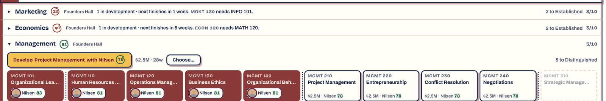 | 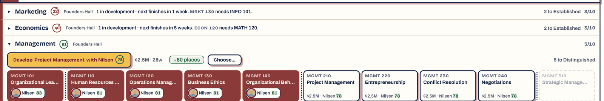 |

**As implemented:** classPlacesShort(s) in instructionCapacity.ts: enrolled > capacity, or last summer's applicants > next summer's room; chip PLACES_CHIP after the cost on open rows of housed programs (not folded rows); --ok-on-light/--grade-a-bg so it turns blue under the colour-vision palette; test/places-chip.test.ts. In the year-7 save all 17 open rows carry it (worth the owner's look).

### PR K — Prestige as four pillar bars (card 7, D-1, D-9b)

1. **At the head of the feeding tabs.** One stacked bar of prestige by
   pillar (academics, research, student life, athletics) at the top of
   Curriculum, Research, Students and Athletics. The tab's own pillar is lit and
   the others are faded, with a line such as "25.6 of your 50.3 prestige ·
   heading for 53.8". A ghost tick on the bar marks the target, so the lag the
   summer's rise cap creates is seen. The prestige chip on the band stays as
   it is (the owner, on the mock-ups).
2. **The summer.** The bars fill at the review, in place of the lines X8 cut.

The colour-vision palette needs checking. **M.**

*Mock-up: the bar at the head of the Curriculum tab (the pillar split is illustrative; the total is the save's).*

| Today | Proposed |
|---|---|
| 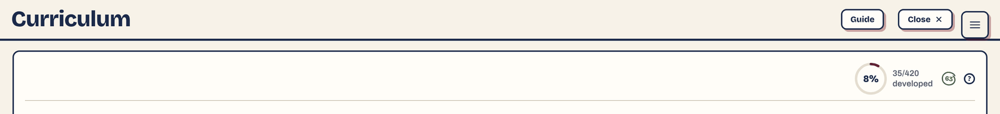 | 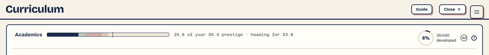 |

**As implemented:** prestigeByPillar(s) in prestigeSystem.ts: each pillar's weight × value scaled so the four sum to prestige exactly; tick = the breakdown's target; test/pillar-split.test.ts. components/PillarHead.tsx: one stacked bar on the 0–150 scale, own pillar lit, others at 35%, cream separators, ghost tick, "18.1 of your 51.8 prestige · heading for 54.6". Inside Curriculum's panel head; a slim panel atop Research, Students and Athletics. Departs from Plan 98B (target only as a direction), as approved on the mock-ups. The summer review's Standing card ends in the same bar, all four lit, filling from the left (@keyframes pillar-fill, at once under reduced motion), with "Academics 16.4 · Research 7.8 · …".

### PR L — The map carries what the tabs say (card 8, E-4)

1. **Dark dots.** A program's dot above its hall goes dark, with a dashed red
   ring, while one of its courses has no teacher, and comes back when one is
   appointed. (Windows were mocked and are too small to read.)
2. **Queues.** A short line of the game's own walkers waits at the door of a
   dining hall or a clinic while that need is under 100, longer with the
   shortfall.

The words stay as PR F leaves them (M2): a count with an icon on faculty tiles,
the bed and place counts on Students. The new marks are drawn in the map's art
(`buildingMotifs.tsx`, `Walkers.tsx`) and need a contact sheet (`npm run sheet`)
in every vernacular. **M–L.**

*Mock-up: a program's dot on Founders Hall gone dark.*

| Today | Proposed |
|---|---|
| 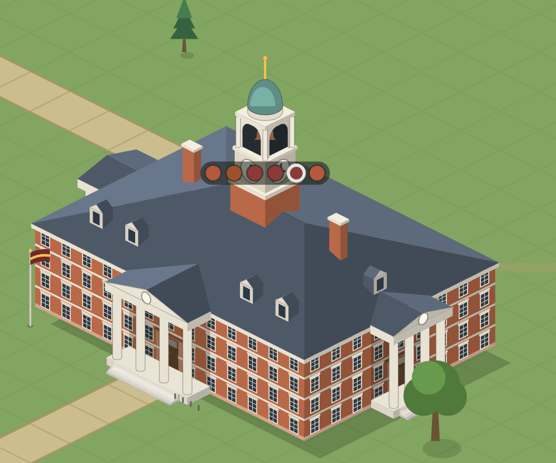 | 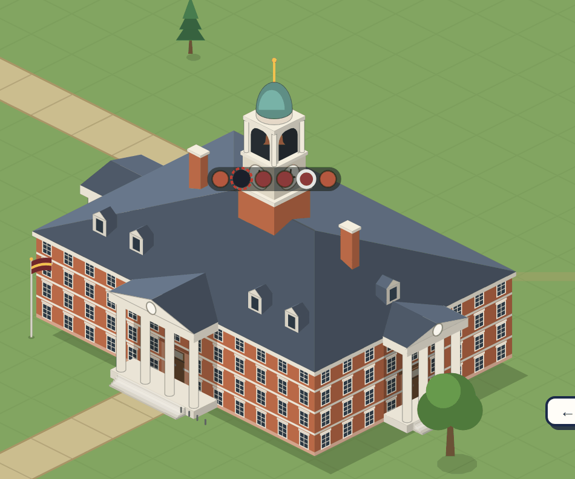 |

*Mock-up: a queue of the game's own walkers at the Original Commons.*

| Today | Proposed |
|---|---|
| 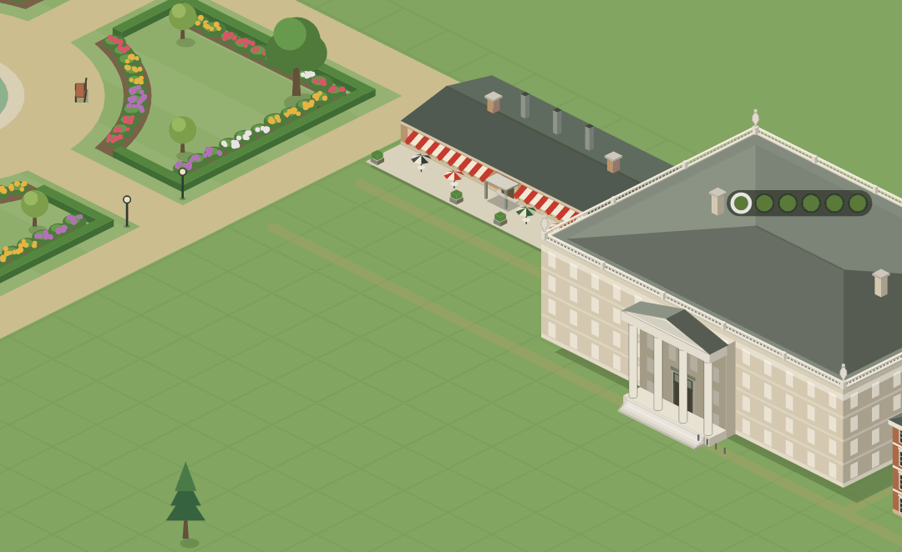 | 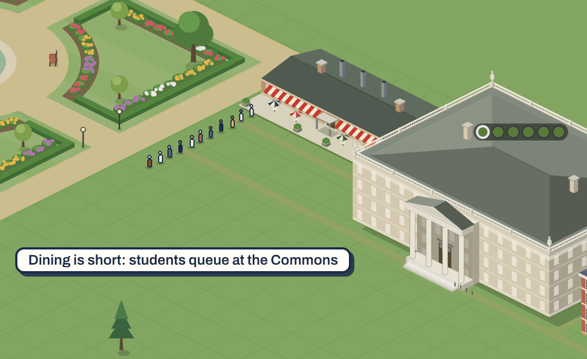 |

**As implemented:** a program's pip turns dark navy with a dashed red ring while a course has no teacher (unstaffedPrograms; not in transit); the pip's tooltip gains "1 program dark, a course without a teacher". Queues: while dining (basicNeeds) or health is under 100 (99.5 counts as served), each dining hall or health centre gets a line at its front door, two out then along the wall, 3 + 1 per 5 points short, capped at 14; "standers" in the walkers' crowd, depth-sorted, on canvas and ?map=svg. Pure parts in components/mapSignals.ts (test/map-signals.test.ts). docs/architecture/campus-map.md updated.

### PR M — The big moments on the map (card 10, C-1, C-2, C-9)

1. **Full stands, drawn as people.** Today a venue's crowd is coloured dots
   in the stands, and only in the three home-game weeks
   (`mapOccasions.ts`). Instead:
   - Spectators are drawn like the walkers (`Walkers.tsx`'s figure), seated
     along the stands' rows.
   - A venue is full on a share of weeks, about one in three, picked from the
     map's own random numbers so it stays put for the week. It doesn't follow
     the fixtures: the point is that a player sees full stands often.
   - On a full week, more walkers stand around the venue, around the track and
     not on it.
   - The dots go.
   - Spectators are packed evenly, a little smaller than a walker, with every
     row and corner filled and nothing spilling past the stands.
2. **Titles.** The year after a national title, pennants in the college's
   colours go up all the way round the venue's rim and stay. The title's page
   stays (A2).
3. **The football stadium's exterior.** The plain brick walls become a college
   stadium's:
   - a limestone cornice carrying the stadium's name;
   - a tier of tall arches with stone voussoirs;
   - banners on the piers;
   - ground-level gates;
   - a plinth;
   - an entrance tower at a corner.

   The references are Ohio Stadium's arches and rotunda, Notre Dame Stadium's
   brick, and Bryant-Denny's facade and tower. It is drawn per vernacular in
   `buildingMotifs.tsx`. Each expansion adds arches or an upper deck, not only
   height.
4. **The Final Report.** It opens over the campus as it stands. The six grades
   stamp in one by one (`GradeMark`, a `tick` each), "Students taught" counts up,
   and the fanfare plays on the final grade. The fanfare moves from the 50th
   admissions' resolve (`resolveAdmissions.ts:79`) to the reveal.

Reduced motion shows each at its end state. With the stadium's exterior and
the crowds this is now **L**. It could split into M1 (crowds and pennants),
M2 (the stadium's exterior) and M3 (the Final Report).

*Mock-up: the fully upgraded Football Stadium (three expansions) and
Multi-Sport Field (two) on a year-30 campus.*

| Today, an ordinary week | Today, a home-game week (the dots go) |
|---|---|
| 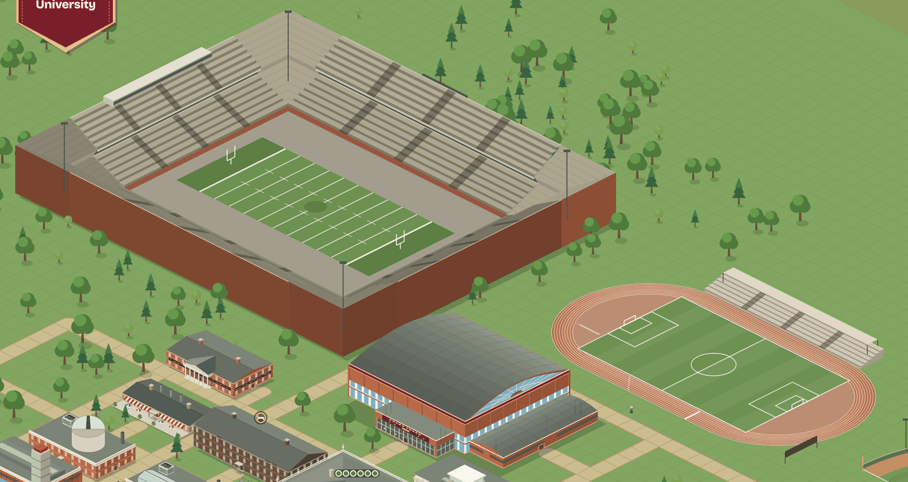 | 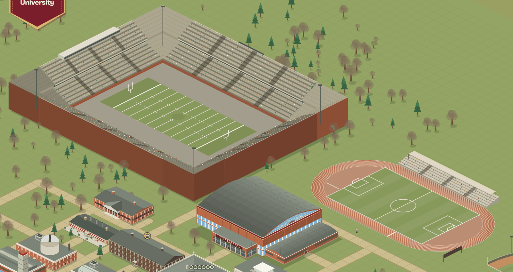 |

| Proposed: a full week, the year after a title |
|---|
| 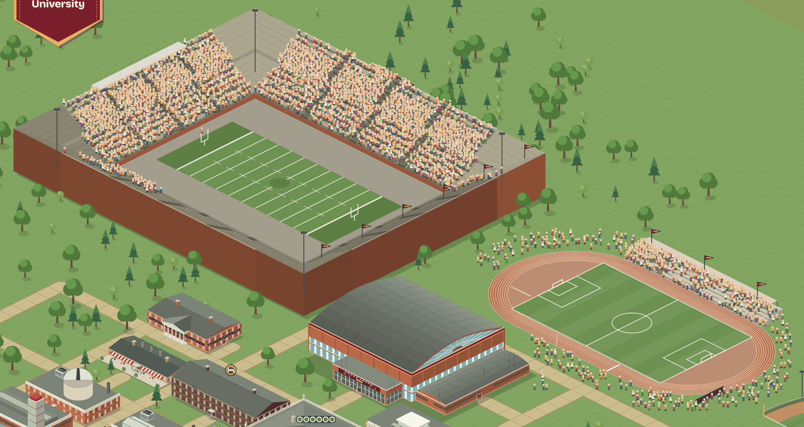 |

*Mock-up: the stadium's exterior, re-faced.*

| Today: plain brick | Proposed: arches, cornice, banners, gates, entrance tower |
|---|---|
| 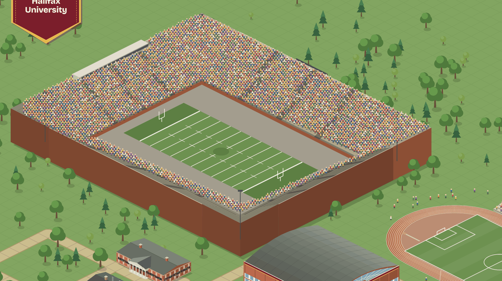 | 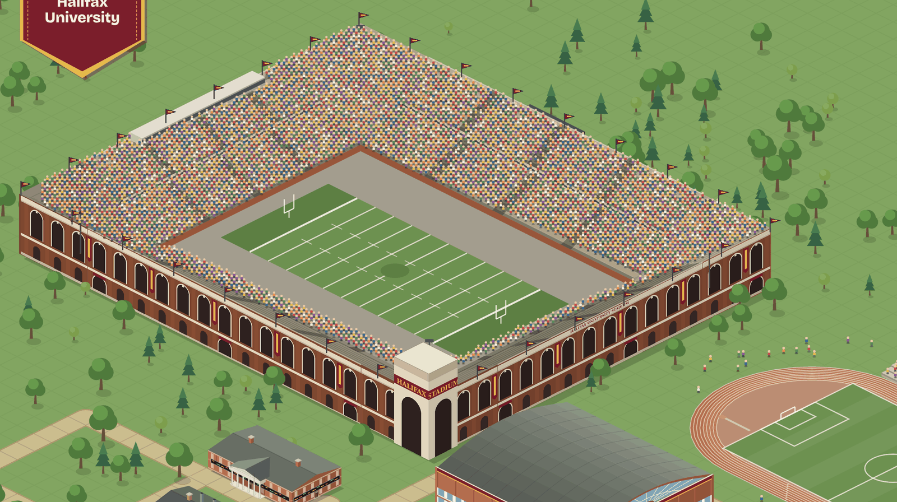 |

*Mock-up: a title's pennant on a smaller campus's field, with a crowd of walkers that week.*

| Today | Proposed |
|---|---|
| 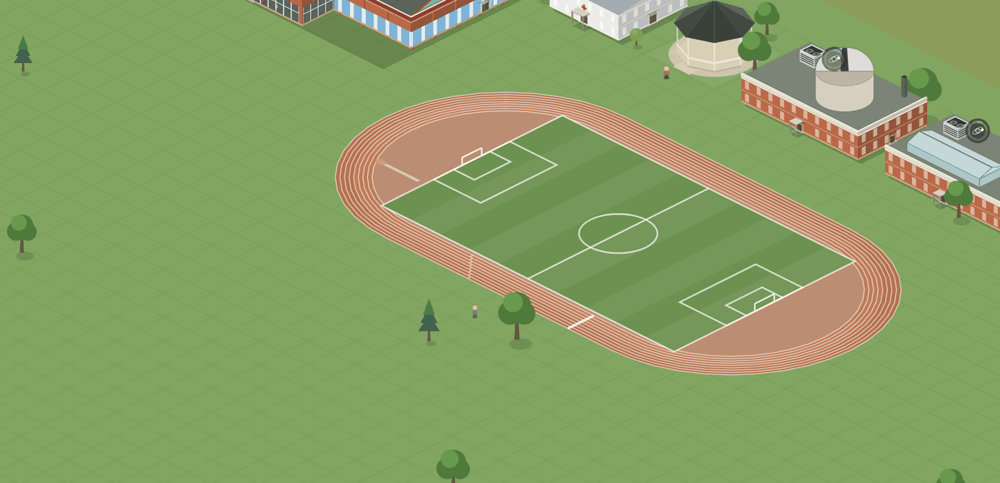 | 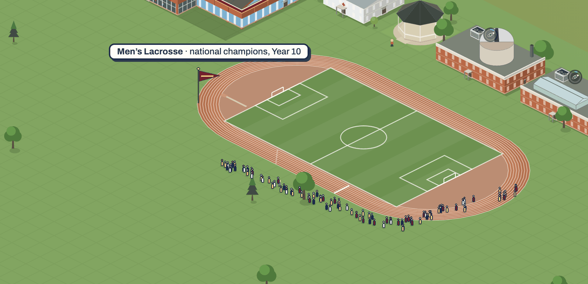 |

*Mock-up: the Final Report, staged.*

| Today: all at once | It opens | Grades stamp in | The final grade |
|---|---|---|---|
| 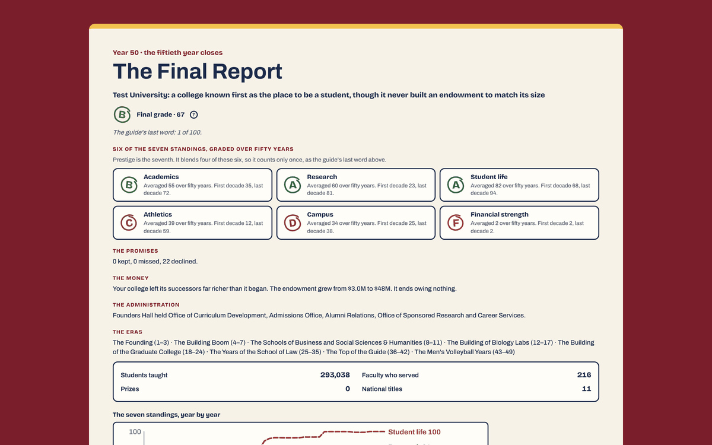 | 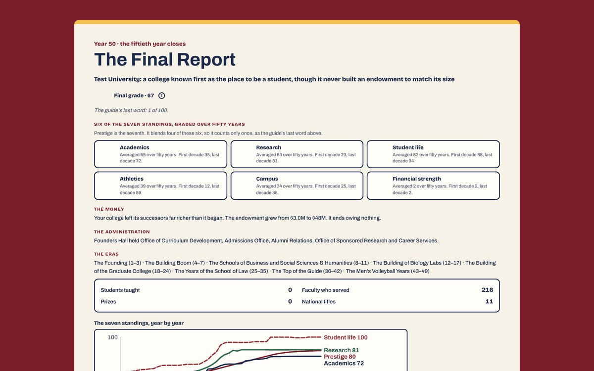 | 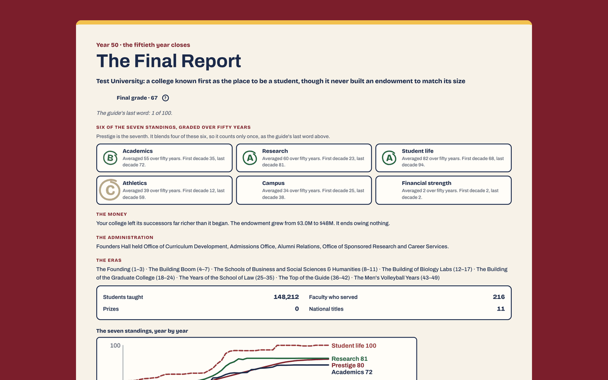 | 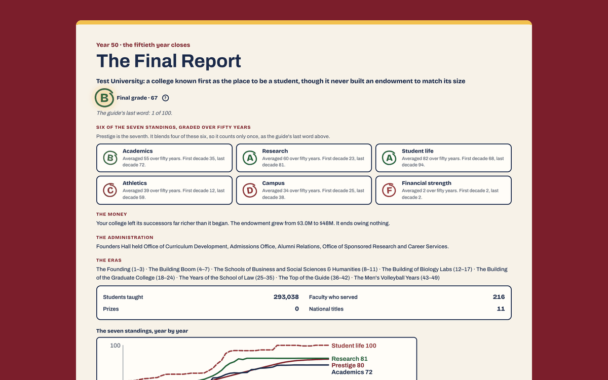 |

**As implemented:**
- **M1:** a venue with stands (stadium, field, diamond) is full when mulberry32 over a hash of college, venue, year and week falls under 1/3, independent of fixtures. crowdedVenues and the dot Crowd deleted. spectators.tsx: the walker's shirt and head at 0.76 scale, seated, packed evenly along each row with alternate rows offset, aisles clear, inset so nothing spills; the bowl's corners too; one path per shirt colour per row (~2,700 elements for ~14,600 figures) recorded into the venue's bitmap. On a full week 16–140 standers 1–3 tiles outside, never on the field or track. Pennants for titles won in earlier years by a sport on that venue: all round the bowl's rim, along the field's and diamond's back rails, on a covered grandstand's roof; about one every 2.2 tiles of rim, not one per title. PennantContext added. Arena and natatorium (no visible stands) get neither. Performance on a laid-out year-31 save (noisy machine): Paused 59.8 fps, Play 51.7, 2× 53.5 (p95 16.8 ms), 4× 42.5; building every crowd path ~22–36 ms, paid when a venue's flag changes, a zoom settles, or each frame of a turn.
- **M1 revised after the owner's playtest** ("fills and empties very abruptly, and too often"): a venue no longer fills on a one-in-three coin toss each week. The year is cut into 13-week blocks. In about half of them, one occasion builds over the weeks and thins out again: a fifth of the seats, then just over half, then packed for two weeks, then back down (`venueLevel`, `CROWD_RAMP`). That gives a crowd on about a quarter of weeks, packed stands two to four weeks a year, and never a jump straight from empty to full. A partly full stand seats the same people as it fills. The crowd outside gathers only when the stands are packed. `CrowdContext` is now a level per venue.
- **M2:** stadiumFacade.tsx drawn over the bowl's visible outer walls: plinth, ground openings with a wide gate every sixth bay, tall arches with voussoirs, banners on every third pier, a cornice carrying "<College> Stadium", an entrance tower at the front-left corner. Round arches by default; lancets for Gothic and Tudor; square-headed slots for Modern and Art Deco; a concrete cornice where a set has no trim. Expansions: 0 an arcade on the touchline stands' backs; 1 a second arcade on the end stands; 2 the full wall with gates and tower; 3 an upper tier of arches and a taller tower.
- **M3:** FinalReportView takes `staged` (only the fiftieth summer's page): after 800 ms the six grades stamp in every 450 ms (tick, grade-stamp), "Students taught" counts up, the final grade lands last with a gold halo (grade-halo) and the fanfare; places are held so nothing shifts. The fanfare came from director.ts's stateCues on `ending`, now removed; it plays only on the reveal. Opens over the campus: .final-page is a 72% veil of the school colour over the live map (enter-fade; the card enter-rise, renamed at the merge from overlay-fade/modal-in). Reduced motion: the end state at once, with the fanfare. test/final-report-staged.test.ts.

### PR N — Alumni warmth and late money, connected (card 11, D-4, D-6)

1. **Alumni warmth into word of mouth.** Word of mouth
   (`admissionsSystem.ts:115-116`) reads the alumni's average warmth beside this
   year's satisfaction. The admissions reveal's existing "word of mouth" line
   shows both, so a happy decade pays again, visibly, every summer. Reunions and
   the Alumni panel stay (A4).
2. **Late money into endowed chairs.** Named funds (`alumni/funds.ts`) can
   endow a chair. Each chair moves the hiring market's centre up a step for
   its field (`data/facultyData.ts:609-617`), shown on the Faculty market's
   line. The Treasury's levers stay (A3).
3. **Balance.** This is the plan's one balance change. Run the sweep and the
   goal players before and after, and record the target and rank changes in the
   PR. The warmth term is weighted so that a college with average alumni sees
   no change.

**L.**

## 5. What this plan does not do

- Cut anything the owner kept.
- Change the balance, except in PR N. Removing promises removes their small
  rewards and penalties, so the sweep and the goal players run once after PR E,
  and the PR notes any target that moved.
- Write the third review's status table. It still awaits the owner.
