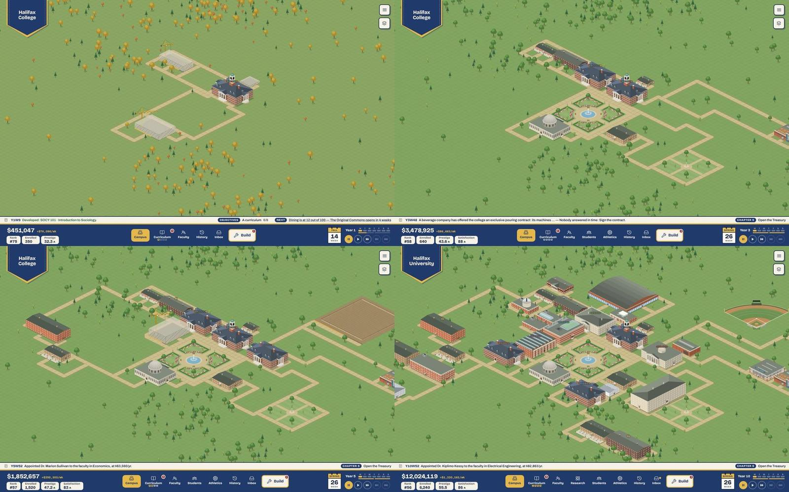
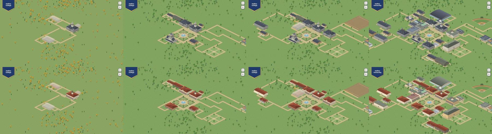
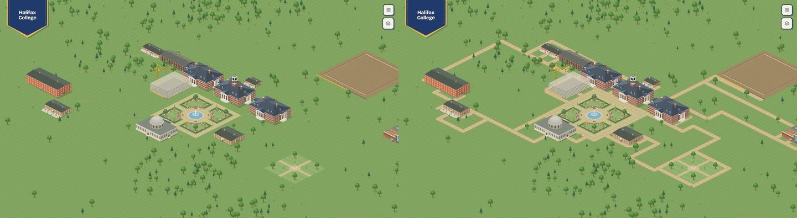
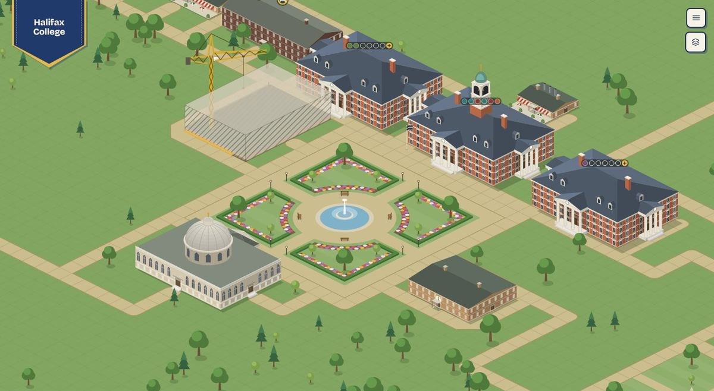
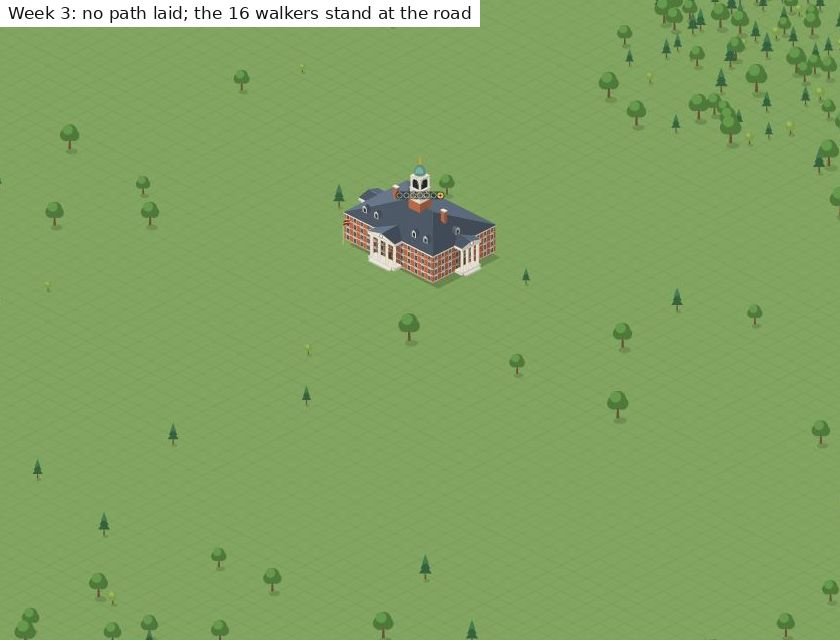
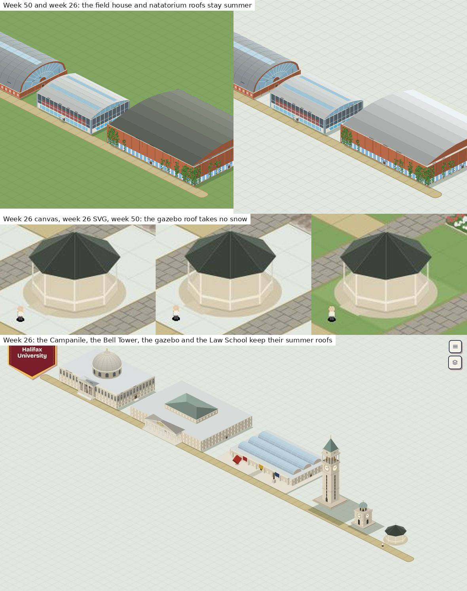
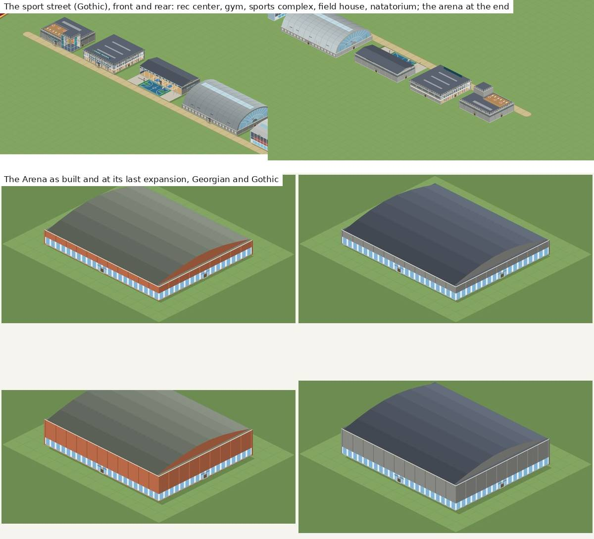
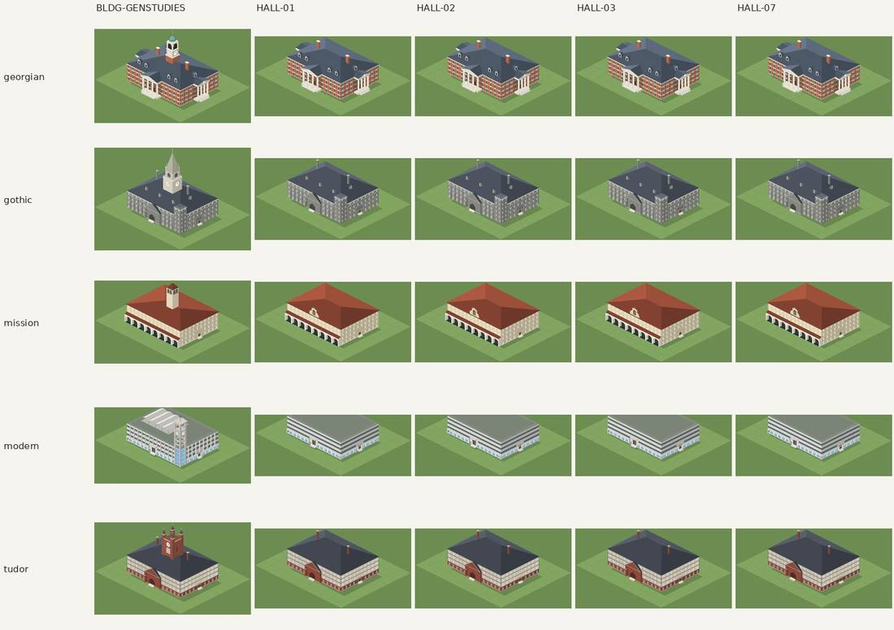
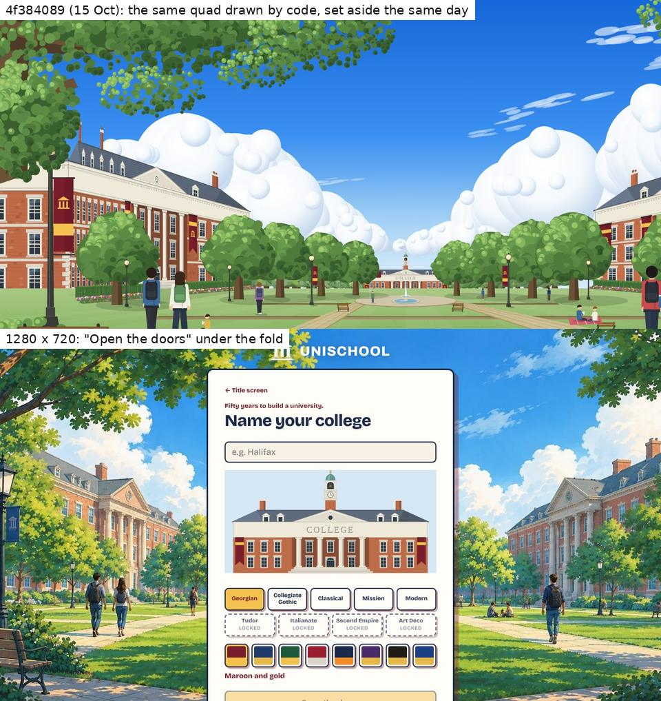

# 1. Aesthetics

Plan 86's shape, area 1, third review. Commit read: `b1f2114` (0.1.3). Production build in `unischool/dist/` (5.2 MB: one 1.95 MB script, the 302 KB title painting, the 2.1 MB title theme), served by `vite preview` on port 4101, at 1440×900, with 1280×720 checked where layout matters.

**What was run.** Every tool is in *Tools* below.
- **Every placeable drawn alone** (`npm run sheet -- --every`): 113 cells in each of the nine vernaculars (1,017 cells) from the opening camera. Georgian was also drawn from the other three cameras. From those four sheets, every flight of entrance steps (117–120 per camera) was cut out at close range.
- **Plan 87's redrawn catalogue as streets.** Three new layouts (sport, civic, centrepieces) through `review:arrangements`' own placer, in all nine vernaculars (27 saves). Each was shot from four cameras on the canvas (108 views), and three were also shot on the SVG fallback. The 15 standing arrangements were checked in the five founding sets (75 saves).
- **Doors and depth** over those 102 saves and four grown campuses (`review:doors`). The probes `catalogue`, `vernacular` and `weather` were also run.
- **The first look, played**: New game, a name, the walkthrough to Founders Hall, then three weeks of play. Walkers were sampled on the SVG map, where each one is a DOM node.
- **Years 1, 3, 5 and 10** of one Guided run in Georgian, Gothic and Mission. These are `timelapse.ts` frames, laid out on the final campus with walks grown from Founders Hall. Year 5 was also shot with its walks removed.
- **One court built for the newer art**: Plan 101's ivy, fenced sinkhole and statue, Plan 99's gazebo and steps, and 0.1.2's path styles, planted trees, banner lamps and flower beds. Shot in four vernaculars and at weeks 12, 26, 38 and 50, on the canvas and the SVG.
- **Also checked:**
  - the downtown at a festival, in summer and in snow;
  - a lab's news on a laid-out year-40 campus, at Play and 2×;
  - every build-menu tab in Gothic at year 25;
  - `npm run gallery:assets`, regenerated and compared pixel by pixel with `docs/assets/`.

**Limits.** The reviewer is a model; judgments of look are labelled **the reviewer's eye**.
- One seed (12345) throughout. The machine was shared by six reviewers, and the pictures are about art, not balance.
- Harness campuses are built along the top-left edge of the grid, so every grown-campus picture went through `layout.ts`. That is not how a player builds.
- No phone pass (out of scope). No GPU-backed timing.

The container restarted once mid-review; everything below was captured before it.

## What works

These are worth protecting. They are **the reviewer's eye**, checked against the renders.

- **Plan 87 did what review II asked, in every set.**
  - The Research Park is lab pavilions round a planted court, with a glazed link and a sign at the gate.
  - The Graduate College is a quad with a corner tower.
  - The rec center has a climbing-wall tower and a roof deck. The gym is a glass box with its machines showing. The sports complex has courts behind glass and a court outside. The field house is a barrel vault with a fanlight. The natatorium has a glazed vault over its lanes.
  - The dining halls run from café to terrace hall to refectory to market hall.
  - There is a library per set (rotunda, Gothic tower, Mission belfry, glass box on pilotis). The Law School has a temple front, the Museum a top-lit gallery court, and the Great Dome a crown per set.

  From all four cameras each still reads as what it is. The court and the quad face every camera ([`img/c1-plan87-catalogue.jpg`](img/c1-plan87-catalogue.jpg), [`img/c1-plan87-four-views.jpg`](img/c1-plan87-four-views.jpg)).
- **The render wall is gone.** `review:probe -- vernacular` reads 0% render wall in every set but Modern and Art Deco, on all three late campuses (`data/c1-probes.md`). In review II it was 27–34% of buildings.
- **The canvas is still the SVG.** On three Plan 87 streets:
  - 3.6–9.1% of pixels differ by more than 3%, with an RMSE of 1.7–2.8%, all of it on edges ([`img/c1-canvas-vs-svg.jpg`](img/c1-canvas-vs-svg.jpg)). Review II had 5.1% and 1.8%.
  - The canvas reported nothing it could not draw except one attribute on the sinkhole (C1-7).
- **Seasons reach the open ground (95B).** At week 26 the pitches are pale and still read as pitches, the pool is covered, the garden's pond is frozen and its cherries are bare. At week 38 they blossom ([`img/c1-grounds-seasons.jpg`](img/c1-grounds-seasons.jpg)).
- **The grounds of 0.1.2 read.** Brick, cobble and flagstone walks each have their own coursing. The four planted trees are distinct at the opening zoom: the birch tall, the willow a curtain, the palm a stem. The flower beds are drifts of colour in a kerb. Ivy climbs any wall, and the fenced sinkhole sits by the door ([`img/c1-grounds.jpg`](img/c1-grounds.jpg)).
- **A lab's news over the map (0.1.3) is the best new thing on it.**
  - "+1 paper", "+$6.6M" and "Breakthrough!" rise in the display face with a dark outline ([`img/c1-lab-news.jpg`](img/c1-lab-news.jpg)).
  - On a year-40 research campus, 1.5 floats are up at once on average at Play, and 5 at most. Busy, not cluttered.
- **The build menu's thumbnails are the map's drawings** (Plan 94): the college's set, a venue's expansion, a site for a building going up, the specialization buildings greyed. Every tab in Gothic at year 25 matched the map.
- **The asset gallery is current.** Regenerated on `b1f2114`, all 27 images match `docs/assets/` (no pixel more than 15% off).
- **Depth is still right.** Over 102 arrangement saves and four grown campuses there are 0 depth-order errors, 0 unreachable doors and 0 walled-in buildings. Nothing is derelict at year 41 or 51 (`data/c1-probes.md`, weather).

## What became of the second review's findings

| Review II | What | On `b1f2114` | Evidence |
|---|---|---|---|
| B1-1 | The Research Park reads as a warehouse | **Fixed** | Plan 87B: pavilions round a court, a glazed link, a sign at the gate, in every set ([`img/c1-plan87-catalogue.jpg`](img/c1-plan87-catalogue.jpg), first row) |
| B1-2 | Seasons stop at the open ground | **Fixed** | Plan 95B: turf, courts, pool, pond, cherries and azaleas follow the week on both renderers ([`img/c1-grounds-seasons.jpg`](img/c1-grounds-seasons.jpg)). The newer roofs that miss the snow are a new finding (C1-3) |
| B1-3 | The vernacular stops at the render wall | **Fixed** | Plan 95D: 0% render wall outside Modern and Art Deco on three late campuses (`data/c1-probes.md`) |
| B1-4 | Diagonal walks draw as staircases | **Superseded** | Discarded by the owner on 12 October (`docs/backlog-archive.md:21`). The diagonal arrangement still draws as a beaded band |
| B1-5 | Doors open onto lawn | **Superseded** | Discarded by the owner: "Let the player connect paths and landscape on their own; no need to automate" (`backlog-archive.md:23`). Still 1,020 door-onto-lawn hits on four grown campuses (`data/c1-doors-grown.md`). Plan 87's new buildings add 126 door-on-seam hits: 8 of the 19 forms on the streets have an even wall (`data/c1-doors-arrangements.md`) |
| B1-6 | The committed asset gallery is stale | **Fixed** | Regenerated by Plans 87, 95D and 99C. A fresh run on `b1f2114` matches it image for image. The construction cells still show only footings, which the owner closed as is (Plan 95, *What area 1 does not do*) |
| B1-7 | The downtown's lights burn at noon; the district is off the opening view | **Fixed** | Plan 95C: no pools of light. Warm windows only in the snow, bunting and a crowd in a festival's weeks, and one camera move to the district when it first grows. At year 37 the district is still off the opening view, so the move is what shows it |
| B1-8 | Identical towers and chapter houses | **Fixed** | Plan 87H gives each tower a crown (hip, stepped, terrace, glazed pyramid), and each chapter house carries its own letters. The probe still counts them as repeats, because its look key ignores crowns and letters |
| B1-9 | Slips on Plan 85's buildings | **Fixed** | Plan 87: a rooflight on Modern's flat roofs; the Athletics Complex renamed the Sports & Recreation Complex; the doors of the park and the complex drawn to scale |

**Counts:** fixed 7, superseded 2 (both by the owner's decision), partly fixed 0, still holds 0.

### The playtest's player findings in this area

| Finding (`playtest-1/findings.md`) | On 0.1.3 | Where |
|---|---|---|
| §1: the concept, the detail, the walkers and the seasons land (10 players; S2, D1, S1) | **Holds, and grew.** A lab's news is new on the map, and nothing a player praised was taken away | What works |
| Switch or mix architectures (R6–R7) | **Decided: kept at the founding.** A sandbox can mix styles (0.1.2) | `BACKLOG.md`, *Later* |
| Walkers head for the road before any path exists (S2) | **Still holds** | C1-2 |
| Stairs drawn backwards (the owner, to R8) | **Fixed in 0.1.1** by Plan 99E. A close look at all 117–120 flights per camera in Georgian finds every one climbing toward its door. The findings log still says "untraced" | Area 7's I7-7 and [`img/c7-stairs-four-views.jpg`](img/c7-stairs-four-views.jpg) |
| More ways to make the campus its own (F2) | **Partly answered** by 0.1.2's grounds: three path styles, four planted trees, banner lamps, flower beds | What works |
| Benches on a quad (T1) | **Still holds by rule.** `PLACE_DRESSING` refuses any tile under a placement (`reducer.ts:498`), and a quad is a placement. Since 0.1.2 the refusal says why | C1-7 |

## Findings

Severity: blocker, major, minor, polish. Effort: S (an hour), M (a PR), L (a plan).

| Id | Finding | Severity | Effort | Was |
|---|---|---|---|---|
| C1-1 | A young campus is a stamp on a lawn: the first five years, which most runs never leave, make the game's weakest picture | major | S–M | — |
| C1-2 | Walkers head for the road before any path exists | minor | S | S2 |
| C1-3 | Winter misses the roofs drawn since 95B: sheds, towers, the gazebo, the Law School | minor | S | (B1-2's sequel) |
| C1-4 | The Arena is the one big sport building Plan 87 left as a shed | minor | S–M | — |
| C1-5 | Every new academic hall of the first decade is one drawing | minor | S | (B1-8's sequel) |
| C1-6 | At 1280×720 the founding screen's *Open the doors* is below the fold | minor | S | — |
| C1-7 | Small slips: the sinkhole trips the canvas probe and sits on a flower bed; a grant's green on the lawn; no benches on a quad | polish | S | T1 |

### C1-1. A young campus is a stamp on a lawn — major, S–M

**What.** The opening view is centred on the middle of the 126-tile parcel at a fixed zoom of 0.4, whatever stands on it (`CampusMap.tsx:150`, `defaultView` at `:1697`). At founding, Founders Hall is about 160 px wide on a 1440 px screen, alone in a clearing. Nothing in the walkthrough or the chapters asks for a path: no objective in `chapterData.ts` or `openingData.ts` names one. So a campus played as the chapters lead it is buildings on grass. The share of the opening view that is plain lawn, at 1440×900:

| Picture | Lawn |
|---|---:|
| Founding, week 1 | 96% |
| Year 5, no paths laid | 86% |
| Year 5, with `layout.ts`'s walks | 79% |
| Year 10, with walks | 68% |
| The itch.io screenshot (year 32, framed by hand) | 40% |
| A year-40 campus at one step in | 32% |

**Why it matters.** The early campus is the one most players see.
- Two in three founded runs end by year 5: 53 of 80 across 0.1.0–0.1.2 (`data/play-statistics.md`, *How far founded runs got*).
- Players praised the walkers, the seasons and the detail (playtest §1). At year 5 and zoom 0.4 those are a few pixels each in a green field.
- **The reviewer's eye:** the same year-5 campus three steps closer reads as well as a year-40 one. Quad, fountain, halls, a crane, walkers and planting fill the frame ([`img/c1-year5-close.jpg`](img/c1-year5-close.jpg)).

The art is there. The camera and the ground plan don't show it.

**Fix.**
1. **Frame the campus, not the parcel (S).** On a new game and on load, centre on the bounding box of what stands, at the zoom that fits it with a margin. Keep a floor of about 1.0 (2.5× today's) while the campus is small, so the view widens as the college grows. The pan limits stay as they are.
2. **Found the college with a drive (S).** Lay a path from the road to Founders Hall's front door at founding, as `layout.ts`'s doorstep pass does. It is about 25 free tiles. It gives the first picture a structure and the walkers a way to the road (C1-2).
3. **One objective that teaches paths (S).** For example, in *Somewhere to sleep*: "Lay a path from the residence hall to Founders Hall", with *Show me* opening Grounds › Paths. The tool is free, and the menu already opens on Grounds (Plan 92).
4. **For the store (S):** a year-5 shot framed close, beside the year-32 one, so a buyer sees the first hour as well as the fortieth. Area 6's C6-7 already asks for the shots to be retaken.

### C1-2. Walkers head for the road before any path exists — minor, S (was S2)

**What.** `pickStop` (`Walkers.tsx:381–389`) sends one walk in five to a point on the road (`roadsides()`, `walkRoutes.ts:146`). When the walker's own building is the only one, the pool is empty, so every walk out of it goes to the road (`:383`). With Founders Hall alone, the crowd shuttles between the hall and the road, across the lawn. On the SVG map at week 3 of a new game, 15 of 16 walkers were more than 60 px below the hall's foot, most of them off the bottom of the screen.

**Why it matters.** S2: walkers heading for the road "looked like a bug". This is the first motion a new player sees, and it takes the walkers out of frame just when Founders Hall should look busy.

**Fix (S).** Until a second building stands, give Founders Hall a forecourt stop on its own lawn, and let the walkers mill between its doors and that stop. Keep the road's one in five for when there are two buildings. With C1-1's drive, the road walks follow a path.

### C1-3. Winter misses the roofs drawn since 95B — minor, S (B1-2's sequel)

**What.** 95B put the open ground under the season's tokens, and `snowOnRoofs` (`buildingMotifs.tsx:268`) whitens every roof drawn through the mass palette. Roofs drawn from their own constants, or by art that reads no snow, stay in summer at week 26:
- the field house's zinc vault and the natatorium's roof (`ZINC`, `POOL_ROOF`, `buildingMotifs.tsx:3790–3791`);
- the Campanile's spire, the Bell Tower's cupola, the Gate and the Great Dome (`landmarks.tsx` never reads snow);
- the gazebo's roof (`groundMarkings.tsx`, `Gazebo`, roof from `roofFor`; the file never reads snow);
- the Law School's reading-room hip (`READING_ROOM_SLATE`, `:7400`).

The arena's vault, the sports complex and the halls do take the snow.

**Why it matters.** The winter campus is the screenshot area 6 and review II rated highest. **The reviewer's eye:** a summer roof on a white campus draws the eye, as the green pitches did before 95B. The Campanile is the tallest thing on any campus that builds it.

**Fix (S).**
- Pass `snow` to `landmarkArt` and `Gazebo` and lay it on their roofs.
- Run `ZINC`, `POOL_ROOF` and `READING_ROOM_SLATE` through `snowOnRoofs`, at a lower cover for the glazed bands.
- Add each to `seasons.test`'s week-26 check.

### C1-4. The Arena is the one big sport building Plan 87 left as a shed — minor, S–M

**What.** Plan 87C and J redrew the rec center, the gym, the sports complex, the field house and the natatorium. The Arena (`ATH-ARENA`, 11×9) "keeps its own vault in the hangar branch" (`buildingMotifs.tsx:3744`). It is a long barrel shed over a striped glazed base: no entrance, no sign, no stands showing. Its expansions change only the wall's height. It is the same drawing in every set, with only the wall's colour changing. On the sport street it is the largest building and the plainest.

**Why it matters.** An athletics college builds it early. The Arena carries basketball and the indoor teams, the athletics specialization's crowd pleasers. **The reviewer's eye:** it reads as an aircraft hangar, the same complaint B1-1 made of the Research Park.

**Fix.**
- S: a glazed entrance hall on the long front with a marquee or scoreboard sign, the field house's lunette on the ends, and the college's colours on a fascia band.
- M: let each expansion add a visible part (a second concourse tier, then a practice annex) rather than wall height alone.

### C1-5. Every new academic hall of the first decade is one drawing — minor, S (B1-8's sequel)

**What.** A hall that is not yet a school's draws as the generic hall. In Georgian, Plan 87M made those halls Founders Hall without the clock tower. In each set the generic hall is one drawing, so on the Guided run's campus `review:probe -- vernacular` counts the same look:
- 2× at year 3;
- 3× at year 5;
- 4× at year 10.

By year 21 the signatures have taken over, and 49 of 50 looks are distinct (`data/c1-probes.md`). The repeats fall in exactly the years C1-1 is about.

**Why it matters.** **The reviewer's eye:** two to four identical halls round the first quad read as copy and paste, the complaint B1-8 made of the towers, in the first hour and in the screenshots most players see.

**Fix (S).** Pick a variant per hall by a hash of its id, as trees pick a species and towers a crown: portico or plain door, a cupola, dormer count, a wing, the door's colour. Keep each set's vocabulary.

### C1-6. At 1280×720 the founding screen's *Open the doors* is below the fold — minor, S

**What.** On a 1280×720 laptop the founding card runs to 805 px. *Open the doors*, the only way into the game, sits at 700–746 px, half under the fold, and the page has to be scrolled to reach it. The title card also scrolls inside itself (839 px in 720), so the hall of fame is cut off. At 1440×900 both fit.

**Why it matters.** This is the first decision every player makes, on the most common laptop size. The page does scroll, so nothing blocks, but a primary button cut off at the edge reads as broken. **The reviewer's eye.**

**Fix (S).** Shrink the founding elevation, which is 200 px tall, when the viewport is under 800 px, or pin the button to the card's foot. Areas 2 and 3 may count this too; it is listed here because it is the first look.

**On the title art itself:** see area 6's C6-1. A code-drawn version of the same quad, in the map's own Georgian vocabulary, was committed and set aside on 15 October (`4f384089`, the SVG and `tools/titleArt.py`, removed in `e96e8c1e`). It is C6-1's "draw the title over the game's own art", already made ([`img/c1-title.jpg`](img/c1-title.jpg), top). Reviving it would make the "no image generator" line true again until the commission arrives.

### C1-7. Small slips — polish, S

- **The sinkhole trips the canvas probe.** `ageMarks.tsx:323` sets `clipPath="none"` on the pit's floor. The canvas counts any `clipPath` as unsupported (`canvasPaint.ts:1008`), so a campus with a fenced sinkhole reports `{"clip-path":1}` in `frame().unsupported`, which `review:views` treats as a failure. The drawing is identical on both renderers. Fix: drop the attribute.
- **The sinkhole sits on whatever is there.** It is drawn out from the front wall regardless of the tile, so it can lie over a flower bed ([`img/c1-grounds.jpg`](img/c1-grounds.jpg), left). Fix: skip dressed tiles, or clear the bed while the hole is open.
- **A grant is green on green.** `.lab-news.grant` fills `#b9eba0` (`styles.css:4270`), the lawn's family. **The reviewer's eye:** "+$6.6M" is the hardest of the three to read on a lawn ([`img/c1-lab-news.jpg`](img/c1-lab-news.jpg), top). Fix: the money gold, with the same outline.
- **No benches on a quad (T1).** The quads draw their own benches, but a player's are refused there. Fix: let dressing stand on a quad's lawn panels, not its walks or centrepiece.

## Each vernacular against its style

**The reviewer's eye**, from the nine sheets. Review II's table stands; only what moved is noted here.

| Vernacular | Since review II | Still missing, most visible first |
|---|---|---|
| Georgian | Founders Hall after the owner's reference; halls as its siblings; warmer brick; a rotunda library | Variety among the halls (C1-5) |
| Collegiate Gothic | A tower library, ashlar labs, a lantern on the Dome, a refectory with lancets | — |
| Classical | A rotunda library; ochre and brick labs | The portico is still on nearly everything |
| Mission | Arcaded halls and dining, a tiled dome, a belfry library | Courtyards |
| Modern | Pilotis under the halls; a carillon on Founders Hall; a glass library | — |
| Tudor, Italianate, Second Empire, Art Deco | Their walls on the old render forms (95D) | Art Deco's halls stay plain beside its library and dome |
| All sets | — | The Campanile, the Bell Tower and the Gate are limestone in every set by design (`landmarks.tsx:16`); only the Dome changes |

## The decorative list, re-ranked for the screenshots that sell

The owner's `BACKLOG.md` *Later* keeps water, walls and gates, sculpture and parking, and *Maybe for 0.1.3* adds SVG textures for a cosy look. Value is **the reviewer's eye**, judged by what it adds to a store screenshot. C1-1's framing and drive come first and cost less than any of these.

| Rank | Asset | What it adds to the picture | Cost |
|---:|---|---|---|
| 1 | **Walls and gates at the road, with the founding drive** | The campus gets a front and the first picture a structure. It pairs with C1-1 | M |
| 2 | **Water: a pond or lake edge with a boathouse** | A second natural material in every season (it can freeze, as the garden's pond does), and a home for rowing | L |
| 3 | **SVG textures, on the panels only** | A paper grain on the cream panels is cheap CSS and fits the cosy register. On the map a texture fights the flat vector look and the seasons' tints, and every redraw pays for it (patterns are per canvas, `canvasPaint.ts:1180`). Try one low-contrast lawn tile against the profiler before going further | S (panels), M (map) |
| 4 | **Sculpture of several kinds** | Variety where the one statue repeats. Small at any zoom a buyer sees | S |
| 5 | **Parking beside the road** | Realism, but grey tarmac works against the cosy look. Last | M |

## Tools

| Tool | What was run | Repair |
|---|---|---|
| `review:views` (`tools/review/shootViews.mjs`) | 27 new saves, 4 cameras each | **Repaired.** It sets Objectives to Brief (and stats off) before loading. A save past the walkthrough opens its chapter's briefing over the map on Guided, which covered a third of every view. This is area 7's I7-5a, which repaired `keyboardCheck` and `touchCheck` the same way |
| `shot` (`tools/shoot.mjs`) | Downtown, founding, year 5 | **Repaired.** `--bare` also hides `.objectives-popup`. `shareImage.mjs` and `itchCover.mjs` take the store pictures through `--bare`, and the drawer would have landed in them |
| `sheet -- --every` and `sheet:shot` | 9 sets at azimuth 45; Georgian and Classical at four azimuths | None. Notes: `--only` matches the cell's label, not its id ("ATH-STADIUM expanded 3"), and a copy bundled outside `node_modules/.tmp` cannot find `src/styles.css` |
| `review:arrangements` | Base: a Completionist year-51 run with `--build-all`, seed 12345 | None. The three Plan 87 streets were written by a scratch script through its exported `applyArrangement`. Worth adding as layouts for the next review |
| `review:doors` | 102 saves and 4 grown campuses | None. It exits 2 whenever it finds a hit, so it ends a `;` chain |
| `review:probe` | `catalogue`, `vernacular`, `weather` | None. Its look key ignores crowns and chapter letters (B1-8) |
| `gallery:assets` | Regenerated into the scratch directory and compared | None |
| `timelapse.ts`, `layout.ts` | Guided to year 11 in three sets; a laid-out year-40 research campus | None |

Scratch scripts, not committed:
- placing the Plan 87 streets and the grounds court;
- shooting several saves at a week or zoom;
- the first minutes and the walkers' sample;
- a lab's news density;
- cutting out every entrance flight;
- the fold at three sizes.

All are kept in `/tmp/claude-0/-home-claude/d6d2bcd3-a237-5faa-b02c-37b9a7844e6a/scratchpad/c1/`.
