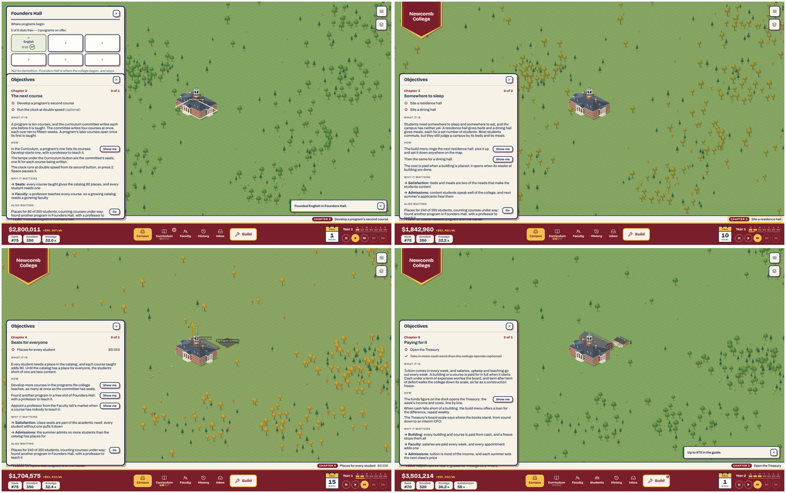
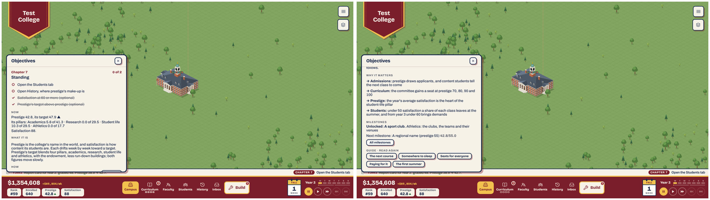
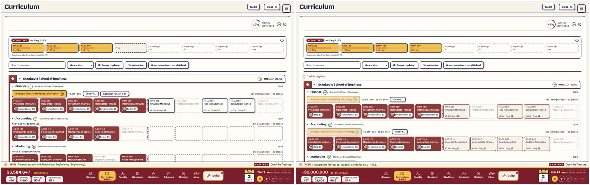
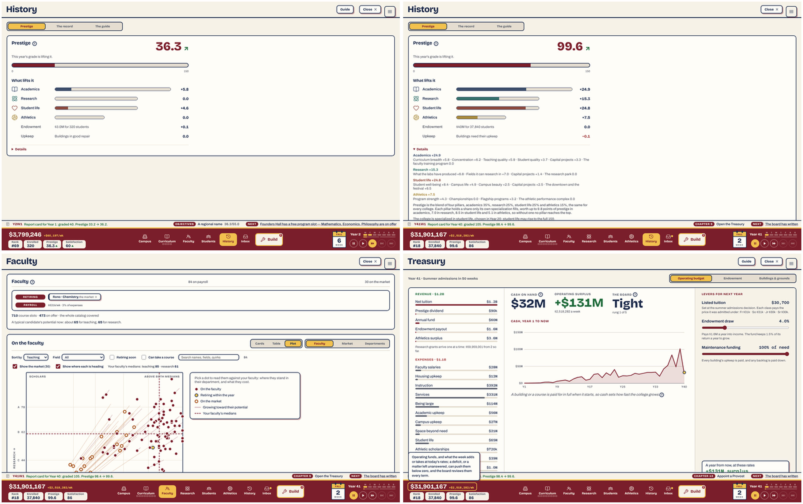
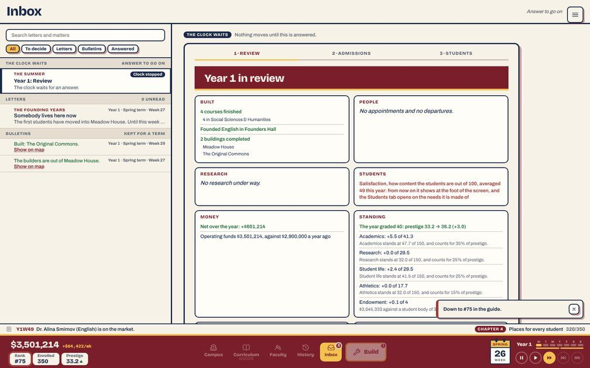
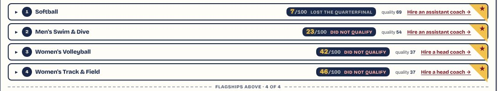

# 2. UI and text

Plan 86's area 2, third review. Commit read: `b1f2114` (0.1.3), the production build in `unischool/dist/` (5.2 MB, 1.9 MB of JS), served on port 4102.

**As run.**

| Pass | Tool or method | What it covered |
|---|---|---|
| A newcomer's opening, counted | a scripted player (`data/c2-opening-script.mjs.txt`) | Founding to the start of year 3, twice, plus a third run that only answered stops. It did what each lead objective asked, opened every briefing and its first *Show me*, and played at 2×. It counted the coach, the letter, the drawer, the ticker and the page at each step, at 1440×900 and 1280×720 → `data/c2-opening.md` |
| The drawer, chapter by chapter | bank saves marked into chapters 7, 8, 9, 12, 13 and between 8 and 9 | Collapsed strip and expanded drawer, top and foot, at both sizes → `data/c2-opening.md` |
| Screen gallery | `npm run review:gallery` (repaired, below) | **316 captures at 1440×900** over 12 saves and a fresh start, and **158 at 1280×720** over 6. Every tab and view, the drawer and the Guide, the admissions page, Prestige details, the Faculty table and plot, save slots, Settings, Founders Hall → `data/c2-gallery.md` |
| String table | `npm run review:strings` (repaired) | 8,472 strings, 59,103 words → `data/c2-strings.md`, `2d-voice.md` |
| Claims against the code | by hand, every string read against its rule | The 18 chapters, the walkthrough, year 1's letters, the admissions page, the glance, the Review; and the greps for every rule changed this week → `2b-flavor-and-mechanics.md` |
| Consistency, voice, courses | by hand | `2c-consistency.md`, `2d-voice.md`, `2a-course-descriptions.md` (a sample: the 25 flags of review II and the 42 capstones) |

One reader, a model. Judgments of feel are labeled as the reviewer's. The scripted player reads every word on screen. A person skims, so its counts are what is *offered*, not what is read. The container restarted midway, and no output was lost.

**Known artifacts.** Every harness college is "Test College/University". No harness player opens a tab or fills a seat, so every bank save past year 1 sits in chapter 5 (*Open the Treasury*) or 13 (*Appoint a Provost*) for good, with Guided's briefing open over the map on load (area 7's I7-5, area 3's C3-1). The gallery's "map" row therefore counts the map *with* the drawer. The map alone was counted with Objectives on Brief (below).

## What became of review II's findings

| II | Title | On `b1f2114` | Evidence | Carried as |
|---|---|---|---|---|
| B2-1 | The load moved to Faculty, History and Athletics | **Partly fixed**, and moved again | **History** split into three views (95H): the Prestige view is 42–75 words at every year, 259–295 with Details open (review II: 2,054–3,296 on one page). **Athletics** folded (95I): 233–954 words, against 1,858–2,252. **Faculty** is no lighter: 1,160 / 115 at Y9 and 2,016 / 227 at Y41 (II: 1,135 / 140 and 1,964 / 293). Its new table is as long, and the plot (520–664) is the light view. **The Curriculum is heavy again**: 1,881 words and 279 controls at Y9, 3,561 / 479 at Y16, against review II's 762 / 47 and 1,118 / 57, because Plan 107C opens every unfinished row. | C2-4 |
| B2-2 | Four false claims | **Fixed** (95E). Board confidence's worry came back in a briefing ("worries the board"). | `2b` greps; `chapterData.ts:126` | C2-2 |
| B2-3 | The specialization: 681 words and a misleading figure | **Fixed** (95F): "Up to 9.8 points of prestige", three lines a card, "Full today: prestige 73.4 → 83.2, #38 → #24". 372 words with the intro. | `gallery-desktop/specialization-02` | — |
| B2-4 | The rule six times; "term" two ways | **Fixed** (95E). `prestigeWords.ts` holds the rule, and "share" is the only player word for a pillar's part. Chapter 18's briefing types the offer's 30/20/10 by hand rather than calling `specializationOfferWhen()`. | `2b` | — (polish, in C2-10) |
| B2-5 | The glossary's last mile | **Mostly fixed** (95J). The specialization's armed label is a bare "Confirm" again (cut by the over-explaining pass). One new bare "slots". Second person back to 40. Three contractions. | `2c`, `2d` | C2-10 |
| B2-6 | The catalog's shape and the 101s | **Fixed** (95J, 95L–M, Plan 102): 473 courses, capstones, the missing cores. The five other sentences 2a flagged are polish, below. | `2a` | — (C2-11 takes the five) |
| B2-7 | Small phone and inbox details | **Fixed** (95K): board letters keep their week, the Answered list's line, "Answer to go on" flat, the funds in the display face. The weekly net and the Treasury's levers stay in mono with spaced commas. | `2c` | — |

**Counts:** 5 fixed (B2-2, B2-3, B2-4, B2-6, B2-7), 2 partly fixed (B2-1, B2-5). None still holds in full, and none was deferred.

**The playtest's area-2 findings** (`playtest-1/findings.md`):

| Finding | Players | On 0.1.3 |
|---|---|---|
| The game is easier than its words: too many words, read twice (S2, D1, S1, F6) | 4 | **Still holds, in a new place.** The walkthrough is short now (coach cards of 49–54 words, two steps). The words moved into the drawer, which opens by itself onto 184–255 words at each new chapter and covers a third of the map (C2-1). Some of those words are wrong (C2-2), which is the "read and re-read" problem at its worst. |
| The screens after the first course were text-heavy (D1) | 1 | **Answered for the walk, moved to the drawer** (C2-1). |
| The board's opening letter took two reads (S1) | 1 | **Fixed** (104L): the welcome is 55 words of welcome. |
| A need's score reads as a clock (S1) | 1 | **Fixed** (104I): "79 /100" in the dial. |
| Grades and ranks unexplained (F2) | 1 | **Answered** in chapter 8 ("The rank beside a name … only reads the average of the two"). Letters linger beside the numbers (C2-9). |
| The walkthrough is skipped by players who don't read (T1) | 1 | **Moot**: the walk is two steps, and the chapters go on whatever the skip. |
| A year-end screen opens over what the player reads (S2) | 1 | **Still holds**: area 7's I7-3. |
| Letters that stop the clock are too quiet (T1) | 1 | Area 3's C3-4. |
| "UI kinda hard to read" (F6) | 1 | No single cause found. The reviewer's judgment: the register is legible at both sizes, and the load is the words (C2-1, C2-4). |

## The screens



**Words and controls per screen**, the top layer, everything reachable by scrolling included, desktop. These are the same saves as review II's B2-1 table, except `founding` (week one now opens before Founders Hall is placed) and `summer30`, which is made the same way. `*` = scrolls. The full table and the laptop counts are in `data/c2-gallery.md`.

| Screen | Year 1 | Year 9 | Year 16 | Year 26 | Year 30 | Year 41 | Review II, Y9 → Y41 |
|---|---:|---:|---:|---:|---:|---:|---|
| Map and dock (Objectives on Brief) | 75 / 19 | 160 / 57 | 249 / 102 | 345 / 109 | — | 387 / 117 | 177 / 56 → 354 / 127 |
| The drawer (chapter 5 or 13, as stuck) | 42 / 3 | 259 / 10* | 284 / 12* | 284 / 12* | 284 / 12* | 270 / 12* | new |
| Inbox, first item | 37 / 7 | 51 / 0 | 267 / 15 | 51 / 0 | 42 / 0 | 24 / 0 | 48 → 371 |
| **Curriculum** | 52 / 8 | **1,881 / 279*** | **3,561 / 479*** | 1,561 / 201* | 1,377 / 189* | 111 / 20* | 762 / 47 → 119 / 19 |
| **Faculty (cards)** | 305 / 24* | 1,160 / 115* | 1,646 / 166* | 1,475 / 164* | 1,669 / 185* | **2,016 / 227*** | 1,135 / 140 → 1,964 / 293 |
| Faculty, table | 302 / 29* | 1,041 / 120* | 1,467 / 171* | 1,354 / 169* | 1,514 / 190* | 1,857 / 232* | new |
| Faculty, plot | 328 / 50* | 520 / 110* | 647 / 144* | 646 / 143* | 663 / 155* | 648 / 175* | new |
| Faculty, a person open | 410 / 26* | 1,291 / 117* | 1,846 / 168* | 1,650 / 166* | 1,815 / 187* | 2,177 / 229* | 1,329 → 2,209 |
| Faculty, the market | 883 / 98* | 1,223 / 130* | 1,351 / 147* | 1,319 / 147* | 1,316 / 150* | 1,275 / 148* | 1,161 → 1,185 |
| Research | — | 138 / 6 | 742 / 16* | 405 / 16* | 405 / 16* | 401 / 16* | 152 → 783 |
| Students | — | 351 / 9* | 611 / 9* | 805 / 10* | 821 / 10* | 734 / 10* | 599 → 791 |
| Athletics | — | 398 / 36* | 954 / 87* | 233 / 19 | 300 / 24* | 356 / 29* | 203 → 2,252 |
| **History › Prestige** | 42 / 5 | 75 / 6* | 75 / 6* | 75 / 6* | 75 / 6* | 75 / 6* | (one page) 2,054 → 3,296 |
| History › Prestige, Details open | 259 | 295 | 295 | 269 | 269 | 269 | |
| History › The record | 33 | 626 | 1,097 | 1,448 | 1,607 | 1,990 | |
| History › The guide | 472 | 1,067 | 1,069 | 1,115 | 1,126 | 1,133 | |
| Treasury | 246 / 9* | 271 / 10* | 282 / 10* | 285 / 10* | 285 / 10* | 285 / 10* | 560 → 615 |
| Build menu | 27 / 14 | 51 / 19 | 118 / 16 | 63 / 17 | 63 / 17 | 66 / 17 | 59 → 35 |
| Settings | 282 / 24* | | | | | | 107 / 17 |
| Save slots (menu) | 37 / 13 | | | | | | new |

Saves: `founding`, `year-8-balanced` (Y9), `crisis` (Y16), `year-25-rich` (Y26), `summer30` (Completionist, Y30 summer), `year-40-done` (Y41).

**The summer** at each age (Review + admissions page, price then standard + Students):

| Summer | Review | Price | Standard | Students | Total |
|---|---:|---:|---:|---:|---:|
| Year 1 (scripted newcomer) | 214 | 103 | 164 | 23 | **504** |
| Year 1 (harness) | 268 | 103 | 158 | 28 | 557 |
| Year 6 | 349 | 98 | 197 | 29 | 673 |
| Year 30 | 443 | 98 | 190 | 23 | 754 |
| Review II, year 1 / year 30 (the price and the pool were one card) | 374 / 618 | 34 / 34 | 179 / 236 | 41 / 27 | 628 / 915 |

**Year one, read.** The scripted newcomer met:
- the welcome (55 words);
- two coach cards (54 and 49), plus Founders Hall's panel (67);
- three briefings that opened by themselves: *The next course* (184 in the drawer), *Somewhere to sleep* (190) and *Seats for everyone* (181);
- one drawer between chapters (54);
- the summer (504).

That is **about 1,390 words before year two**, against review II's 1,400–1,800. *Paying for it* (255) opened in the first week of year 2, and *The first summer* not at all, since the newcomer had not seated every student by week 46 (C2-3). Year 2 adds three more briefings (*Paying for it*, *Standing*, *A faculty*: 255, 256 and 239) and the second summer (487). **The reviewer's judgment:** about the same total as review II, in smaller pieces, and almost all of it optional. The words are not too many. Too many of them land in the same eight square inches over the map, and some are not true (C2-1, C2-2).

**What earns its place.** The reviewer's judgment, from the captures.

| Screen | Rating | Why |
|---|---|---|
| The admissions page (Plan 108) | **Compelling** | The year's best decision, now drawn. The line across the cloud *is* the admit rate, the hall fills, and the money and mood move beside it. 158–197 words, two controls. It holds at 1280×720, though *Send the offers* sits below the fold there ([image](img/c2-admissions-page.jpg)). With no room, it breaks (C2-5). |
| The coach card and the two-step walk | **Compelling** | 49–54 words a card, on the left beside the build menu as the owner asked. At 1280×720 the card returns to the top right (the left rule needs 820 px of height) and still clears the menu. |
| History › Prestige at a glance (107D) | **Useful, close to compelling** | One figure, an arrow, four meters: 75 words where review II had 2,000–3,300. Opened about once in two years (play statistics), it is now the right size for that. Its one sentence of rule is wrong early (C2-6). |
| The drawer (Plan 106) | **Useful, overloaded** | One objective in the strip is right; the strip is 13–17 words. The expanded drawer is 184–284 words in a 440-px column, and scrolls even at 1440×900 (content 683–869 px in 540). At 1280×720 the objectives and the *what* paragraph fill the 432 px (C2-1). |
| The Guide | **Useful** | "Read again" lists every briefing met. Each tab's *Guide* button opens its chapter over the tab. The drawer's buttons are in the register (107B). |
| Faculty: cards, table, plot | **Useful; the plot is the find** | The plot (teaching against research, the medians, the market as rings) says in 650 words what the cards say in 2,000. The table is the cards in rows, as long. Opened 2–3 times a year, the busiest tab after the Curriculum. |
| Treasury as one board | **Useful** | 246–285 words at every age: cash, surplus, the board's rung, the levers, the year ahead. Right for a tab opened once in ten years. "The board: Tight" beside "+$131M" at Y41 reads as a contradiction (C2-2, row 3). |
| The Curriculum | **Useful, heavy again** | Rows open until done (107C) made the year-9 to year-16 Curriculum the heaviest screen in the game (C2-4). |
| Summer Review | **Useful** | 214–443 words. 95I's grouping holds. Its graduating-class line is wrong in the first summers (C2-7). |
| Settings | **Useful** | Objectives Guided/Brief/Off with one honest line each, and the keyboard list from `hotkeys.ts`. 282 words. |
| Plan 90's polish (rings, dividers, ID cards, the calendar, dials, scoreboards, switches) | **Compelling as a look** | The register reads as one thing. Two details mislead: the scoreboard's "7/100" is a rank (C2-9), and the calendar counts weeks of the term while the text counts weeks of the year (C2-8). |
| Founders Hall with offices; the build menu (92–94); committee lamps | **Useful** | 26–64 words. The offices read as cards with a pip row, and the build tiles draw the buildings themselves. |

## Findings

Ranked by how many players they hit, how early, and how badly.

| Id | Title | Severity | Effort | Was |
|---|---|---|---|---|
| C2-1 | The words moved from the walkthrough into a drawer that opens over the map | major | M | S2, D1, S1, F6 |
| C2-2 | The new chapters state ten rules that aren't so | major | S | B2-2 |
| C2-3 | The first summer's briefing waits behind two chapters, so the players it was written for meet it after the summer | major | S | T1 |
| C2-4 | The Curriculum is the heaviest screen again | major | S | B2-1 (A2-1) |
| C2-5 | Admissions with no room: "1%", "0 of 0", "0/100" | minor | S | — |
| C2-6 | Prestige is explained three ways, and the target is back | minor | S | B2-3, B3-2 |
| C2-7 | The first Review describes a graduating class that isn't the one recorded | minor | S | — |
| C2-8 | Two week numbers: the calendar's and the text's | minor | S | — |
| C2-9 | Numbers and letters for one scale; a rank written as a score | minor | S | — |
| C2-10 | The glossary's last mile, again | polish | S | B2-5 |
| C2-11 | Five course sentences | polish | S | B2-6 |

Cited, not repeated:
- area 7's **I7-6**: "admitting more crowds 350 beds", a crowding sentence left in the admit note;
- area 7's **I7-2**: the sport club's letter says the Athletics tab is open;
- area 3's **C3-1**: chapter 5 holds a run that never opens the Treasury;
- area 3's **C3-3**: the first drawer;
- area 6's **C6-7**: the store shots predate 104–108.

### C2-1. The words moved from the walkthrough into a drawer that opens over the map — major, M



**What.** Plan 106's rule was that more explanation must not mean more reading: a veteran reads one line, and the rest is a click away. The strip keeps that rule: "CHAPTER 7 Open the Students tab", 13–17 words with the log line. The drawer breaks it.

- **It opens by itself** at every chapter with a briefing, in Guided, the default (`App.tsx:180–189`), unless a tab is open at that moment. The scripted newcomer met six chapters with briefings in its first two years (year 1 weeks 1, 10 and 12; year 2 weeks 1, 2 and 14), and the hall chapter follows when the first academic hall opens. Each is **184–256 words**, against the 95 words of Plan 106 §5's own example briefing. The objectives come first, then the briefing, then *Also waiting* (one NEXT line, 15–25 words), then *Milestones* (one "Next milestone" and an *All milestones* button), then the Guide's list, which grows by a button a chapter (`data/c2-opening.md`).
- **It covers the map's left third** (440 × 540 px at 1440×900, 432 px tall at 1280×720) and **scrolls at both sizes**: its content is 683–869 px. At 1280×720 the first screen holds the objectives, the live readout and the *what* paragraph. *How*, with its *Show me* buttons, is below the fold ([image](img/c2-drawer-1280.jpg)).
- **The test counts sentences, not words** (`test/chapters.test.ts`). So the three sentences of *what* run 30–68 words and the longest sentence is 39 (`2d`). Every chapter passes §5 and still reads long.
- **The NEXT line repeats the chapter.** Through year 1 the drawer's *Also waiting* and the strip's NEXT both say "Places for 80 of 350 students, counting courses under way: found another program in Founders Hall, with a professor to teach it" (25 words) under a chapter that asks for the same thing.

**Why it matters.** S2, D1, S1 and F6, four of the playtest's players, made this their main point. 0.1.3 fixed the walkthrough they complained about and put the same reading in a panel that pops up, scrolls, and opens again each chapter. A player who closes it at once (area 3's skimmers) loses nothing but the explanation. A player who reads it reads 1,400 words by the first summer, in a 440-px column. **The reviewer's judgment:** the chapters are the right design. Their default posture, the drawer open with the full briefing, is the reading the owner set out to remove.

**Fix.**
- Open a new chapter's drawer **collapsed to its objectives and *what***, with *How* and *Why it matters* behind one "More" (as the faculty card and the specialization cards do). The first open would be about 60–80 words.
- Hold §5 to **words**: *what* at most 45 words, no sentence over 20. `test/chapters.test.ts` can count them. `2d` has rewrites for the eight longest sentences.
- Drop *Also waiting* when the NEXT line asks what the chapter asks, and move *Milestones* and the Guide's list under a fold.
- At 1280×720, let the drawer take up to 70% of the height, so *How* is on the first screen.

M.

### C2-2. The new chapters state ten rules that aren't so — major, S

**What.** Of 18 claims in the new text that a player could act on, 10 are false, 7 vague and 1 ticks wrongly (`2b-flavor-and-mechanics.md`, with rewrites). Most are in the briefings, the text that exists to explain the rules. The worst, by how many players read them and how early:

1. **The walkthrough "takes about five minutes"** (`openingData.ts:84`). It is now two steps.
2. **"The committee writes four courses at once, each over ten to fifteen weeks"** (chapter 2). Courses take 3–5, 9–15, 18–30 or 21–35 weeks by tier. The Curriculum one click away shows "4 of 4w". And "its second button" for double speed is its third.
3. **"Cash under a term of expenses worries the board, and term after term of deficit walks the college down its scale, as far as a construction freeze"** (chapter 5). Tight does nothing (`distress.ts:163`). Deficits stop at Deficit. Only empty cash freezes. And "a freeze stops them all": courses go on (`techSystem.ts:324`). At year 41 the Treasury reads "The board: Tight" beside "+$131M".
4. **"History shows prestige's target"** (chapter 7). History hides it (98B, 107D).
5. **"Graded each summer, it climbs toward its grade and falls faster than it climbs"** (the glance). Through year 5 it climbs faster (0.45 against 0.30) and partly every week (107F).
6. **"When three programs of one school share a hall, that school claims the hall and gives it its name"** (chapter 9). The name comes at six (`hallDisplayName`). The *Moving in* letter has it right.
7. **"A matter left unanswered decides itself after four weeks"** (chapter 10). 118 of 160 matters take 1–3 weeks.
8. **"The first sport club approved opens the Athletics tab"** (chapter 10). Not in a guided run (I7-2).
9. **"Each pillar has a share that only its capital projects fill"** (chapter 16). Athletics has no projects term.
10. **The laboratories letter's ask** ("see a project through in every lab") and NEXT's "{lab} has not finished a research project yet". Since the F5 fix, finishing labs opens nothing (`projectData.ts:62–68`).

Plus chapter 12's required "Appoint an athletic director", which no lever brings sooner (area 3's C3-2 has the stall; `2b` row 14 the words), and the charter objective, which ticks when the offer arrives, before any answer.

**Why it matters.** Review II's point holds and is sharper here. A player who catches a briefing in one false rule stops trusting the briefings, which are the 0.1.3 answer to "I didn't know how it works" (F2, F6). Items 1–3 reach every guided player in their first ten minutes. These are new claims, written in the last two days, and Plan 95E's habit (grep `src/` for a changed rule's words) checks old text against a new rule, not new text against old rules.

**Fix.** The rewrites in `2b`, about an hour. Then read each briefing's numbers from the constants they describe, as `prestigeWords.ts` does: `TIER_DURATION_WEEKS`, `timeoutWeeks` (say "when its weeks run out"), `CLAIM_AT` and six, `PLAYOFF_WEEK`, `specializationOfferWhen()`. Add a test that every number in `chapterData.ts` comes from a constant, as `test/pillar-rule.test.ts` does for the weights.

S.

### C2-3. The first summer's briefing waits behind two chapters, so the players it was written for meet it after the summer — major, S

**What.**
- Chapter 6, *The first summer*, holds T1's lesson: "a class admitted too small leaves four years short", said *before* the beat, as the owner decided (Plan 106 §7.5). It opens at week 46, and only once chapters 4 and 5 are done (`chapters.ts:380`): every student seated, *and* the Treasury opened. **Who reaches it:**
  - Area 3's careful player opened the Treasury from *Show me* and read chapter 6 at week 46.
  - The scripted newcomer here was still at "Places for every student 320/350" at the summer. *Paying for it* opened in year 2, week 1, and chapter 6 never showed: it is done the moment the summer closes.
  - The bank's Guided player seated everyone by week 12 but never opened the Treasury, so it was held on chapter 5 (`summer1`, `summer`).
  - Area 3's skimmers sat on chapter 3 or 5 (C3-1).

  So the warning reaches only a player who is already on top of the year: the opposite of T1.
- The *Summer is coming* letter that said the same in 0.1.2 is retired in a guided run, since a chapter "says the same" (`eventData.ts:1210`, `eventSystem.ts:268`). So a guided player now gets **less** warning before the first admissions than 0.1.2 gave.
- At 1280×720 the admissions page puts *Send the offers* below the fold at the first summer (`gallery-laptop/summer1-04`).

**Why it matters.** T1's three 1% summers were the playtest's clearest case of a choice made without its consequence. The owner's answer was explanation, not a warning at the slider. Chained behind two other chapters, that explanation misses the players it was written for.

**Fix.** Make *The first summer* a side chapter that opens at week 46 whatever the state of chapters 4 and 5, as *The teams* is. Chapter 5's Treasury objective can then be optional too (area 3's C3-1 asks the same for its own reason). Keep *Summer is coming* for any guided run in which chapter 6 has not opened by week 48.

S.

### C2-4. The Curriculum is the heaviest screen again — major, S (was B2-1, and October's A2-1)



**What.** Plan 107C made rows open until done: "a row folds when all its courses are developed" (`CurriculumTab.tsx:924`). Mid-game, most rows are unfinished, so they are all open:

| | Year 9 | Year 16 | Year 26 | Year 30 |
|---|---:|---:|---:|---:|
| October (A2-1) | 2,244 / 282 | 3,649 / 474 | 1,340 / 181 | — |
| Review II (after 76B) | 762 / 47 | 1,118 / 57 | 574 / 42 | 440 / 41 |
| **`b1f2114`** | **1,881 / 279** | **3,561 / 479** | 1,561 / 201 | 1,377 / 189 |

At the specialization save (year 23) the tab is **3,883 words and 542 controls**, the most on any screen in the game. The Curriculum is opened 3–6 times a year (play statistics), more than any other tab.

**Why it matters.** The owner's note 6 was about a new player: a folded row hides the course to develop next. That is right for a program in its first courses. For a school with six programs each 4/10, every row open means every course cell, its teacher chip and its row actions on one page. Plan 76B's fix for exactly this is undone.

**Fix.** Open by default only the rows a player is likely to act on: a program whose next course can start now, or whose course is dark. Fold the rest, as before. Keep 107C's "fold when it finishes" and the player's own overrides. In a guided run, open everything until chapter 9, which keeps the owner's year-one intent.

S.

### C2-5. Admissions with no room: "1%", "0 of 0", "0/100" — minor, S

**What.** A college whose returning students fill the catalog has no room for a freshman class. The admissions page then reads "Room for 0 new students", "Admit rate 1%", "Freshman class 0 of 0 places", "Incoming quality 0/100", "The admit rate opens at 1%, the most the seats left will hold (the founding rate is 86%)". The cloud draws 174 applicants under a line marked "the hall is full" ([image](img/c2-admissions-page.jpg), left). `maxAdmitRate` is floored at 0.01 (`AdmissionsPage.tsx:133`). The scripted player that founded one program and only answered stops met this at its first summer, the kind of run T1 played.

**Why it matters.** The page's job is to make the decision readable. With no room there is no decision, and the page shows a 1% rate that admits nobody and grades nobody 0/100, on the first summer of the player most in need of a plain answer.

**Fix.** With no seats left, replace the standard's card with one line: "No places this year: the returning students fill the catalog. Every course developed before next summer adds 80." Hide the line and the rate. *Send the offers* becomes "Continue".

S.

### C2-6. Prestige is explained three ways, and the target is back — minor, S (B2-3's and B3-2's ground)



**What.** A year-2 player reads three accounts of prestige, all in their first week of chapter 7:

- **The drawer:** "Each drifts week by week toward a target… Prestige's target blends four pillars…", then the live readout "Prestige 42.8, its target 47.9", then "Its pillars: Academics 5.6 of 41.3 · Research 0.0 of 29.5 · Student life 10.3 of 29.5 · Athletics 0.0 of 17.7" (`ObjectivesPanel.tsx:48–50`).
- **History › Prestige:** "36.3 ↗ This year's grade is lifting it", meters with "+5.8" and no maximum, and in Details "Graded each summer, it climbs toward its grade and falls faster than it climbs."
- **The Review:** "Academics: +5.5 of 41.3 / Academics stands at 47.7 of 150, and counts for 35% of prestige."

Plan 98B removed the target figure from every screen, so the player would read the arrow. Chapter 7 says "target" six times and prints it. The 41.3 of the drawer and the Review is never explained (35% of 118, the span above the baseline). The glance's rule is wrong through year 5 (C2-2). Area 3's C3-11 has the glance's other gap: it doesn't say which row can move now.

**Why it matters.** F6's "why is my prestige continuing to plummet" is the question chapter 7 exists to answer. Three vocabularies and one forbidden figure make the answer harder to hold.

**Fix.** One vocabulary, the glance's: "rising" or "falling", what each pillar adds, no target and no "of 41.3". In the drawer, reuse the glance's meters, as Plan 107D proposed and its as-implemented note left out ("The Standing chapter's readout keeps its words"). Retitle the optional objective "Prestige rising". Make the glance's rule true in both eras (`2b` row 6).

S.

### C2-7. The first Review describes a graduating class that isn't the one recorded — minor, S



**What.** The summer Review's graduating-class card reads the class's four years with `classYears` before the closing year's history row exists (`yearInReview.ts:293–300`). The row is pushed at `resolveAdmissions.ts:175`, and the class is stamped at `:182`. In the first summer the Review falls back to *today's* satisfaction:

| Save | Review says | Recorded once the summer closes |
|---|---|---|
| Guided Y1 summer | "happy in it, well taught and there for the building years … warm toward the college (83 of 100)" | satisfaction 60.2, "well taught and there for the building years", warmth 65.7 |
| Scripted newcomer, Y2 | "The class of Year 2: miserable in it…", two cards below "Satisfaction averaged 64 this year" | — |
| Y6, Y30 | warmth 94 and 99 | 99.3 and 99.4 (and one more clause each) |

**Why it matters.** It is the first verdict on the first class, on the summer's first page. It contradicts the satisfaction card beside it, and the alumni record in History disagrees with what the Review said.

**Fix.** Build the class line from the same inputs the stamp will use: the closing year's average (`priorYearAvgSatisfaction`) appended to the history rows. Or stamp the class before the Review and read it back.

S.

### C2-8. Two week numbers: the calendar's and the text's — minor, S

**What.** Plan 90's desk calendar shows the week of the term, 1–26 (`weekOfTerm`, `StatusHeader.tsx:219`): "FALL 7", "SPRING 26". The briefings and letters count weeks of the year: "Week 52 is the summer", "the playoffs in week 47", "At week 52 the clock stops", "cut it after the postseason in week 47". The long date mixes the two: `gameDate` prints "Spring term · Week 27" for the dock's Spring 1 (`format.ts:168`). The inbox, letters and drawer use the long date ("Somewhere to sleep opens in Year 1 · Fall term · Week 10").

**Why it matters.** A player told the summer comes at week 52 sees a calendar that never passes 26. Even this review's tool, reading the dock, logged "Y1W26" for the summer (`data/c2-opening.md`).

**Fix.** One count. The term's is the calendar's look, so: "Spring term · Week 1" in `gameDate`, "the summer, after the Spring term's 26th week", "the playoffs in the Spring term's 21st week". Read them from `PLAYOFF_WEEK` through `weekOfTerm`.

S.

### C2-9. Numbers and letters for one scale; a rank written as a score — minor, S



**What.**
- **Teaching is a number** (104G), and the top band is named "the top band" (107H). But chapter 8 asks for "a professor who teaches at B or better" (`chapterData.ts:187`), the Faculty filter's tooltip says "below an A in teaching" (`FacultyTab.tsx:599`), the plot's grid reads "A 78 / B 62 / C 44" (`facultySort.ts:72`), and the training card promises "a full grade better at teaching" (`specializationData.ts:234`). The rings agree with the numbers (`ScoreMark` keeps the band's color and prints the number), so it is the words that lag.
- **The scoreboard** prints a team's *rank in its sport* as "7/100" in gold digits (`AthleticsTab.tsx:427`), one cell from "quality 69". Everywhere else "/100" is a score out of 100, so the best team on the page reads as the worst.

**Why it matters.** F2 asked what the grades mean, and 104G answered with numbers. Letters on the same scale bring the question back. The scoreboard misleads every player who reads Athletics.

**Fix.** "teaches at 62 or more" (from `GRADE_B`); "below the top band"; the plot's lines as "78, the top band" and bare 62/44; training "one band better (16–18 points)". On the scoreboard, "#7 of 100" or "7th".

S.

### C2-10. The glossary's last mile, again — polish, S (was B2-5)

**What** (`2c`, `2d`):
- the specialization's armed label is a bare "Confirm" (`specializationData.ts:343`): the run's one permanent button no longer names what is lost;
- "Unlocked" in the drawer (an engine word);
- a bare "slots" in the claimed hall's note (`BuildingInfoPanel.tsx:544`);
- second person back to 40 strings ("Your faculty's median" ×9 on the new plot and table, "Costs {cost} · you have {cash}");
- three contractions ("won't return", "isn't open", "doesn't come back");
- "Full marks" on a dial, and "autumn" in two new speed-up letters;
- the weekly net and the Treasury's levers still in Azeret Mono with spaced commas;
- chapter 18 types the offer's 30, 20 and 10 by hand;
- "the slider" in chapter 6, and "this run" in the skip.

**Fix.** As listed. "Confirm — the other three shares stay empty for good" returns. "Opened", not "Unlocked". "The faculty's median". The scanner gains contractions as a failing check and "Your" in help hints.

S.

### C2-11. Five course sentences — polish, S (was B2-6)

**What.** The catalog's shape is fixed (`2a`). Five of review II's 25 sentences were never rewritten: PHIL240, PHDL720, PHYS230, KINE230 and PHRM230. And one capstone, PHYS310, leads with a junior lab. **Fix:** review II's sentences, word for word, and swap PHYS310's two halves. S.

## Tools

| Tool | Repair, all under `unischool/tools/review/` |
|---|---|
| `gallery.mjs` | A `laptop` size (1280×720, Plan 86's second size). The admissions **page** (Plan 108) is not a `.modal`, so the tour stopped at the summer's second beat; it now captures the price, locks it, captures the standard and sends the offers. Faculty's **Table** and **Plot** layouts. History's Prestige **Details**. The objectives **drawer** and the Guide's first "Read again" page; it doesn't toggle the drawer shut when Guided has already opened it. The Faculty tab's **Guide** button. The menu's **Save slots**. |
| `strings.ts` | Plans 89–108's files fell into "Other" (4,468 words, 2,566 of them the chapters). They now have screens: "Objectives (chapters, briefings, the Guide)", "Admissions page (summer)", "Founders Hall offices", "Speed-ups (letters)", and the new Faculty, History and Treasury files on their tabs. "Other" is down to 258 words. Six jargon terms added (objective, briefing, top band, sweep, office, composite). The save slots are excused from the glossary's bare-"slots" check, which was written for halls and professors (6 of 7 hits were the slots). |

Scripts kept outside the repo, in the review's scratch directory, and described in `data/c2-opening.md`:
- `opening.mjs`: the scripted newcomer (copied as `data/c2-opening-script.mjs.txt`);
- `drawers.mjs`: the drawer, collapsed and expanded, at both sizes;
- `markTo.ts` and `between2.ts`: mark a bank save into a chapter, or between two;
- `classLine.ts`: the Review's class line against the recorded one;
- `chapterWords.ts`: the briefings' word counts;
- `catalog.ts`: the course sample;
- `mapCount.mjs`: the map with Objectives on Brief.

Saves made here, both with the shared bundle (`bin/scenario.mjs`):
- `summer1`: Guided, year 1, summer held;
- `summer30`: Completionist, year 31 from year 30, summer held.

Nothing under `src/` or `sim/` was changed.

```sh
CAMPUS_URL=http://localhost:4102/ node tools/review/gallery.mjs <saves…> --sizes desktop --out …
CAMPUS_URL=http://localhost:4102/ node tools/review/gallery.mjs <saves…> --sizes laptop --no-fresh --out …
npm run review:strings -- --out …
```
