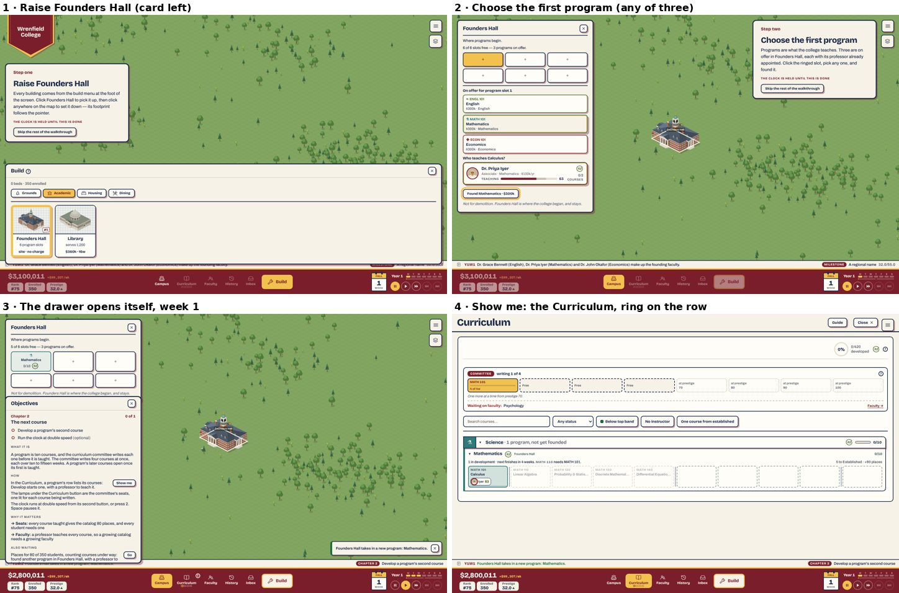
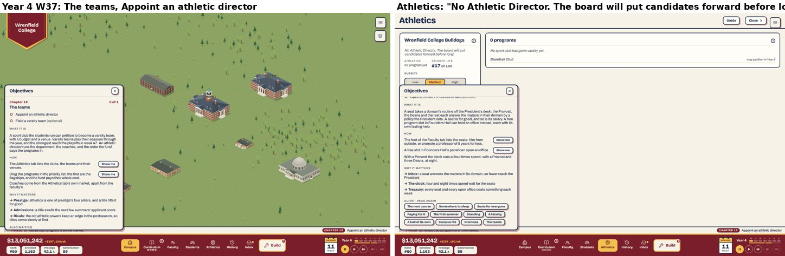
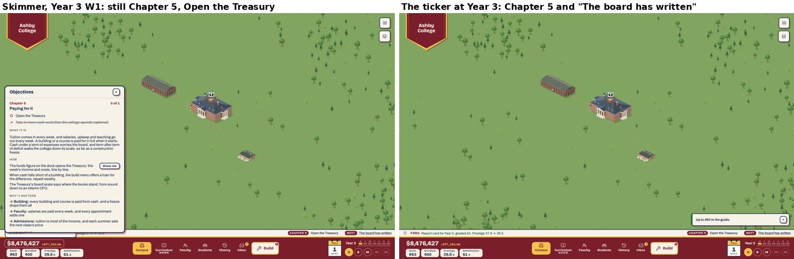
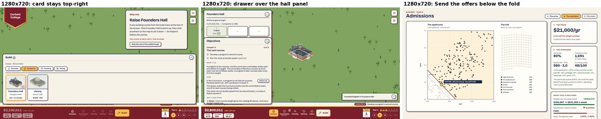
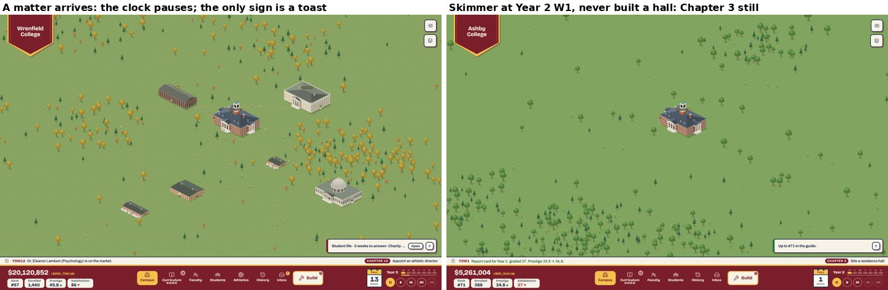
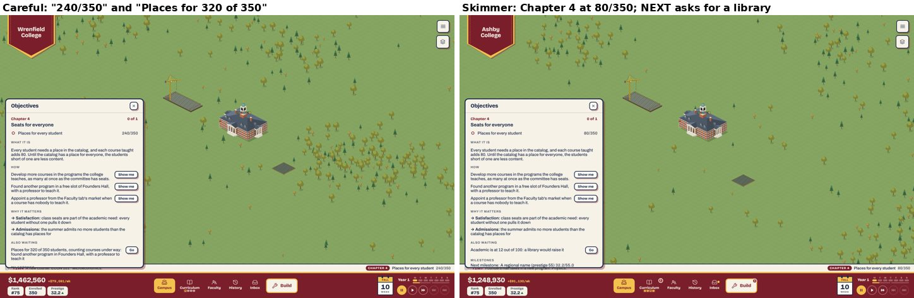
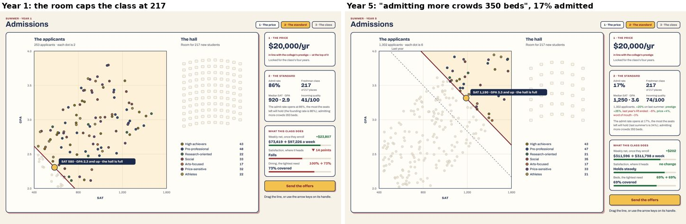
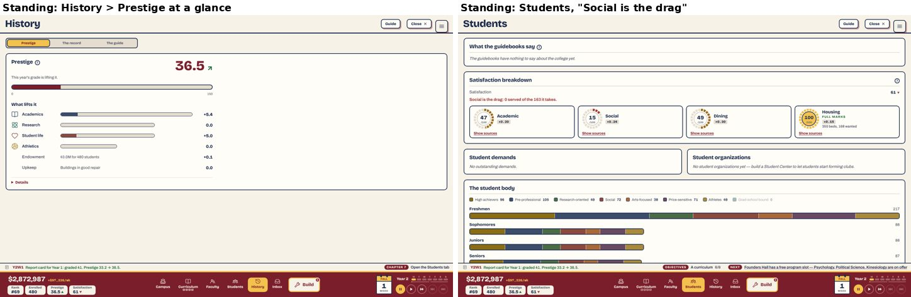

# 3. Intuitive gameplay

Plan 86, area 3. Commit read: `b1f2114` (0.1.3), production build in
`unischool/dist/` (1.95 MB JS, 5.2 MB in all), served on port 4103.

**As run.**
- **A careful player** (Objectives: Guided) from a clean browser to Year 6, week 41: "Wrenfield College", Georgian. It opened the drawer, followed every objective and *Show me*, and answered every stop. 70 minutes of wall time, much of it tool reloads.
- **Three skimmers** (Guided, but the drawer closed at once): they did only what the ticker, the NEXT line and the rings asked. Skim 2 reached Year 2; skim 3 reached Year 3, week 43.
- **Brief and Off**, each to the first week.
- **Later saves** from the shared bank: `guided-y10-clear`, `guided-y20-clear`, `summer` (a later admissions day) and `specialization`.
- **The opening at 1280×720**, and the first load at three connection speeds.
- **Every player confusion** in Plan 106 §1a and playtest-1 areas 2–3, traced to the screen that answers it, or doesn't.
- The logs, per-chapter weeks, every clock stop and the word counts are in [`data/c3-sessions.md`](data/c3-sessions.md).

**The limits.** I am a model, not a human player. "Didn't know" means the screen did not say what to do or why. I read every word, so my reading time is not a player's. The skimmers are my imitation of T1, S2 and D1, not those players. The local build has no PostHog key, so I could not see the statistics notice; I read its code. One seed per player type: the machine was shared, and the hands-on session was the point.

## The new player's first five years

| When | What happened (careful player) | Doubt? |
|---|---|---|
| Title | Menu over the new art; "New game" is the first, filled button. | No |
| Founding | Name field empty; "Open the doors" greyed until a name is typed; facade reads COLLEGE. Enter does nothing (no form). | Mild (polish) |
| Welcome | 45 words, "The walkthrough takes about five minutes." The ticker behind already names the founding faculty. | No |
| Step one | Card on the left between pennant and build menu (Plan 107A), build menu open on Academic, Founders Hall ringed. "Click anywhere on the map". Placed in two clicks. The placing hint still says "Click open ground to break ground". | No |
| Step two | "Three are on offer … each with its professor already appointed. Click the ringed slot, pick any one, and found it." All three tiles ringed; picking one shows its professor and "Found Mathematics · $300k". | No. Good: S1's and the owner's notes answered. |
| W1, after founding | The walk ends; the clock starts at 1×; **the drawer opens by itself** over the hall panel: Chapter 2, *The next course*, 132 words, "Show me", "Also waiting: Places for 80 of 350 … found another program". | Mild. Two asks at once: the chapter says *develop a second course*, Also waiting says *found another program*. |
| W1 | *Show me* opens the Curriculum on the program, Develop ringed. But the second course can't start until the first is taught (4 weeks): the ring sits on a button that isn't there yet ("MATH 110 needs MATH 101"). | Mild. The skimmer, who closed the drawer, ran to week 25 with nothing on the map saying "come back in week 5" (C3-6). |
| W6 | Developed MATH 110 from the ring. Chapter 2 done. Drawer: "Somewhere to sleep opens in Year 1 · Fall term · Week 10." | No |
| W10 | Drawer opens by itself on *Somewhere to sleep*. Show me opens the build menu on Housing with Meadow House ringed; the second Show me on Dining. Two placements, chapter done in the same week. | No. Good. |
| W10 | *Seats for everyone*, already half met: "240/350". Also waiting under it: "Places for 320 of 350, counting courses under way". Two counts of the same thing, 80 apart. | **Yes** (C3-5) |
| W22–25 | Chapter 4 ticks at 350/350 by week 25. | No |
| W25 | First letter after the walk: "Somebody lives here now", as a toast. | No |
| W30–38 | *Paying for it*: one Show me opens the Treasury; done. | No |
| W46 | *The first summer*: 159 words on what the price and the admit rate do (T1's lesson, said before the beat, as §7.5 decided). | No |
| W52 | The Review: "The year graded 41: prestige 33.2 → 36.5 (+3.3)". | No. **B3-1 and F6's "plummeting" are answered**: every summer of five rose (+3.3, +1.6, +2.1, +3.2, +1.8). |
| W52 | Admissions day: price locked blind, the cloud rains, "Room for 217 new students", "SAT 580 · GPA 2.3 and up · the hall is full". "The admit rate opens at 86%, the most the seats left will hold (the founding rate is 86%); admitting more crowds 350 beds." | Mild. A note that says nothing on the first summer, and "crowds" survives crowding (C3-8). |
| Y2W1 | *Standing* opens with the Students tab (Y2W1, not W2: 107G holds). History's *prestige at a glance*: one figure, an arrow, four meters, "This year's grade is lifting it." | No. Good. |
| Y2W1 | NEXT: "Founders Hall has a free program slot — Psychology, Political Science, Kinesiology". The candidates: teaching 25, 41 and 40 ("your faculty's median is 74"). | Mild. Is a 41 worth founding a program on? Nothing says. |
| Y2W14 | *A faculty* opens and is done the same week: Faculty opened; staffing and a B were already met. | No |
| Y2W14 | NEXT "Site Elm Hall" (`go: build`) opens the build menu **on Grounds**, not Academic; Elm Hall is a tab away. | Mild (C3-9) |
| Y2W39 | Elm Hall opens. Letter "Moving in", 150 words, still a stop in a guided run. Then "A school takes shape", 108. | Mild (C3-7) |
| Y2W40 | *A hall of its own* done by moving English. NEXT now names the step: "Establish Social Sciences & Humanities (2 of 6): found Sociology in Elm Hall". | No. **B3-4 is fixed.** |
| Y3W1 | *Campus life*. Show me ("site it from the build menu") opens the menu on Grounds; the Student Center is under Social. | Mild (C3-9) |
| Y3W2 | First student demand, which pauses the clock. The only sign is a toast bottom right; the ticker still shows the last log line. | **Yes** for T1 (C3-4) |
| Y3W36 | "…: post a search in Philosophy" → posted, 26 weeks. The search turned up a candidate at Y4W1 (a log line). The NEXT line kept saying "found Philosophy in Elm Hall" without saying the candidate had come. | Mild |
| Y4W1 | *The teams* opens and asks "Appoint an athletic director". There is no way to: the Athletics tab says "No Athletic Director. The board will put candidates forward before long", and the club "may petition in Year 6". The chapter stayed on the ticker for **143 weeks**. | **Yes** (C3-2) |
| Y4W37 | Hired a Provost from the Faculty tab's foot ($320k) for *Running the college*; 4× opened. | No |
| Y4W52 | Admissions: "Admit rate 34%: the most the seats left will hold (last summer's is 86%)". | No. 107G holds. |
| Y5W1 | *The long game* opens done but for the sweep; Show me opens the Treasury on the budget view, not the Endowment view where the sweep is. | Mild (C3-9) |
| Y5W1 | *Research* (side) opens: "Site a laboratory". NEXT says "Site Oak Hall". | Mild |
| Y6W40 | The AD finally comes (after a varsity petition at Y6W39). Appointing him renamed the teams: the mascot box was pre-filled "Miners" though they were named "Bulldogs" in Year 4. | **Bug** (C3-10) |

**The skimmers.**
- **The walk** took 17–29 seconds of wall time, with no doubt.
- **Week 1.** The drawer that opens by itself was closed. The ticker then read "Chapter 2 · Develop a program's second course" and nothing else. With a chapter open, the NEXT line leaves the strip unless it is urgent (`LogTicker.tsx:67`).
- **Skim 1** didn't open the Curriculum and ran to week 25 with the committee idle.
- **Skim 2** followed NEXT, which in year 1 said only "found another program". It reached the first summer with no residence hall: satisfaction 28, "12 won't return (housing, dining)". It was still on Chapter 3 at Year 2.
- **Skim 3** did everything the ticker and the rings asked, but never clicked the funds figure. It was on **Chapter 5, "Open the Treasury", from Year 1 week 30 to Year 3 week 43 and on**. No matter, demand or promise came, and NEXT said "The board has written" (C3-1).

**Brief** behaves as designed: the line only, and the same gates. **Off** is 0.1.2's ticker ("MILESTONE … NEXT Places for 80 of 350"), and the gates open at once.

**Real time and weeks per chapter** (careful): chapters 2–8 took 0–15 weeks each and no chapter waited on a date it couldn't meet, except *The teams* (143 weeks) and *Research* (open from Y5W1, unmet at Y6W41). Full table in `data/c3-sessions.md`.

**Words.**
- **The walk** is about 110 words: S2's and D1's complaint is answered.
- **The chapters.** Guided then opens fourteen briefings by itself in five years, 99–174 words each, about 1,800 in all. Each comes over the map with the milestone list under it.
- **Against the brief.** That is not less reading than 0.1.2. It is reading at better moments, a chapter at a time. The owner's goal, "more explanation must not mean more reading", is met for the player who closes the drawer, not for the one who reads what opens.

## The play statistics: what could stop a run in its first minute

A third of 0.1.2's founded runs ended before the first summer with zero minutes of running clock (`data/play-statistics.md`). On 0.1.2 the walk held the clock through Plan 103's four extra steps. Two of the eight stopped at `site-hall`, two at `second-course` and two after `play`.

What 0.1.3 changes, and what I checked:
- **The walk is now three screens** (welcome, site, found) of about 110 words, and the clock starts the moment the first program is founded (`App.tsx:396`). The `second-course` stall can no longer happen with the clock held.
- **Load** is quick: title 0.6 s unthrottled, 3.9 s at 1.6 Mbps; founding to the welcome 1.0–1.3 s.
- **The statistics notice** is one sentence and two buttons above the menu (`TitleScreen.tsx:53`). It doesn't block "New game". Most of those zero-minute runs never answered it, since they are counted only if they said "Fine".
- **What remains:**
  - **A drawer that opens itself in week 1, with 132 words**, a minute after the walk promised five minutes. The clock is running, at 1×. For the reader D1 was, this is the "next few screens were quite overwhelmingly text heavy" moment moved by one step (C3-3).
  - **Nothing on the founding form says what the game is.** The tagline does: "Fifty years to build a university". I found nothing else that could stop someone.
- **Since 0.1.3 has six runs** (the owner's), whether the third falls is for the next statistics read. `chapter_opened` and `chapter_done` (Plan 106 PR I) will show where runs stall now. C3-1's Chapter 5 is the place I'd watch.

## What became of the second review's findings

| Finding | Title | On `b1f2114` | Evidence |
|---|---|---|---|
| B3-1 | The first summers mark every college down | **Fixed** | Opens at 32 (Plan 107F). The careful run rose every summer: +3.3, +1.6, +2.1, +3.2, +1.8 (graded 41, 41, 44, 50, 51). The skimmers rose too (+3.0, +2.5). |
| B3-2 | Prestige's panel can't answer "how do I raise it?" | **Partly fixed** → C3-11 | *Prestige at a glance* (107D): one figure, an arrow, four meters on one scale, detail folded. No row says which term can move now; research and athletics sit at 0.0 with their doors only under *Details*, as hover text. |
| B3-3 | NEXT asks for a building already going up | **Fixed** | "Housing is at 12 — Meadow House opens in 9 weeks" (Plan 95O, `nextStep.ts:303-305`). In year 1 a guided player isn't shown the needs at all. |
| B3-4 | "Establish a school" names the goal, not the step | **Fixed** | "Establish Social Sciences & Humanities (2 of 6): found Sociology in Elm Hall"; "…: post a search in Philosophy"; "…: the search in Philosophy has 26 weeks to run". The count rose 2 → 3 → 4 → 5 → 6. |
| B3-5 | Admissions hides what a big class costs in prestige | **Superseded** | Crowding retired (107E). The page shows the weekly net, satisfaction and the tightest need. The rate is held to the room (107G). |
| B3-6 | The specialization says when, not why | **Fixed** | The choice page leads with "Up to 9.8 points of prestige", the strongest pillar ("student life (#10)"), the rivals by pillar, and "Full today: prestige 73.4 → 83.2, #38 → #24" (95F; `specialization` save). |
| B3-7 | The first lab doesn't say it starts research | **Fixed** | Tile "starts research, 25% of prestige" (`BuildPopup.tsx:340`); research row "A school's founding opens its lab." (`prestigeSystem.ts:875`). |
| B3-8 | The Curriculum won't name a school the letters name | **Fixed** | "Science · 1 program, not yet founded" (`CurriculumTab.tsx:1005`). |
| B3-9 | Nothing points at an idle committee | **Deferred by the owner** (Plan 95: "the lamps are enough") → still holds, C3-6 | Y6W1: "writing 0 of 4", 26 courses ready with a professor on the payroll and $7.0M in hand, while NEXT spoke of Oak Hall. |
| B3-10 | Smaller doubts | **Mostly fixed** | "Cancel" and "Esc cancels" (`buildWords.ts:6-7`). The charter says "With its first laboratory open". A greyed tile says why on its face. The satisfaction target is retired (98B). The search price's tooltip is deferred by the owner. The Library's excess line was cut again ("serves 1,200", `BuildPopup.tsx:345`). |

**Counts:** fixed 6 (B3-1, B3-3, B3-4, B3-6, B3-7, B3-8); mostly or partly fixed 2 (B3-2, B3-10); superseded 1 (B3-5); deferred by the owner 1 (B3-9).

## What became of the players' confusions

Plan 106 §1a's fifteen, and playtest-1's areas 2 and 3 as the brief lists them.

| # | Who | What they said | On 0.1.3 | Where |
|---|---|---|---|---|
| 1 | F6 | "why is my prestige continuing to plummet?" | **Answered.** Opens at 32 and rose every summer of five. *Standing* asks the player to open History, and the glance says "This year's grade is lifting it." | `img/c3-standing.jpg` |
| 2 | F6 | Hard to get acclimated at first | **Mostly answered** for a reader; a skimmer can still lose the thread (C3-1, C3-3). | — |
| 3 | F2 | Milestones and objectives in the banner, unclear what to do | **Answered.** Milestones folded into the drawer as "Unlocked:" lines; every objective has a Show me. | drawer |
| 4 | F2 | Unsure what athletics is for | **Answered in words** (*The teams*: pillar, applicants, titles), **broken in play**: the chapter asks for what can't be done for two years (C3-2). | `img/c3-the-teams-y4.jpg` |
| 5 | F2 | Research projects confusing | **Answered in words** (*Research*: one project per lab, its scale, team and return). Not met in play by Y6. | Guide |
| 6 | F2 | Ranks and how they affect teaching | **Answered**: "The rank beside a name … only reads the average of the two." | *A faculty* |
| 7 | F2 | Introduce the systems gradually | **Answered**: one chapter a season, tabs held to their chapters. | — |
| 8 | D1 | "next few screens … overwhelmingly text heavy" | **Partly.** The walk is ~110 words; the briefing that opens itself in week 1 is 132 more (C3-3). | `img/c3-opening-four-screens.jpg` |
| 9 | T1 | Didn't see the clock had stopped, or a letter waiting | **Still holds** (Plan 104B held). A matter pauses the clock; the sign is a toast for 8 s and the pause button's state. | C3-4, `img/c3-quiet-signals.jpg` |
| 10 | T1 | 1% admitted three summers, never connected it to debt | **Answered before the beat** (*The first summer*: "a class admitted too small leaves four years short"), and the page shows the weekly net move with the line. | admissions day |
| 11 | S1, F1 | "A search seemed to stop" | **Partly.** NEXT counts the weeks left. No word says the search found someone (a log line only), and nothing says the market is thin by design except *A faculty*'s "few people in a thin field". | — |
| 12 | S1 | "I can only wait for the money" | **Answered**: the build menu offers a loan for the difference ("borrow $434k" on Elm Hall), and *Paying for it* says so. | — |
| 13 | F3 | Two titles a year reads as a cap | **Answered in words** (*The teams*: "the old athletic powers keep an edge in the postseason"). | — |
| 14 | F1 | Waiting to add more classes | **Partly**: *The next course* says the committee writes four at once and opens a seat at 70, 80, 90, 100. Nothing points at an idle committee (C3-6). | — |
| 15 | B3-10 | Why searches double; why a course is three times a program | **Still holds**: no word on either (search $90k → $128k → $184k → $286k → $387k by Y4; a course $910k against a program's $300k). | C3-12 |
| R2 | Reddit | Lost after the tutorial ends | **Answered**: the chapters take over in the same week. | — |
| T1 | Twitch | Programs on the map, courses in the Curriculum | **Answered** for the reader: chapter 2 is exactly this seam, with its Show me. A skimmer meets only the one line. | — |
| R9 | Reddit | Tutorial easy to miss | **Answered**: Skip asks first, and the chapters run whether the walk was read or not. | — |
| R10/11 | Reddit | Too much on screen during the walk | **Answered** (104F): tabs shut, figures dimmed through both steps. | — |
| S2 | service | The End of Year overview forced itself open over the Faculty screen | **Still holds**: reproduced with Faculty open at Y4W52; the summer replaced it with the Inbox. Area 7's I7-3 carries it. | — |
| S2 | service | Where do I found the next program? | **Answered** while NEXT says "found another program in Founders Hall" (its Go opens the hall). Once NEXT moves on, nothing in the Curriculum or Faculty points to a free slot (C3-9). | — |
| S2 | service | Walkers head for the road before any path | **Still holds**: no word says walkers wear their own paths. The build menu's help doesn't mention paths, and the Paths tile's tooltip says only how to draw. | C3-12 |
| S1 | service | Satisfaction falling in year two, reason unsaid | **Answered**: "Social is the drag: 0 served of the 163 it takes" heads the breakdown. | `img/c3-standing.jpg` |
| F6 | form | (as 1) | as 1 | — |

## Today's changes holding together

- **Crowding retired (107E).**
  - The rule is gone from prestige and the pool. The words remain on every admissions page: "…; admitting more crowds 350 beds" (`yearOverYear.ts:94`, area 7's I7-6). On Year 5's page it sat beside "17% admitted, 217 of 217 places", where admitting more was impossible.
  - The NEXT reading is still named `crowding` and still speaks a need's coverage under 85% (`nextStep.ts:328`). Its words no longer say "crowding", so a player doesn't see it.
- **The admit rate held to the room (107G).** It holds. The label, the line and the class agree at 86%, 34% and 17%. The arrow keys move the handle down and back, and it stops at the room's edge. The page's "Send the offers" is below the fold at 1280×720 (C3-12).
- **Unlocks on the spot (107G).** The Students tab opens at Y2W1, the moment the first class is set.
- **Chapter 8 and the Faculty tab (107B).** "Open the Faculty tab" required; a search optional. Met in the week it opened.
- **"Below top band" (107H).** The chip carries the band's swatch. History's link reads "Show the 8 courses below the top band".
- **Tabs gated on chapters vs. the Guide and the letters.**
  - The Athletics tab waits for *The teams*, but the first sport club's stop (name the teams) came at Y4W1, the same week. Area 7's harness probe has it two years before the tab (I7-2).
  - *Campus life*'s briefing says "the first sport club approved opens the Athletics tab"; in a guided run it doesn't.
  - Every *Show me* I pressed opened its tab. But four *Show me*s and Go buttons land one level short of what they name (C3-9).
  - No letter pointed at a tab that wasn't open in my runs.

## Findings

| Id | Finding | Severity | Effort | Continues |
|---|---|---|---|---|
| C3-1 | A player who never opens the Treasury stays on Chapter 5 for good, and everything after it waits | major | S | — (area 7's note under I7-2) |
| C3-2 | *The teams* asks for an athletic director nobody can appoint until the club's third-year petition | major | S | — |
| C3-3 | The first minute after the walk is a drawer over the map with a 132-word briefing | major | S | D1, S2 |
| C3-4 | A matter still stops the clock with only a toast to say so | major | S | T1 (Plan 104B held) |
| C3-5 | Two counts of the same places, 80 apart, side by side | minor | S | — |
| C3-6 | The committee sits idle with nothing on the ticker | minor | S | was B3-9 |
| C3-7 | In a guided run the chair's letters still stop the clock beside the chapter that says the same | minor | S | — |
| C3-8 | Admissions day's first note says nothing, and "crowds" outlived crowding | minor | S | I7-6 |
| C3-9 | Show me and Go land one level short of what they name | minor | S | S2 |
| C3-10 | Appointing the athletic director renames the teams | minor | S | — |
| C3-11 | Prestige at a glance doesn't say which row can move now | minor | S | was B3-2 |
| C3-12 | Smaller doubts | polish | S | B3-10, S2 |

### C3-1. A player who never opens the Treasury stays on Chapter 5 for good — major, S

**What.**
- **The rule.** *Paying for it* (Y1 W30) has one required objective, "Open the Treasury", met only when the shell marks `tab:treasury` (`chapters.ts:128`, `App.tsx:203-208`). The chapters run in a chain, each waiting for the one before (`settleChapters`, `chapters.ts:380-382`). The matters, demands and promises wait for *Campus life* and *Promises* (`gates.ts`).
- **The Treasury has no tab button.** It opens only from the funds figure, whose label is the money itself (`StatusHeader.tsx:129-137`; `aria-label="Treasury"`, never seen).
- **In play.**
  - Skim 3 did all the ticker and the rings asked and never clicked the money. It sat on "Chapter 5 · Open the Treasury" from Y1 W30 to Y3 W43 and on.
  - It got no matter, no demand, no promise, no *Standing*, no *A faculty* and no *A hall of its own*.
  - The ticker's NEXT said "The board has written" for a year. The board's "Money doing nothing" letter was itself answered from the Treasury.
  - Every harness save past week 30 shows the same chapter up to year 50 (`guided-y10-clear`, `guided-y20-clear`). Area 7 found 13 years in its probe.
- **The statistics:** before a chapter asked, players opened the Treasury about once in ten years (`play-statistics.md`, last table).
- **The same chain holds earlier too.** The repaired `newplayer` (Tools), which does nothing after the walk, sat on Chapter 2 for three years. Chapter 2's ring helps only a player who opens the Curriculum.

**Why it matters.**
- The gates were built for the slow player (Plan 106 §7.3, "let it be slow"). Here they hold back a player who is not slow, only one who never clicked a figure that doesn't look like a button.
- Every later system then waits behind a chapter whose one task the player has stopped reading: the student body's demands, the board's matters, the promises, and every briefing from *Standing* on.
- The statistics say this is most players.

**Fix.**
- Make "Open the Treasury" optional, as Plan 107B made the search optional. Done when the summer's admissions beat has run, which shows the money anyway.
- Or ring the funds figure while the chapter waits, as the build menu rings a tile, and give the figure a visible "Treasury" word (the chips beside it have "Rank", "Enrolled", "Prestige").
- Either way, no required objective should be a click the game can't ring.
- Mark the tab when *Show me* is used from the drawer too. It is, through the shell; the gap is the skimmer who never opens the drawer.

### C3-2. *The teams* asks for an athletic director nobody can appoint until the club's third-year petition — major, S

**What.**
- **What it asks.** *The teams* opens at Y4 W1 once a sport club has formed (`chapters.ts:211-218`). Its one required objective is "Appoint an athletic director".
- **What the game allows.** The AD comes only as the board's offer, and only once a varsity team exists (`eventSystem.ts:132-135`). A team comes from a petition at week 39, three years after the club formed (`VARSITY_PETITION_MIN_TENURE_YEARS = 3`, `studentLifeData.ts:1022`). Nothing in the Athletics tab appoints one: "No Athletic Director. The board will put candidates forward before long." The club "may petition in Year 6".
- **In play.** The chapter sat on the ticker from Y4 W1 to Y6 W40: **143 weeks**. How long depends on when the club formed: 38 weeks for area 7's harness player. The briefing's two *Show me*s open a tab with nothing to do, and the second points at a priority list with no programs in it.
- **The chain.** *The teams* is a side chapter, so the chain went on. But the ticker shows the first open chapter (`currentChapter`, `chapters.ts:319-323`). *Running the college*, *The long game* and *Research* were open under it, and the ticker said "Appoint an athletic director" through all of them. The drawer showed *The teams* too; the others were reachable only through the Guide's "Read again".
- **Area 7's I7-2** is the same seam from the other side: the stops come before the chapter.

**Why it matters.** F2 asked what athletics was for. The answer now arrives as a task the player can't do, on the one line every player reads, for two years. The chapters behind it are hidden.

**Fix.**
- Open *The teams* on the first varsity team, not the club (`opensWhen: s.orgs.teams.length > 0`). That is the moment the AD offer and the tab have something to act on. Fold the first sport club's mascot stop into it, as I7-2 suggests.
- Make the ticker show the first open **main** chapter. A side chapter belongs in the drawer as a second section, not on the strip.
- **Test:** no required objective may be impossible on the week its chapter opens (a harness check over the guided players).

### C3-3. The first minute after the walk is a drawer over the map with a 132-word briefing — major, S

**What.**
- **What opens.** The walk ends on the program founded, and the clock starts at 1×. In the same instant, Guided opens the drawer by itself (`App.tsx:180-188`) on *The next course*: 132 words, three levers, two "why" links, an "Also waiting" and the milestones.
- **The two asks disagree.** The chapter's line is "Develop a program's second course". Also waiting says "found another program in Founders Hall". The second course can't start for four weeks ("MATH 110 needs MATH 101"), so the chapter's *Show me* rings a Develop button that isn't there.
- **At 1280×720** the drawer covers the hall panel, and step one's card stays top-right (the left placement needs 820 px of height, `styles.css:3797`).
- **Who closed it.** The careful player read it; all three skimmers closed it.

**Why it matters.**
- This is the moment the statistics flag: runs that end with under a minute of running clock.
- The walkthrough promised "about five minutes". A minute later comes the densest panel of the opening, asking for something that can't be done yet.
- D1's "next few screens were quite overwhelmingly text heavy" was about exactly this step on 0.1.1. S2 said it again on 0.1.2.
- My judgment: the chapters work, but the first one arrives too early and says too much.

**Fix.**
- Don't open the first chapter's drawer by itself. Let *The next course* open as a ringed line on the ticker, and start auto-opening from *Somewhere to sleep* (week 10).
- Or open the chapter at the week its objective can first be met: the first course taught, week 4–5.
- Show "Also waiting" only when it asks for something different in kind, not a second route to the same objective.
- Cut the briefing to its first sentence and the Show me. Its "what" (committee seats, ten to fifteen weeks) is reference for the Guide.

### C3-4. A matter still stops the clock with only a toast to say so — major, S (T1; Plan 104B held)

**What.**
- With "Pause when a matter arrives" on (the default), a matter or demand pauses the clock (`App.tsx:439-453`).
- **What shows.**
  - A toast, bottom right, for 8 seconds (`Toasts.tsx:33`), then gone. The inbox icon keeps a small badge.
  - The pause button turns yellow, and the calendar stops.
  - The ticker keeps the last log line, and the chapter line doesn't change.
- **In play.** In the careful run this happened 12 times in Years 3–6. Twelve seconds after the Y5 W13 matter, the screen was the same as at the stop, minus nothing: the toast was still there, but at the edge of the screen, at the end of a line.
- T1 "didn't realize time had stopped and there was something he had to do". Plan 104B was held "for a second report". The chapters made the screen calmer, so the stop is quieter still.

**Why it matters.**
- Every player from Year 3 meets it about three times a year.
- A player who doesn't see it sits on a stopped clock, the failure T1 named. Area 4 counts 8.3 stops a year late in the game.

**Fix.** Plan 104B as written. While the clock is paused for a matter:
- the ticker's NEXT slot reads "Paused: a matter waits — Open" (urgent style);
- the calendar card gets a "paused" band.

One line; no new screen.

### C3-5. Two counts of the same places, 80 apart, side by side — minor, S

**What.**
- *Seats for everyone* counts places taught (`instructionCapacity`, `chapters.ts:114-117`): "240/350".
- The NEXT reading under it in the same drawer counts places taught **and coming** (`placesComing`, `seating.ts`): "Places for 320 of 350 students, counting courses under way".
- The two never agree while a course is in development, which is most of year 1.

**Fix.** Use one reading. The objective's count could add the coming places in a second figure ("240 taught · 320 with courses under way"), or the NEXT line could drop its count when a chapter counts the same thing.

### C3-6. The committee sits idle with nothing on the ticker — minor, S (was B3-9)

**What.**
- At Year 6 W1 the careful college's committee was "writing 0 of 4". Twenty-six courses were ready with a professor on the payroll for each, and $7.0M was in hand.
- The ticker said "Appoint an athletic director" and NEXT said "Site Oak Hall".
- The lamps under the Curriculum button were dark. Plan 95 decided "the lamps are enough", but a dark lamp reads as nothing, not as a free seat.
- Skim 1 left the committee idle from week 4 to week 25 of year 1 for the same reason.

**Why it matters.** F1's "waiting to add in more classes" is about the committee's pace. Here the committee waited on the player and the game didn't say so. Courses are the academics pillar's biggest lever.

**Fix.** The B3-9 reading, placed after the shortfall: "The committee has 4 free seats — develop the next course", going to the Curriculum's *Ready to start* filter. Or make the lamps' unlit state visible (a hollow lamp with a "+").

### C3-7. In a guided run the chair's letters still stop the clock beside the chapter that says the same — minor, S

**What.**
- Plan 106 lets a chapter retire a letter that says the same (`letter.chapter && guidedRun`, `eventSystem.ts:268`). Only *A hall of its own* and *Summer is coming* carry it.
- *Moving in* (150 words), *A school takes shape* (108) and *A second school* (85) still stop the clock in a guided run, each with a TO DO line. *A hall of its own* is already open and says the same.
- Of the careful run's three letter stops in Years 2–4, all three were these.

**Fix.** Mark the three with `chapter: 'hall-of-its-own'`, or turn them into kept letters (no stop) in a guided run. Their TO DO already lives in NEXT.

### C3-8. Admissions day's first note says nothing, and "crowds" outlived crowding — minor, S (area 7's I7-6)

**What.**
- **The first summer** reads "The admit rate opens at 86%, the most the seats left will hold (the founding rate is 86%)". The parenthesis repeats the figure it explains.
- **Every summer** adds "admitting more crowds 350 beds" (`yearOverYear.ts:94`).
  - Crowding is retired (107E).
  - The panel's tightest need was dining in Year 1, not beds.
  - In Year 5 the line was capped at 17%, so admitting more wasn't possible.

**My judgment of the page.**
- The cloud, the line on it and the hall filling are the best-explained decision in the game.
- One thing the page doesn't say: what raising the line buys. A higher standard gives fewer, better students. The quality figure moves, but nothing says what quality feeds (academics' "Student quality" term).

**Fix.**
- Drop the parenthesis when the two rates are equal, and drop "crowds … beds".
- Add one line under *Incoming quality*: "feeds academics' student quality".

### C3-9. Show me and Go land one level short of what they name — minor, S (S2)

**What.** Four doors open the right screen on the wrong part:
- **NEXT "Site Elm Hall"** (`go: 'build'`) opens the build menu on Grounds, and Elm Hall is under Academic. `initialBuildTab` rings only the chapter's building (`BuildPopup.tsx:259-265`).
- ***Campus life*'s "site it from the build menu"** also opens on Grounds; the Student Center is under Social.
- ***The long game*'s "The Treasury's endowment panel sets the sweep"** opens the Treasury on its budget view; the sweep is on the Endowment view.
- ***Research*'s Show me for the Research tab**, before any lab, does nothing: the tab doesn't exist yet (`openTab` returns at `App.tsx:330`).

Separately, S2's "where do I found the next program": once NEXT stops saying "found another program", neither the Curriculum nor the Faculty tab points to a free slot in Founders Hall.

**Fix.**
- A `build` door carries the buildable it means and opens on its tab, ringed, as *Somewhere to sleep* does.
- A Treasury door carries its view.
- A Show me whose tab is shut is hidden, or says when it opens.
- The Curriculum's head gets "Found a program: Founders Hall has 3 free slots →" while a slot is free and an offer has someone to teach it.

### C3-10. Appointing the athletic director renames the teams — minor, S (bug)

**What.**
- At Y4 W1 the first sport club's stop named the teams "Bulldogs" ("The school's teams will play as the Bulldogs.").
- At Y6 W40 the AD's stop showed three candidates, and clicking one sent the payload's fresh mascot suggestion with it. The log: "Glenn Ashford is the new Athletic Director. The teams will play as the Miners." `s.self.mascot` is now "Miners".
- **Cause.** `AthleticDirectorView` keeps `mascot` in state from `payload.mascotSuggestion` and hides the field when a mascot exists (`InterruptModal.tsx:660, 689`). But it passes `mascot` on every pick (`:675`). `RESOLVE_ATHLETIC_DIRECTOR` then writes it whenever it is non-empty (`reducer.ts:697-698`).

**Why it matters.** A name the player chose is overwritten without being asked. It reaches every player who names the teams at the sport club, which in a guided run is all of them.

**Fix.** Pass `''` for the mascot when `s.self.mascot` is set, or have the reducer write it only when none exists. Add a test.

### C3-11. Prestige at a glance doesn't say which row can move now — minor, S (was B3-2)

**What.**
- The glance is a large improvement: one figure, an arrow, four meters of their true weight, and "This year's grade is lifting it".
- What it still doesn't answer is B3-2's question, "how do I raise it?". Research (25%) and athletics (15%) read 0.0 for five years. The meters show them as the longest empty bars.
- The doors are in *Details*, as one line of terms ("What the labs have produced 0.0 · Fields it can research in 0.0 …"). "A school's founding opens its lab" is only in the row's hover text.
- The owner dropped "Most room to grow" because it named research before a lab could exist (107 §4). The opposite line, what can move **now**, wasn't added.

**Fix.** Under a pillar at 0.0, one muted line naming its door ("opens with a school's first lab"; "opens with a varsity team"). In *Details*, mark terms that can't move yet, as B3-2 asked.

### C3-12. Smaller doubts — polish, S

- **The search price climbs unexplained** (B3-10, deferred): $90k, $128k, $184k, $286k, $387k by Year 4. The tooltip could say "two weeks of running costs".
- **A course costs three times a program** ($910k against $300k): nothing says the first course comes with the program's founding price.
- **Walkers head for the road before any path** (S2): no text says they wear their own paths. One clause on the Paths tile would do: "students wear their own paths; paving one keeps the grass".
- **Admissions day at 1280×720**: "Send the offers" sits below the fold (818 px of 720). The page scrolls, but nothing hints at it.
- **The founding form** doesn't submit on Enter (no `<form>`, `StartupScreen.tsx:320-394`).
- **The placing hint** still says "Click open ground to break ground", after Plan 107A taught "anywhere on the map".
- **The search's result** is a log line ("The Philosophy search has turned up Dr. Daniel Jenkins"). NEXT keeps "found Philosophy in Elm Hall" without saying a candidate came. A toast would do.

## Tools

- **`tools/review/drive.mjs`: one repair.** It ran unchanged against the rebuilt opening. A step that missed waited Playwright's 30 seconds, which made a long session crawl. It now reads `DRIVE_TIMEOUT` (ms) for the page's default timeout (`drive.mjs:55-57`). Nothing else changed.
- **`tools/newPlayer.mjs`: repaired.**
  - **Unchanged, it passed.** It founded, walked and reached Year 2 in 143 s with no stall. Its comments still described the appointing step and Plan 103's steps, and it saw nothing of the chapters.
  - **Words.** Its header and the README's newcomer paragraph now describe Plan 107A's walk.
  - **Chapters.** It logs the chapter line each time it changes and closes the drawer Guided opens. It is the skimmer, and says so.
  - **`--years=N`** plays N years (default 1, as before).
  - **The run after the repair**, `--years=3`: founded, walked, reached Year 4 W1 in 411 s with no stall. The chapter line it logged in week 1, "Chapter 2 · Develop a program's second course", **never changed in three years**. A player who does only what the walk asks never meets a matter, a demand, *Standing* or *A faculty*. It is C3-1's chain from its first link.
- **A run-until-stop helper** for the session (scratch, not committed). It plays a drive profile until the clock stops and logs each stop with its word count. With `--auto`, it reads and continues a letter, answers a matter with its first choice, and plays on.
- **Not run:** `npm run build`, `npm ci`, any sim batch. All play was on the production build. No game code was changed.
