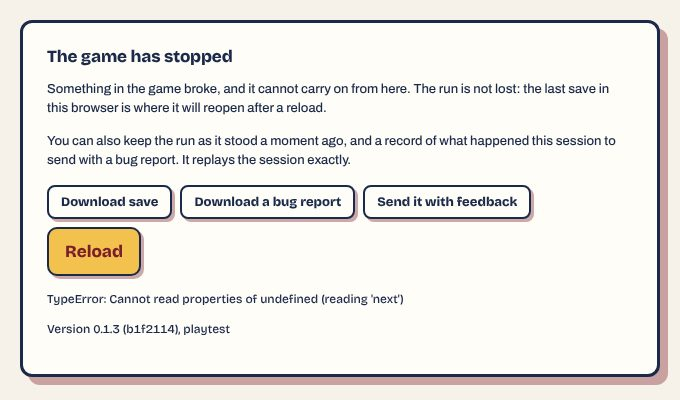
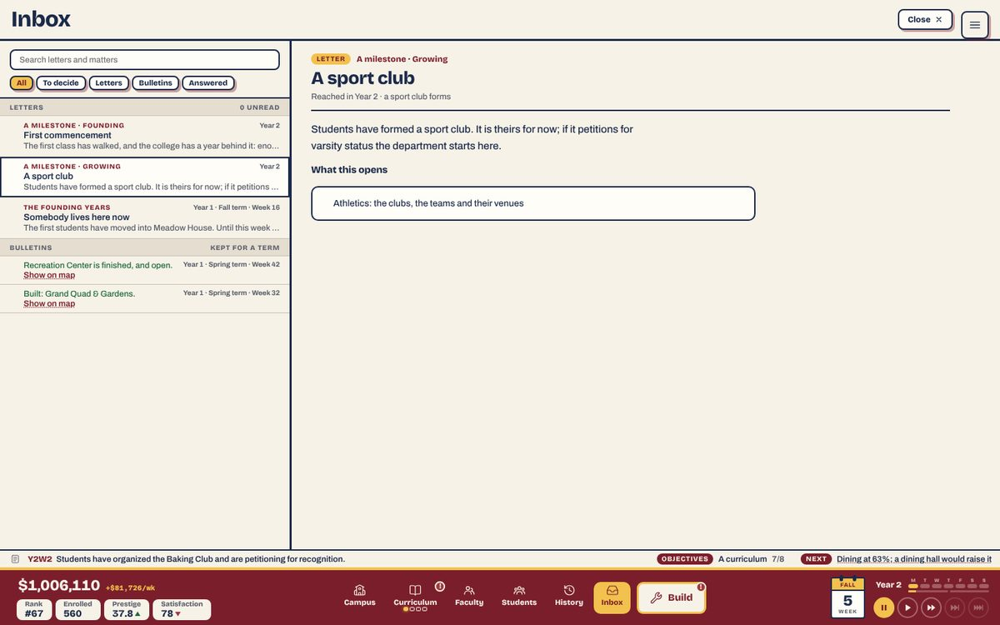
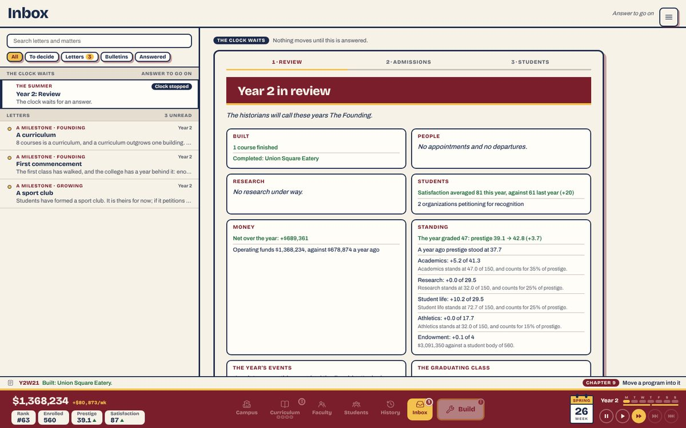
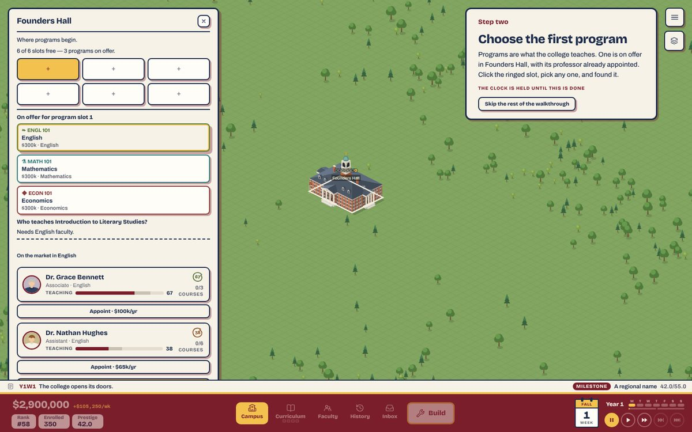
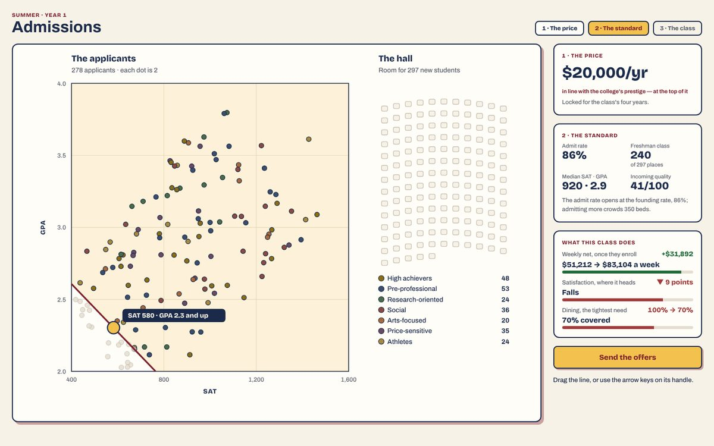

# 7. Bugs

Plan 86, area 7, third review. Commit read: `b1f2114` (0.1.3), the production build in `unischool/dist/` (one 1.95 MB script), served by `vite preview` on port 4107. Ranked by severity, then by how many players meet it.
- **Severity:** *blocker* breaks a run or a save; *major* a player will notice and be hurt by it; *minor* noticeable and harmless; *polish*.
- **Effort:** S an hour, M a PR, L a plan.

**One blocker.** A 0.1.2 save made on one of the walkthrough's later steps crashes 0.1.3 the moment it is continued, every time (I7-1). It was reported to the lead when found. Everything else that touches a save holds: 31 committed fixtures, S1's three playtest saves and eleven saves built by 0.1.2's own code load, round-trip and play on with every invariant.

**The fix-first list** (each changes saved data, misleads every player of a kind, or breaks a tool the next review needs):
- **I7-1** the 0.1.2 save that crashes;
- **I7-2** the gated athletics stops: a guided run is asked about the sport club, varsity and an athletic director while the Athletics tab and its chapter are shut, and every letter says the tab is open;
- **I7-5** the scenario saves open with a chapter briefing over the map, which broke two review tools (repaired here); and `demand` still never stops.

| # | Finding | Severity | Effort | Was |
|---|---|---|---|---|
| I7-1 | A 0.1.2 save on a later walkthrough step crashes 0.1.3 on Continue; a slot or file load writes it over the live run first | blocker | S | — |
| I7-2 | A guided run meets the sport club, the varsity petition and the athletic director before their chapters, and is told the Athletics tab is open when it is shut | major | S | — |
| I7-3 | The summer still replaces the tab being read with the Inbox | minor | S | S2 |
| I7-4 | An old save on the old appointing step: "One is on offer" over three offers, and a market where the card says a professor is appointed | minor | S | — |
| I7-5 | Tooling: scenario saves open on a briefing; `demand` never stops; no harness player fills a seat | minor | S | H7-8a |
| I7-6 | "Admitting more crowds 350 beds": a crowding sentence after crowding went | polish | S | — |
| I7-7 | Stale records: Plan 89 says "in progress" and the findings log calls the stairs untraced; both are done | polish | S | — |

## What was run

The machine was shared by six reviewers (load 5–14 on 2 cores), so the 50-year sweep ran three seeds, not five; the second review ran five.

| What | Tool | Result |
|---|---|---|
| Typecheck, lint, every suite | `npm run check` | **Passed:** 190 of 190 suites in 863 s |
| The slow suites | `npm run test:slow` | **Passed:** 3 of 3 in 1,813 s |
| Invariants every week, an export, import and four-week play-on check every year. Six players × seeds 1–3 × 50 years (Natural seeds 1–3; Guided, Completionist, Selective, Lean, Idle 1–3), October's odd names | `review:sweep` | **20 of 20 clean.** The Idle runs first failed on a tool fault, repaired and re-run (Tools) — `data/c7-sweep.txt` |
| The same, 30 years, Lean and Idle × six more odd names (emoji, Zalgo, HTML and quotes, leading spaces, diacritics, apostrophes) | `review:sweep -- --names` | **12 of 12 clean** after the repair |
| Every committed fixture (v78 launch save to v102), migrated and played five years by Guided and Idle | `review:sweep -- --fixtures` | **62 of 62 clean** — `data/c7-sweep-fixtures.txt` |
| Every fixture, S1's three playtest saves, and **eleven saves made by 0.1.2's own reducer** (`4f5b83e`), one per walkthrough stage and one skipped at the welcome: read through `readSave`, chapters settled, tabs before and after, the founding faculty, the crowding fields, an export/import round trip, four weeks of play | a probe (`data/c7-load-*.txt`; the generator is `data/c7-old-saves-script.ts.txt`) | All load, no tab lost, no duplicate professor, the crowding fields gone, round trips identical. **In the browser, four of the eleven crash (I7-1)** |
| A guided-founded (gated) run played by Guided (two seeds), Lean and Selective to year 10, and by Guided opening no tab | a probe (`data/c7-gates.txt`) | I7-2 |
| Two tabs, four ways | `tools/review/twoTabs.mjs` | **All four as Plan 95AA means them**; case 4 keeps A's three unsaved weeks (`data/c7-two-tabs.txt`) |
| The map by keyboard and by touch | `keyboardCheck.mjs`, `touchCheck.mjs` | **All pass after a tool repair** (`data/c7-keyboard-touch.txt`) |
| Frames at Paused, Play and 2× | `npm run profile` on year 30, 40 and 50 | Recorded, not judged: the machine was loaded (`data/c7-profile.txt`). 4× is locked on every scenario save (I7-5) |
| Hands-on, some 50 sessions | `drive.mjs` and short scripts on the production build | Below |

**Checked and fine on 0.1.3:**
- **Saves.** Export from the menu and import from the title screen bring back an identical state (year 26). A chapter record is caught up by date on load (`chapters.ts:345`): no old save is held at a chapter, and no tab it had is shut, since a save from before 0.1.3 is never gated. The founding faculty are never doubled: a 0.1.2 save keeps whoever it hired and the rest stay on the market. Old report cards with crowding grades render in History. S1's year-6 summer save goes through the new admissions page and on into Year 7.
- **Objectives Guided → Off → Guided.** Off marks the run (`objectives-off`), the Athletics tab appears at once, and turning Guided back on leaves every gate open, as the Off note says. Skipping the walkthrough at the welcome asks first, keeps the clock held until Founders Hall stands, and Chapter 1 then reads "Found the first program".
- **Admissions day.** The price locked, the tab hidden for 2.5 s mid-rain and shown again: the page resumed at the cut. A reload with the price locked reopens on the standard; after Send the offers, on the Students beat. The class committed matches the line (80.4% chosen and stored). Under reduced motion the commit is one step. The opening note says when the room clips the rate.
- **Faculty.** Cards, Table and Plot switch; the table sorts by salary and years both ways; the plot shows the market's 30 as rings and each professor's heading line.
- **The Treasury board** in week 1 and year 41, **History › Prestige** at 32 and 99.6, **the lab news** over the map at 2× ("+$11M", "+1 case study", "Breakthrough!"), **the offices panel** (three held, nine on offer, the next milestone named), **sandbox moves** (a building's own vernacular is kept only in a sandbox, `persistence.ts:991`).
- **Closing a program.** Eighteen programs closed across a year-9 and a year-26 save: refused with a reason where another program needs a course, no invariant broken, schools stay founded, the save round-trips, and two years play on. A closed program returns to the offers at once, as the owner decided.
- **The console.** No page error and no console error or warning in any session but I7-1's. The canvas reports no fill it can't draw over five saves after four turns and six zooms.

## What became of the second review's findings

| # | Finding | On `b1f2114` | How verified |
|---|---|---|---|
| H7-1 | A pre-85F save counts more than three Landmark Programs a week | **Fixed** (95AA) | `researchParkGate` caps each week before the year (`persistence.ts:257-273`); the v81-recruiting fixture plays five years under Guided and Idle with the invariant held |
| H7-2 | The wheel can't stop the browser's zoom | **Fixed** (95AB) | A native non-passive listener (`CampusMap.tsx:2093`); on both maps nine wheel events, Ctrl included, all cancelable and prevented; the page's scale stays 1; no console message |
| H7-3 | A second tab's Continue drops the first's unsaved weeks | **Fixed** (95AA) | `twoTabs.mjs` case 4: A's weeks 2→5 kept, a fresh tab continues at week 5 |
| H7-4 | An opened matter pauses again after a reload | **Fixed** (95AA) | `unseen.ts`'s `readOpened`/`keepOpened` over `sessionStorage`; `test/unseen.test.ts` passes |
| H7-5 | A board letter is always dated this week | **Fixed** (95K) | The specialization notice reads "Year 18 · Week 1" at weeks 2 and 3 (`inbox.ts:276`, `letterWeeks`) |
| H7-6 | Short money rounds past its unit | **Fixed** (95AB) | `moneyShort`: 999,500 → "$1.0M", 9,950,000 → "$10M", 999,950,000 → "$1.0B". Past a trillion it reads "$1,000B", which no run reaches (the richest scenario holds $23B) |
| H7-7 | "University of Ashford College" | **Fixed as decided** (95AC): the form says so | Typing "University of Ashford" shows: This will read "University of Ashford College", and "University of Ashford University" once the board grants it |
| H7-8 | Tooling: `demand` and `training`; "Test University University"; the scaffold fill | **Partly fixed.** b: the harness college is "Test". c: fixed (no unsupported fill). a: `training` stops (Y38 W6); **`demand` still never stops** | Carried as I7-5 |
| H7-9 | Three events name anyone | **Fixed** (95AD) | `eventCatalogue.ts:75, 479, 511` name `researcher`, `tenure-track`, `recent`; `event-truth` 1,148 of 1,148 checks |

**Counts:** fixed 7 (H7-1–H7-6, H7-9); fixed as the owner decided 1 (H7-7); partly fixed 1 (H7-8, carried as I7-5).

## The players' bug reports, on 0.1.3

| Report | On 0.1.3 | Evidence |
|---|---|---|
| NEXT asks for a library that stands (S2) | **Fixed** | `nextStep.ts:117-125` asks for one only when none stands, else for seats, else names the teaching |
| One path square re-plans every walker (S2) | **Still holds, by design, softened.** A stroke waits 700 ms after the last tile (`Walkers.tsx:71, 331-333`, Plan 62), then every walker re-plans from where it stands. One click is still a re-plan of the whole crowd. Code read only; a visual check was not possible headless. The cheaper fix is to re-plan only walkers whose route crosses the changed tiles | — |
| The End of Year overview opens over a screen being read (S2) | **Still holds** | I7-3 |
| A red ghost with no reason (S1, Plan 104H) | **Fixed** | The ghost and the click share one financing test (`CampusMap.tsx:2299-2314`, `buildReasons.ts`). On the crisis save (−$2M) the tower's tile reads "$202M short · with no cash in hand, the college cannot borrow" |
| No courses in Walnut Hall (F5) | **Fixed** | `drawsGlobalOffers` (`programOffers.ts`); `test/offer-decline.test.ts` §1b mirrors the repro. No scenario leaves a claimed hall with a free slot, so this was checked by test, not by hand |
| The Research Park doesn't appear (F5) | **Fixed** | A save specialized in research with the park locked and no lab project finished: the park is `available` a week after load; in the browser it is in Capital projects at "$45M · 144w from gifts" |
| Stairs drawn backwards (the owner, to R8) | **Fixed in 0.1.1** (Plan 99E, `a73d21a6`, 13 October) | `treadBox` (`buildingMotifs.tsx:930`) and `test/entrance-steps.test.ts`; Founders Hall's flights from all four corners, each climbing toward its door (`img/c7-stairs-four-views.jpg`). The findings log still says "not yet traced" (I7-7) |

## The findings

### I7-1. A 0.1.2 save on a later walkthrough step crashes 0.1.3 — blocker, S

- **Repro.** `data/c7-v012-needs-save.json` is a save made by 0.1.2's own reducer (commit `4f5b83e`), on the walkthrough's `needs` step. Put it in `unischool.save`, open the production build, press Continue. "The game has stopped — TypeError: Cannot read properties of undefined (reading 'next')". Reload and Continue: the same, every time.
- **Which saves.** Of the ten stages 0.1.2 could save on, five crash: `await-course`, `second-course`, `needs`, `site-housing`, `site-dining`. `welcome`, `site-hall`, `appoint`, `found` and `play` open. 0.1.1 had the same stages, so its saves are the same.
- **Two more ways in.**
  - **A save slot** (98D). With a 0.1.3 run in progress, Title → Save slots… → Load → "Confirm — replace Test University" → Continue crashes. The confirmed load has already written the old run over the autosave, so the 0.1.3 run in progress is gone from the browser unless it was in another slot or a file.
  - **"Load a save file"** goes through the same `readSave`, so a downloaded 0.1.2 file ends the same way.
- **Cause.** `sanitizeOpening` (`persistence.ts:1657-1663`) carries only `appoint` to `found`. The other retired stages stay in the state until the first TICK or action runs `settleOpening` (`opening.ts:107`), and the shell renders first. `OpeningCoach.tsx:32` takes `isCoachStage(stage)` (any stage but `play`, `openingData.ts:87`) and indexes `OPENING_STEPS`, which has no `needs`. `step` is `undefined`, not `null`, so `step !== null && step.next` (`:38`) throws. `test/opening.test.ts:366` checks that a TICK moves these stages on, but never renders the card after a load.
- **Who meets it.** Anyone who left a 0.1.1 or 0.1.2 run in its first weeks, between founding the first program and finishing the residence and dining steps. `await-course` lets the clock run for about four weeks; the others hold it, so a player who stopped to read and left is on one. The play statistics show 2 of 24 founded 0.1.2 runs stopped on `second-course` alone (`data/play-statistics.md`, "Where 0.1.2's runs stopped"). The changelog promises them: "a run still on one of the old walkthrough steps plays on from there". 0.1.3 is already on itch.io: its update post went up at 21:04 UTC on 21 October, and the play statistics show 0.1.3 runs from minutes later (`playtest-1/README.md` still says it isn't). So the fix ships as a patch.
- **Fix.**
  - In `sanitizeOpening`, carry any stage outside `welcome`/`site-hall`/`found`/`play` to `play`, as `settleOpening` does.
  - Make `OpeningCoach` return `null` when `OPENING_STEPS[stage]` is undefined, so an unknown stage can never crash the shell.
  - A test that renders `OpeningCoach` from `readSave` of a fixture on each retired stage. A `save-v103-walkthrough.json` fixture from 0.1.2 would hold it.

### I7-2. A guided run meets athletics before its chapter, and is told the tab is open — major, S

- **The rule** (Plan 106 §7.3, `gates.ts`). In a guided run, matters wait for *Campus life* and the Athletics tab for *The teams*. "A player who hasn't finished chapter 8 doesn't see decision events, demands or athletics, whatever the year."
- **What happens.** A guided-founded run played by the harness, the tabs opened as each chapter asks (`data/c7-gates.txt`):

  | Player, seed 7 | First sport club (a stop) | Athletics tab | Varsity petition (a decision) | Athletic director (a stop) | Campus life opens |
  |---|---|---|---|---|---|
  | Guided | Y2 W1 | Y4 W2 | Y4 W39 | Y4 W40 | Y3 W15 |
  | Lean | Y3 W1 | Y4 W2 | **Y5 W39** | **Y5 W40** | Y6 W40 |
  | Selective | Y3 W1 | Y4 W2 | **Y5 W39** | **Y5 W40** | Y8 W28 |
  | Guided, never opening a tab | Y2 W1 | — | **Y4 W39** | **Y4 W40** | never, by Y13 |

  1. **Every guided player** gets the first sport club's stop (name the mascot) one to two years before the Athletics tab exists. The milestone's letter says "What this opens: Athletics: the clubs, the teams and their venues" (`img/c7-sport-club-letter-tab-shut.jpg`). The drawer says "Unlocked: A sport club. Athletics: …". The toolbar has no Athletics button until Year 4.
  2. **A slow guided player** (here Lean and Selective, two and three years behind) is asked to take a team varsity, spend money on it, and hire an athletic director, before *Campus life* has explained the inbox's matters. The petition is a decision event, the thing the gate holds.
  3. *Campus life*'s own briefing says "the first sport club approved opens the Athletics tab" (`chapterData.ts:240`). In a guided run it does not.
- **Cause.**
  - `fireMascotBeat`, `fireAthleticDirectorOffer` and `fireVarsityPetition` (`eventSystem.ts:117, 132, 154`) check no chapter. `fireTrusteeResponse` and `rollDecisionEvent` (`:172, :194`) do.
  - The milestone's `opens` line (`ladderData.ts:235`) is printed as is by the letter (`InboxTab.tsx:430`) and the drawer (`ObjectivesPanel.tsx:169`). Only the button checks `tabAvailable` (`InboxTab.tsx:424`).
- **Who meets it.** Every guided player whose students form a sport club meets point 1; the probe's players did in year 2 or 3. Point 2 reaches the slower ones, who are the players the gates exist for.
- **Related, by design.** A guided player who never opens the Treasury stays on Chapter 5 for good (13 years in the probe), and no matter, demand or promise ever comes, as Plan 106 §7.3 decided. Before a chapter asked, players opened the Treasury about once in ten years (`play-statistics.md`). Areas 3 and 4 may want that number.
- **Fix.**
  - Gate the petition and the AD offer on `ATHLETICS_CHAPTER`, which already waits for a sport club.
  - Hold the mascot beat until the same chapter, or fold it into *The teams*' opening.
  - Have the letter and the drawer say "opens with *The teams*" while `tabAvailable` is false.
  - Re-run the guided sim: the petition's timing moves.

### I7-3. The summer still replaces the tab being read with the Inbox — minor, S (S2)

- **Repro.** A guided save at Y2 W50: open Faculty, play at 2×. At week 52 the Faculty tab is gone and the Inbox shows "Year 2 in review", "Answer to go on". Every year.
- **Where.** `App.tsx:409-418`: a held stop sets the overlay to the Inbox and keeps the old tab to return to (`beforeHold`). The player is put back afterwards, but the page they were reading is taken away the moment the week turns. S2: "quite jarring, particularly when it happened repeatedly while I was trying to read something else."
- **Who.** Every player, every summer, who has a tab open at week 52. After year 1 nothing warns that the stop is next.
- **Fix.** While a tab is open, hold the summer behind a pill ("The summer is here: open it") and pause the clock, rather than swapping the tab. Or show the NEXT bar's "Summer in N weeks" from week 48, so the stop is expected.

### I7-4. A save on the old appointing step: the card counts one offer and promises an appointed professor — minor, S

- **Repro.** A 0.1.2 save on `appoint` (Founders Hall sited, no professor). It loads onto `found` (Plan 107A's `sanitizeOpening`). The card reads: "One is on offer in Founders Hall, with its professor already appointed. Click the ringed slot, pick any one, and found it." Three offers stand under it. Picking English shows the market (Bennett at $100k, Hughes at $65k, a search), not an appointed professor. Appointing Bennett and founding English ends the walk correctly.
- **Where.** `openingData.ts:116`: `teachableOffers` counts offers whose field someone on the payroll teaches. On such a save nobody is on the payroll, so `n` is 0 and the singular sentence is chosen.
- **Who.** A 0.1.1 or 0.1.2 player who left on the appointing step, with Founders Hall sited and nobody hired. Nothing is lost; the card misleads for one step.
- **Fix.** Count `programOffers` when the faculty is empty, and say "pick one and appoint its professor" there. Or put the founding three on the payroll in `sanitizeOpening` for a save with `faculty: []`, as a new game has them.

### I7-5. Tooling — minor

| # | What | Where | Severity |
|---|---|---|---|
| a | **The scenario saves open with a chapter's briefing over the map.** Every harness save past week 30 has a chapter open that needs a tab opened (*Paying for it*: "Open the Treasury"), since no harness player opens tabs. In Guided the drawer opens over the map on Continue. It took the first Escape in `keyboardCheck.mjs` (2 checks failed) and covered the building `touchCheck.mjs` tapped (1 failed). **Repaired here** (both tools set Objectives to Brief). For the next review's gallery and screenshots: every scenario save shows "Chapter 5 · Open the Treasury" in its ticker at any year, up to year 50 (`img/c4-prestige-glance-y40.jpg` shows the same in area 4's capture). Fix: `tools/scenario.ts` marks the four `MARKED_TABS` and every `read:` mark on the state it writes, or the harness's Guided player sends `MARK_GUIDANCE` for a tab when its chapter asks. | `chapters.ts:295`, `tools/scenario.ts` | minor, S |
| b | **`demand` still never stops** (was H7-8a). Lean, Selective and Completionist all run out at year 30 with satisfaction never under 60. Idle stops in year 3 at a college of one building and 154 students. Plan 95 left it. The three scenarios the lead saw end with "modal none" are **fine**: since Plan 95T `first-milestone` and `research-report` are letters, and each save holds its unread letter (milestone at Y4 W40, research report at Y14 W21); `charter` holds the university charter pending in the inbox. One description drifts: `charter` says "the week the first lab is at work", but its lab is built with no project running. Fix: a `mutate` that drops satisfaction to 55 at year 8 (as `crisis` does), and "the week the first lab stands". | `tools/scenarios.ts:354, 364` | minor, S |
| c | **No harness player fills a seat**, so no scenario save has a Provost: 4× is locked on all of them, `npm run profile` cannot sample 4× or 8×, and *Running the college* is never done in any harness save. | `sim/harness/guided.ts` | polish, S |
| d | `npm run profile` read the date off the page's text, which the toolbar no longer draws in one piece ("clock after: ?"). **Repaired here**, as 95AA did for `twoTabs.mjs`. | `tools/profile.mjs:96` | polish |
| e | `review:sweep`'s round trip failed every Idle game: a college that never founded a program has no `hallClaims`, and the load's `settleClaims` writes `{}`. The state reads the same either way (every reader uses `?? {}`). **Repaired here**: the comparison treats an absent record and an empty one as equal. | `tools/review/sweep.ts:54` | polish |

### I7-6. "Admitting more crowds 350 beds" — polish, S

- The admit-rate note ends "…; admitting more crowds 350 beds" (`yearOverYear.ts:94`). Plan 107E retired crowding as a rule: beds now cost satisfaction only, as the same page's "Dining, the tightest need: 100% → 70%" says. On the first summer the note names beds while the panel's tightest need is dining.
- **Fix.** "admitting more stretches the {tightest need}", read from the panel's own figure, or drop the clause; the panel already shows it.

### I7-7. Two records say work is undone when it is done — polish, S

- `docs/plans/089-the-administration.md:8` and its row in `docs/plans/README.md` say "In progress: A–G open". Every PR has an "As implemented" note, and all of it is live: twelve offices in Founders Hall (four to six held in the late scenario saves), Walnut Hall (`HALL-07`, standing in every late save), the six milestones, the effects, the panel.
- `docs/reviews/playtest-1/findings.md:383`: "Stairs drawn backwards … Not yet traced in the code." Plan 99E traced and fixed it on 13 October, shipped in 0.1.1.
- **Fix.** Status *Landed*; one line in the findings pointing at 99E.

## Tools

Repairs, all under `unischool/tools/`, none under `src/` or `sim/`:

| Tool | Change |
|---|---|
| `keyboardCheck.mjs`, `touchCheck.mjs` | Set Objectives to Brief before loading the save, so a chapter's briefing doesn't open over the map (I7-5a). Before: 13 of 15 and 10 of 11; after: all pass. |
| `profile.mjs` | Reads the date from the calendar's label (I7-5d). |
| `review/sweep.ts` | An absent record and an empty one compare equal (I7-5e). |

Probes written for this review, kept in the scratch directory and not committed, except the 0.1.2 save generator (`data/c7-old-saves-script.ts.txt`, run against a `git archive` of `4f5b83e`): a load probe over any saves, a gated-run probe, a close-program probe, and short Playwright scripts for slots, export/import, the wheel and the stairs. Not done: a real trackpad pinch (the wheel probe stands in), a GPU-backed profile, and a phone pass (phones are out of scope).
