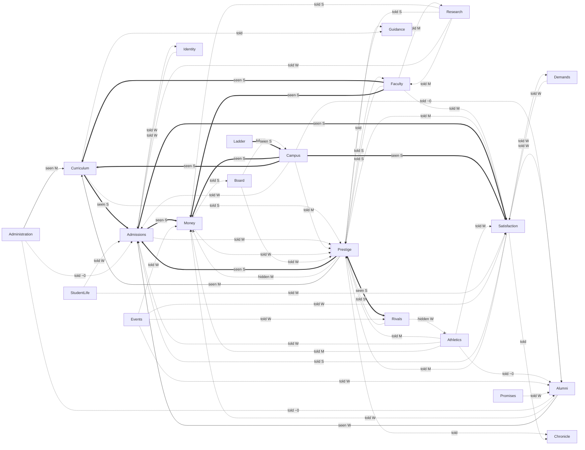

# Pass D — The web

*Plan 123 §3, pass D: which systems visibly feed which, and which are islands?*

**Commit read:** `5d06ae4`. **Reviewer:** a model (Claude), reading code and running the harness; no human played for this pass.

## Method and limits

- **Graph.** Started from `review:web`'s import graph (23 folders, 104 import edges) and replaced it with causes: an edge A→B is a line in the weekly tick or the summer (`engine/reducer.ts:79-128`, `admissions/resolveAdmissions.ts`) where A's state changes B's. Imports that carry no cause were dropped; causes that cross folders through `data/` were added. Paths in the table are under `unischool/src/systems/` unless they start `data/`, `components/` or `engine/`.
- **Nodes.** 21 systems. Finance, endowment and debt are **Money**; distress, board letters and the board's question are **Board**; delegation seats and offices are **Administration**; clubs, chapters, petitions and the downtown are **Student life**; rivals and rank are **Rivals**; the specialization sits in **Prestige**. **Chronicle** and **Guidance** (chapters, next steps) read the state and write nothing back. Inbox and sandbox are a surface and a mode, not systems.
- **Visibility.** *Seen*: the player can watch A move B as it happens — on the map, or a figure that moves in the view where A is changed (the price slider moves the applicant cloud; a placed dorm lights up full and turns the satisfaction arrow). *Told*: only words say it — a breakdown, a hover, a help (?), a letter, the summer review's text lines, the reveal's once-a-year "word of mouth +4%" line. *Hidden*: nothing says it. Checked by reading every component that renders the effect (`StatusHeader.tsx`, `AdmissionsPage.tsx`, `yearInReview.ts`, `StudentLifeTab.tsx`, `CampusMap.tsx` and its map modules, `BuildPopup.tsx`, `CurriculumTab.tsx`, `FacultyTab.tsx`); no browser session (three other passes held the machine).
- **Weight.** From constants, at the size a 30,000-student college meets them: *strong* (changes rank or the class by itself), *moderate* (several points of prestige or satisfaction), *weak* (a point or two, or a few percent of a pool), *negligible* (below a point).
- **Goal players.** Seven goals × seeds 12345, 4242 × 40 years (14 runs): [`data/goal-players.md`](data/goal-players.md). **Ablations:** 33 more runs of big-then-good (two seeds) and prestige with one system's actions blocked from Year 1, through a scratch copy of the tool (game code untouched). Limits: three runs per ablation; one changed decision moves a run by up to ~8 target points and ~6 places, so only effects that repeat across all three are read as real. The harness runs some systems for every player (athletics department, downtown, board question), and the players are scripted, not human.

## Headline

- **21 systems, 64 causal edges** (plus 4 read-only edges into Chronicle and Guidance).
- **Visibility: 14 seen (22%), 48 told (75%), 2 hidden (3%).** Of the **34 edges that matter** (20 strong, 14 moderate): 13 seen, 20 told, 1 hidden. 30 edges are weak or negligible.
- **Hubs:** Prestige (20 edges, 14 that matter), Satisfaction (15), Admissions (15), Money (11), Campus (11).
- **Islands** (≤ 1 edge that matters): **Alumni** (8 edges, none that matter), **Identity**, **Events**, **Promises**, **Demands**, **Administration**, **Student life** — 7. **Dead ends by design:** Chronicle, Guidance. Ladder has one edge, but it is structural (it opens the building tiers).
- **The loop that carries the game** — curriculum and faculty → prestige → applicants and price → money → buildings and courses — has every *money* and *seat* edge seen and every *prestige* edge told.

## The web

Solid thick: seen and strong. Solid: seen. Dotted: told. Dotted with ✕: hidden. S/M/W = strong, moderate, weak; ~0 = negligible. One arrow per pair, labelled by its weightiest edge.

| From | To | How | Where | Visibility | Weight |
|---|---|---|---|---|---|
| Curriculum | Admissions | courses' seats cap the freshman class (seats ≈ 80 a course) | `techtree/instructionCapacity.ts:66-83` | seen | strong |
| Curriculum | Prestige | breadth (50) and concentration (30) in academics | `prestige/prestigeSystem.ts:201-202,606-616` | told | strong |
| Curriculum | Admissions | cohort pulls: pre-professional, arts, high achievers, grad-bound | `admissions/cohorts.ts:146-160,215-218` | told | weak |
| Faculty | Curriculum | a course needs a teacher; the teacher sets its grade | `faculty/facultyAssignment.ts:43` | seen | strong |
| Faculty | Prestige | teaching quality (30) and the teaching ceiling on the target | `prestige/prestigeSystem.ts:203,529-553` | told | strong |
| Faculty | Satisfaction | teaching against the standard: 60 of the academic need's points | `satisfaction/satisfactionSystem.ts:108,241` | told | moderate |
| Faculty | Money | salaries | `finance/financeSystem.ts:277` | seen | strong |
| Faculty | Research | research skill drives output | `data/researchData.ts:72` | told | moderate |
| Faculty | Satisfaction | quirks' morale, ±3 on academic (≤0.6 on the headline) | `data/quirkData.ts:71-74` | told | negligible |
| Prestige | Admissions | applicant pool, price tolerance ($190 a point), admit-rate curve, quality mix | `admissions/admissionsSystem.ts:60-64,85-86,229-235` | seen | strong |
| Prestige | Faculty | the hiring market's candidates centre on prestige | `data/facultyData.ts:609-617` | told | strong |
| Prestige | Money | "prestige dividend", $900 a point a year | `finance/financeSystem.ts:137,271` | told | negligible |
| Prestige | Money | market-rate multiplier on salaries, services, scale costs | `finance/financeSystem.ts:202,244,294; data/facultyData.ts:718` | hidden | moderate |
| Prestige | Satisfaction | pride (≤ +15 social) and rising expectations | `satisfaction/satisfactionSystem.ts:60-62,248` | told | moderate |
| Prestige | Curriculum | a committee seat at prestige 70, 80, 90, 100 | `techtree/techSystem.ts:253-259` | seen | moderate |
| Prestige | Rivals | rank is the order by prestige | `rivals/rivalsSystem.ts:482` | seen | strong |
| Rivals | Prestige | rank 30 (or a pillar's top 10) offers the specialization, worth 28-34 pillar points | `prestige/milestone.ts:52; prestigeSystem.ts:131-169` | told | strong |
| Admissions | Money | tuition by class | `finance/financeSystem.ts:255-271` | seen | strong |
| Admissions | Prestige | student quality (24 × scale) | `prestige/prestigeSystem.ts:204,274-275,624` | told | moderate |
| Admissions | Satisfaction | every student dilutes every need | `satisfaction/satisfactionSystem.ts:216-221` | seen | strong |
| Satisfaction | Admissions | word of mouth ±60% of the pool; attrition up to 8% a year | `admissions/admissionsSystem.ts:115-116,238-244,317-321` | told | strong |
| Satisfaction | Prestige | welfare (20) in student life | `prestige/prestigeSystem.ts:205,725-733` | told | moderate |
| Satisfaction | Alumni | a class's warmth is set by its four years | `alumni/ledger.ts:82-85; data/alumniData.ts:62-65` | told | weak |
| Satisfaction | Prestige | third route to the specialization (85+ most years) | `prestige/prestigeSystem.ts:190-195` | told | weak |
| Satisfaction | Demands | a demand is raised below the threshold | `demands/demandSystem.ts:299` | told | weak |
| Campus | Satisfaction | buildings and beds serve the five needs | `satisfaction/satisfactionSystem.ts:154-182` | seen | strong |
| Campus | Money | construction and upkeep | `finance/financeSystem.ts:297-299` | seen | strong |
| Campus | Curriculum | halls house programs; libraries multiply breadth | `prestige/prestigeSystem.ts:452-462` | seen | strong |
| Campus | Prestige | condition penalty, at most −4 of 150 | `prestige/prestigeSystem.ts:215,711-714` | told | weak |
| Campus | Admissions | beauty moves the pool ±12% | `estate/beauty.ts:32,85-87` | told | weak |
| Campus | Prestige | beauty (6) in student life, ≈3 prestige at most | `prestige/prestigeSystem.ts:211,645` | told | weak |
| Campus | Alumni | "handsomest campus" memory, +6 warmth | `alumni/ledger.ts:70; data/alumniData.ts:34` | told | negligible |
| Campus | Prestige | capital projects as pillar terms | `prestige/prestigeSystem.ts:474-482` | told | moderate |
| Campus | Satisfaction | pairing neighbours, ≤2 points on a need | `estate/pairing.ts:11,40-41` | told | negligible |
| Athletics | Satisfaction | 2.2 social a team × budget tier | `data/studentLifeData.ts:287-290,316,1322` | told | moderate |
| Athletics | Prestige | athletics pillar, 15% (≤12.6 points unspecialized) | `prestige/prestigeSystem.ts:100-104,955-957` | told | moderate |
| Athletics | Admissions | athletes cohort ≤ +7% pool; top-band drag ≤ 6% | `admissions/cohorts.ts:195,225` | told | weak |
| Athletics | Money | subsidy, scholarships, gate surplus | `finance/financeSystem.ts:279-282` | told | moderate |
| Athletics | Alumni | a title year lifts campaigns 25% | `alumni/campaigns.ts:38-42` | told | negligible |
| Rivals | Athletics | postseason seeding by overall rank | `athletics/season.ts:73` | hidden | weak |
| Research | Money | grants paid to cash | `research/researchSystem.ts:68` | told | strong |
| Research | Prestige | research pillar, 25% | `prestige/prestigeSystem.ts:336-361` | told | strong |
| Research | Admissions | research cohort ≤ +8% pool | `admissions/cohorts.ts:219` | told | weak |
| Research | Faculty | candidates' research centres on research standing | `data/facultyData.ts:613-616` | told | moderate |
| Alumni | Money | annual giving ($220 an alum), campaigns, named funds | `alumni/giving.ts:9,51-55; finance/financeSystem.ts:274` | told | weak |
| Alumni | Admissions | scholarship funds lower the net price | `alumni/funds.ts:32-46` | seen | weak |
| Money | Prestige | endowment, at most 4 of 150 | `prestige/prestigeSystem.ts:220,363-370` | told | weak |
| Money | Board | the distress ladder (freeze, austerity, receivership) | `finance/distress.ts:4-18` | told | strong |
| Board | Campus | a freeze stops construction; austerity cuts maintenance | `finance/distress.ts:4-18` | told | strong |
| Board | Prestige | the board's question trades 1-2 points between pillars | `prestige/prestigeSystem.ts:580-594; data/boardQuestionData.ts:17` | told | weak |
| StudentLife | Satisfaction | clubs 0.6, chapters 2.5(+1.5) social each | `data/studentLifeData.ts:62-64,77-78` | told | moderate |
| StudentLife | Admissions | social cohort ≤ +7.5% pool | `admissions/cohorts.ts:221` | told | weak |
| Demands | Satisfaction | met or missed, a bump to the stock | `demands/demandSystem.ts:261` | told | weak |
| Events | Money | one-shot cash, endowment, debt, backlog | `events/catalogue.ts:509-516` | told | weak |
| Events | Satisfaction | one-shot mood (half gone in ~14 weeks) | `events/catalogue.ts:516; satisfactionSystem.ts:25` | told | weak |
| Events | Alumni | one-shot warmth | `events/catalogue.ts:517` | told | weak |
| Promises | Alumni | kept or missed: warmth ±2-6, mood ±2-4, $0.5-2M | `data/promiseData.ts:47-152` | told | weak |
| Admissions | Identity | tags read research, teaching, price, Greek life, beds, selectivity | `identity/tags.ts:26-53,95` | told | weak |
| Identity | Admissions | tag teeth: pool −5…+12%, quality −4…+4 (also giving, attrition, cost, beauty, team strength) | `data/tagData.ts:21-30; identity/teeth.ts` | told | weak |
| Administration | Admissions | offices: career services +15% one cohort, aid −20% one cohort's price | `data/officeData.ts:119-124` | told | negligible |
| Administration | Alumni | alumni relations +15% giving, +20% campaigns | `data/officeData.ts:150-151` | told | negligible |
| Administration | Curriculum | seats staff courses and run routine; unlock 4× speed | `delegation/seats.ts; components/StatusHeader.tsx` | seen | moderate |
| Ladder | Campus | milestones open building tiers and tabs | `ladder/ladderSystem.ts; engine/reducer.ts:79` | seen | strong |
| Events | Rivals | a richer rival poaches (suitor) | `events/catalogue.ts:335` | told | weak |
| Many | Chronicle | the chronicle reads the year; feeds nothing back | `chronicle/chronicle.ts` | told | none |
| Many | Guidance | chapters and next steps read state; feed nothing back | `guidance/*, state/chapters.ts` | told | none |

## Can a strategy ignore a system and lose nothing?

Year 41, prestige **target** change and rank against the unblocked run. Full table and method in [`data/goal-players.md`](data/goal-players.md).

| Ignored from Year 1 | big-then-good 12345 | big-then-good 4242 | prestige 12345 | Verdict |
|---|---|---|---|---|
| Research (no initiatives, no landmarks) | −17.6, #4→#17 | −25.7, #1→#28 | −18.6, #8→#27 | **Not ignorable** — the one optional system that pays |
| Varsity teams (none ever) | −15.7, #4→#12 | −9.9, #1→#9 | −3.9, #8→#13 | Costs 5–9 places |
| Clubs, chapters and teams (every petition refused) | −15.8, #4→#12 | −19.3, #1→#13 | −3.5, #8→#13 | Clubs and chapters add 0–9 beyond teams |
| Athletics *department* (no coaches, venues, budget, scholarships; teams still form) | −6.5, #4→#5 | −6.2, #1→#3 | −0.2, #8→#10 | **Nearly ignorable** |
| Alumni levers (campaigns, reunions) | −8.1, #4→#10 | 0.0, #1→#1 | −4.0, #8→#11 | Noise-level; one campaign was the only use |
| Treasury levers (endowment moves, draw, sweep) | 0.0, #4→#4 | −1.5, #1→#1 | −5.1, #8→#9 | **Ignorable**; cash piles to $1.7–2.2B |
| Seats (no Provost, no VP of Advancement) | −0.3, #4→#1 | −5.1, #1→#5 | −1.5, #8→#9 | **Ignorable for standing**; seats buy speed |
| Offices | 0.0 | 0.0 | 0.0 | **Ignored by every player in 47 runs** |
| Faculty training | −0.4 | −1.7 | −13.6, #8→#19 | Matters only to a teaching-led college |
| Decorating (trees, paths, dressings), reunions | — | — | — | No goal player ever does either; big-then-good finishes #1 |
| Promises | — | — | — | The championships player takes none and finishes #14 |

## Findings

Each states its net change: systems, surfaces, words. Negative is the default.

**D-1. The game's spine is told, not seen.** The strongest edges into prestige — curriculum breadth and concentration (80 of academics' weight), teaching (30 plus the ceiling), research (a 25% pillar) — show only as the summer review's text lines (`state/yearInReview.ts:224-253`) and the History tab's breakdown. The Curriculum tab is opened 3.7 times a run-year, History 0.57. Prestige itself moves only at the summer (the weekly drift is a tenth of a rate, `prestigeSystem.ts:90`), so no player ever watches a course or a hire move it. **Change:** make prestige one figure — four pillar bars on the prestige chip — and reuse that bar at the head of the tab that feeds each pillar (Curriculum: academics; Research; Students: student life; Athletics). The summer fills the bars instead of listing "Academics: +1.4". Cut the review's standing lines and the Standing breakdown's prose. **Net:** systems 0; surfaces −1 (the text breakdown), +1 figure used in five places; about −400 words.

**D-2. Offices are an island nobody visits.** Twelve offices (`data/officeData.ts`), each a ±15–20% nudge on one cohort, giving, a demand timer or a grant chance (`officeData.ts:119-151`). No goal player opened one in 47 runs; blocking them changed nothing, to the decimal. The two actions they gate (charter a club, found a team) already happen by petition. **Change:** cut offices; keep the seats, which buy speed (the 4× key is a seen edge). **Net:** −1 system, −1 surface (Founders Hall offices), −2 actions, −10 told edges, about −600 words.

**D-3. The letters layer is five islands.** Events, promises, demands, identity's teeth and the board's question have no edge that matters between them yet carry about 20,000 of the game's 61,000 words (events alone 16,400). Each effect is a one-shot nudge: mood +3 to a stock that loses half of it in ~14 weeks (+1 on the year's average), warmth ±2–6, $0.5–2M against late cash of $35M–$2.8B, 1–2 prestige over five years for a board answer, tag teeth of ±2–12% on a pool that seat-bound colleges do not need. The championships player takes no promise and finishes #14; the promises chapter was opened by 11 players. **Change:** cut promises; cut demands and fold their deadline into satisfaction's drag, which the header chip already names (`satisfactionSystem.ts:409`); keep identity's tags as words for the guidebook and the Final Report title but cut their teeth; keep only events whose effect lands on the map or a seen figure (trees, ivy, a sinkhole, a building, enrollment). **Net:** −2 systems, −2 surfaces (Promises panel, demand card), −7 tag levers; about −4,000 words before events are trimmed.

**D-4. Alumni is a dead end.** It reads six systems (satisfaction, teaching, beauty, events, promises, program cuts) and returns only weak money: $220 an alum a year (`alumni/giving.ts:9`), so even 100,000 warm, mature alumni give ~$0.4M a week against a net of $3–5M a week. Its panel lives in History (0.57 opens a year); no goal player held a reunion; blocking campaigns is noise. **Change (connect, not add):** let warmth feed the edge that already carries satisfaction to applicants — word of mouth reads the alumni's warmth beside this year's satisfaction, and the reveal's existing "word of mouth" line shows it. A happy decade then pays twice, visibly, every summer. Cut reunions. **Net:** systems 0 (Alumni becomes part of the satisfaction → admissions loop), −1 action, the Alumni panel to one line; one weak told edge becomes a moderate edge on the reveal.

**D-5. Athletics: the department is busywork, the teams are not.** Running no department at all (no coaches, venues, budget, scholarships) costs 0–6.5 target points and 1–2 places; the championships player spends 176 coach actions on it. Having no teams costs 4–16 points and 5–9 places, mostly through social satisfaction (2.2 a team, `data/studentLifeData.ts:316`) and the pillar. Titles show nowhere on the map; crowds fill the stands only on game weeks. **Change:** cut coach management and the team-order and scholarship controls (keep the budget tier); let each title hang a banner on its venue (seen, and it stays). **Net:** systems 0; −4 actions; the Athletics tab (1,197 words, the wordiest tab, opened 0.62 a year) roughly halved; +1 map mark.

**D-6. Money stops mattering, and the Treasury's levers are ignorable.** Blocking every endowment move, the draw and the sweep cost 0–5 target points; cash piles to $1.7–2.2B instead. The endowment is worth at most 4 of 150 prestige (`prestigeSystem.ts:220`); the "prestige dividend" is $900 a point a year (`financeSystem.ts:137`), $1,800 a week at prestige 104 against a $4.7M week. **Change:** cut the dividend line, the draw-rate slider and the sweep (a fixed draw); give late money one strong outlet that is already a system — endowed chairs (`alumni/funds.ts`) that lift the hiring market's centre (the prestige → faculty edge), shown on the Faculty tab's market line. **Net:** −2 controls, −1 Treasury line, Endowment panel (272 words) to one figure; one weak edge (money → prestige) becomes a moderate one into the teaching loop.

**D-7. Two scores for how the campus looks.** Beauty (0–100: greenery, landmarks, upkeep, quads; `estate/beauty.ts:56-74`) feeds applicants ±12%, ~3 prestige and an alumni memory; the Campus standing (0–150: decoration, quads, paths, buildings) feeds the Final Report and the rivals' campus axis. The Estate panel shows one, the build menu the other. No goal player ever decorates and big-then-good still finishes #1. **Change:** one score, carried by the map (wear, ivy and greenery already are); one strong edge — student life's pillar — and drop beauty's applicant factor. **Net:** −1 score, −1 figure, −1 reveal factor, −3 weak edges, +1 edge that matters.

**D-8. Most of the applicant pool's multipliers do not bind.** For every growth strategy the class is capped by courses' seats from about Year 10 (prestige player: 3,700 admits for ~2,200 places at Y15, 11,700 for ~8,300 at Y40), so word of mouth, cohort pulls, beauty, tags and offices only change selectivity, hence incoming quality (≤ ~6 prestige). Only the revenue player, priced at 1.6× what families expect, is short of applicants. The reveal's cloud and cut line show this honestly (keep). **Change:** keep prestige, price, word of mouth, "what you offer" and beds on the pool line; cut beauty, tags, the honors cut and the office pulls (D-2, D-3, D-7). **Net:** −4 factors, the reveal's line shorter.

**D-9. Two hidden edges that matter.** (a) Prestige raises every salary, service and scale cost (`financeSystem.ts:202,294`; `data/facultyData.ts:718`): a brake on growth no surface names. (b) The summer's rise cap (`prestigeSystem.ts:44-62`) lets the target run up to 14 points ahead of prestige late (big-then-good: target 121, prestige 107 at Y41), so the work a player does now lands years later, unseen. **Change:** a ghost tick for the target on the D-1 bars (no words); the market rate as the salary axis's scale on the Faculty plot. **Net:** surfaces 0, words 0; two hidden edges become seen.

**D-10. Negligible edges to cut outright.** Faculty quirks' morale (±3 on academic, ≤0.6 on the headline; `data/quirkData.ts:71-74`), building pairing (≤2 on a need; `estate/pairing.ts:11`), a title year's +25% on campaigns, rivals' seeding of the postseason (hidden), the beauty memory of alumni. **Net:** −5 edges, the words that explain them (quirk morale lines, pairing notes).

## Keep

- **Price ↔ prestige ↔ applicants in the summer reveal.** The slider moves the cloud, the cut line chooses quality, "Families expect about $X" ties price to prestige. The best seen edge in the game.
- **Courses' seats → the class.** "The hall is full" / "places empty": curriculum visibly decides enrollment.
- **Buildings → needs → satisfaction.** Placing a dorm lights residences and turns the header arrow; the drag names the need.
- **Teacher → course grade.** The grade sits beside the instructor in the Curriculum tab.
- **Research → grants and its pillar.** The one optional system all three ablations say pays (−18 to −26 target points without it); make its edges seen, never cut it.
- **Prestige → committee seats.** Locked seats labelled "at prestige 80": a gate the player can see.
- **The ladder's unlocks** and the **walkers, wear and lit residences** on the map: the map already carries students, upkeep and housing.
