# UniSchool — a review of the interface, November 2026

Commit read: `cb6fc22` (0.2.0, with Plan 124 landed). Findings only; nothing in the game was changed.

The owner asked three questions, and the review has one part for each:

1. Where is the same information conveyed in different ways?
2. Where can a screen say less, so a player is never overwhelmed, without the simulation losing depth?
3. Where do the systems meet on screen, and do they help each other or get in each other's way?

**How it was done.** The production build, in headless Chromium at 1440×900 and 1280×720. `npm run review:gallery` over ten harness saves (the founding, years 2, 8, 15 and 30, a summer, a decision, a demand, the specialization, a forced crisis) gave 264 captures, counted in [`data/gallery.md`](data/gallery.md). A second set was driven by hand for the places where two things share the screen: the build menu with a tool armed, toasts over a tab, the clock running, a new game's first minute. Where a finding rests on the code, the file is named.

**Limits.** The reviewer is a model, so every "reads as" is a judgment, not a player's report. The harness sites buildings in a strip, so the campus in the pictures is denser than a played one. The phone layout, the Final Report page and the title page were not read. The year-30 captures were counted but only the year-15 ones were read closely. The crisis save is forced (cash set to −$2M on a college earning $6M a week), so I-7 is about how a bad state is drawn, not about a state a player would reach that way. The review by subtraction's signal dictionary ([`cohesion.md`](../2026-11-review-by-subtraction/cohesion.md)) is not repeated; where one of its clashes still stands after Plan 124 it is named in a line.

## The verdict

The register holds. One panel shape, one type scale, the college's colours and the four pillar colours carried everywhere: a screen never looks like it came from another game. And the shell's one-slot rule works. Build, a tab and the objectives drawer never stack, a building in hand folds the build menu to a strip, and the Inbox drops the NEXT line while it is open.

What is left is of three kinds.

- **The same quantity changes its unit from screen to screen.** A pillar of prestige is read on five scales, and two of them give different numbers under the same word (U-1). A person's or a team's quality is drawn six ways (U-2). Most events have no name, so a sentence stands in for one (U-4).
- **The busiest screens spend their first screenful on summary.** Curriculum, Faculty and Research each put 170 to 410 px of header above the first thing a player can act on, and each repeats a fact in every row that could be said once (S-1 to S-3).
- **A few overlays do not know about each other.** The build menu stays at full height under a path tool. Toasts land on an open tab's content. The admissions page's button covers the lines that say what the class will do (I-1, I-2, I-4).

## The ten to do first

Ranked by how many players meet it × how often ÷ effort. S an hour, M a PR.

| # | Finding | Change | Effort |
|---|---|---|---|
| 1 | U-1 | One number for a pillar's part of prestige, the same on its tab and in History | M |
| 2 | I-4 | The admissions button stops covering *What this class does* | S |
| 3 | U-4 | Every event gets a short subject; the row stops saying its sentence twice | M |
| 4 | I-1 | A grounds tool folds the build menu, as a building in hand does | S |
| 5 | S-1 | Curriculum: the committee's locked seats fold to one; a cell stops repeating its row's price and teacher | M |
| 6 | I-2 | Toasts keep off an open tab's content, and like toasts merge | S |
| 7 | S-3 | Research: a lab is one line until opened | M |
| 8 | U-5 | Short money on choice cards and the placing strip, as the number rules already say | S |
| 9 | S-2 | Faculty: one line of summary, the rest moved to the view it describes | S |
| 10 | I-5 | Map marks hold a readable size on screen | M |

---

## Part 1. The same information, conveyed differently

### U-1. A pillar of prestige is read on five scales, and two disagree

The same college, the same week (year 16), the academics pillar:

| Where | Reads | What it is |
|---|---|---|
| Curriculum's head | "21.7 of your 64.8 prestige · heading for 71.0" | the pillar's share of current prestige, floor included (`prestigeByPillar`, `PillarHead.tsx`) |
| History › Prestige | "Academics +12.7" | the pillar's contribution above its floor (`PrestigeGlance.tsx`) |
| The specialization's page | "#49 of 100" and "69 / 150" | rank among the hundred; the pillar's standing on its own scale |
| Athletics' side panel | "Athletics #74 of 100" | rank |
| History › The record | a circled D, "Averaged 38" | a letter, and the standing averaged over the years |

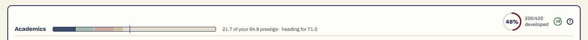
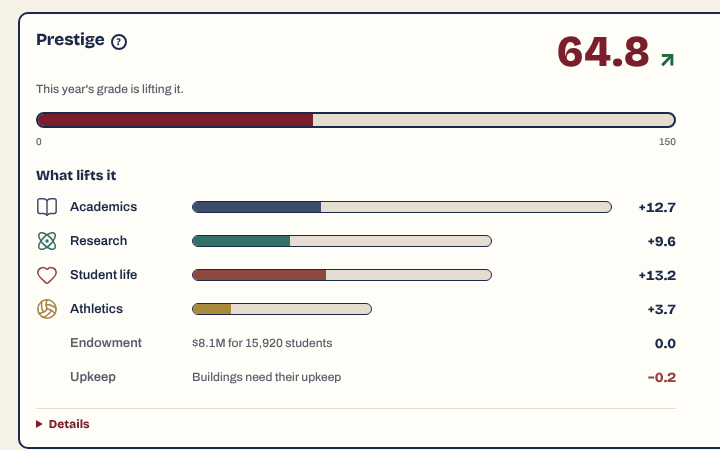

Three things follow.

- **Two numbers under one word.** A player who reads "21.7" on Curriculum and opens History finds "+12.7" beside the same label and the same colour. Both are called what academics adds to prestige.
- **History's rows do not add up to its headline.** The four pillars, the endowment and upkeep sum to 39.0 under a figure of 64.8. The floor that makes up the difference is not on the panel.
- **One screen hides the target and four print it.** `PrestigeGlance.tsx` shows the summer's direction only, by decision (its comment cites Plan 98B: "the target is not shown as a figure"). The pillar head on Curriculum, Research, Students and Athletics prints "heading for 71.0".

**Change.** One apportionment for "how much of prestige is this pillar", the pillar head's, used in History too, so the rows sum to the headline and the two screens agree. Rank stays as the second read, the one that compares with rivals. The standing out of 150 belongs under Details. And decide once whether the target is a figure; today it is both.

### U-2. Quality is drawn six ways

A 0–100 score for how good something is appears as:

- a circled grade mark (a course, a program, a school: `GradeMark`);
- a number on a tinted ground inside a chip ("Berg 87" on a course cell);
- a grade-coloured bar with now → potential (Faculty);
- a maroon bar with one number (the same professor's research score, on Research);
- the bare words "quality 70" (a team, a coach, the Athletic Director);
- a segmented dial "/100" (a satisfaction need) and "56/100" (the incoming class).

The maroon bar on Research was clash 12 in the review by subtraction and still stands ([`s3-research.png`](img/s3-research.png)). Athletics is the outlier that matters: its teams are ranked against the same hundred colleges as everything else, yet "quality 37" has no ink, no bar and no scale.

**Change.** A quality is its number in its grade's ink, everywhere. The bar is added where two are compared (Faculty). Athletics' "quality 37" takes the ink, which also shows at a glance which teams drag.

### U-3. Three ways to say a step in a sequence, nested

The summer's three beats are tabs with an underline ("1 · Review  2 · Admissions  3 · Students"). The second beat is a page of its own with a second stepper, as pills ("1 · The price  2 · The standard  3 · The class"), and its side cards are numbered a third time ("1 · THE PRICE", "2 · THE STANDARD"). A player on step 2 of 3 is shown step 2 of 3 again in another style.

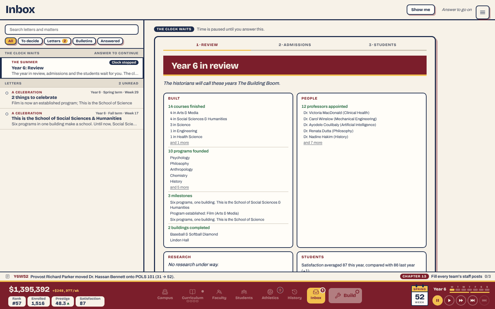
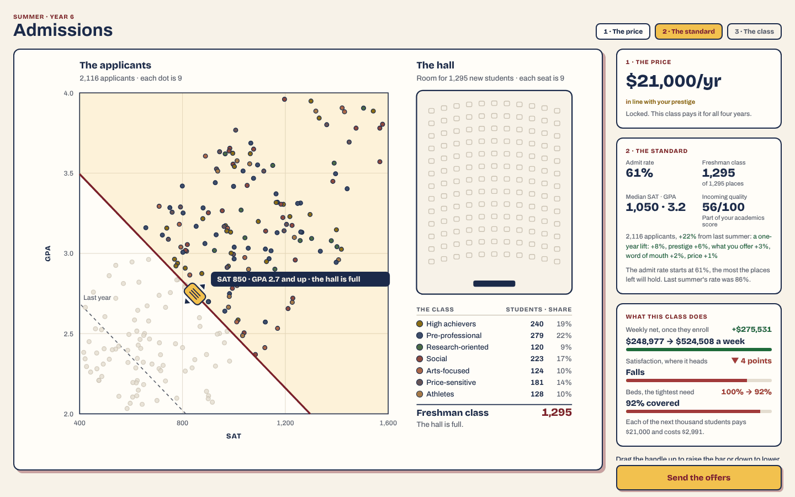

The summer also changes shell twice: the review is in the Inbox's reading pane with the dock dimmed, admissions is a page with no dock, and the third beat is back in the Inbox. The third beat then shows the tuition and admit rate that were set on the page before.

**Change.** One stepper for the summer, with admissions' two decisions as its middle steps (Review · Price · Standard · Students), or drop the inner numbers and let the side cards carry the order. Fold the third beat's two repeated lines away; when no organization asks for approval, that beat has nothing left and can go.

### U-4. Most events have no subject

Of the 159 events in `data/eventCatalogue.ts`, 27 have a `title`. The others take their first sentence (`inbox.ts`'s `eventSubject`), cut with an ellipsis. So the year-15 matter reads, at dialog-title size, "An inspector spent forty minutes in the boiler room of Art Gallery, then came out and c…", with the same sentence as the first line of the body under it.

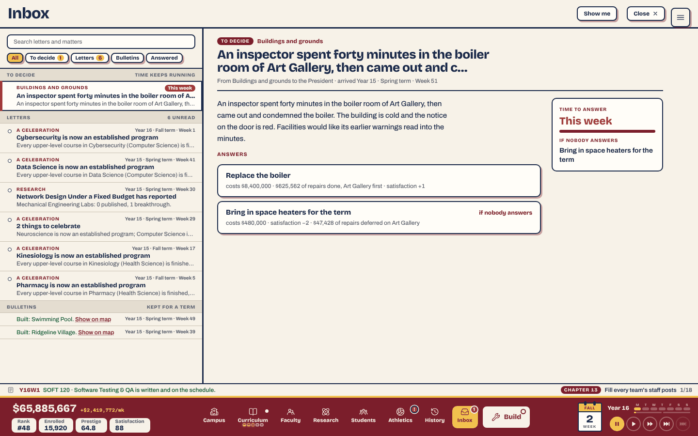

- The list row prints the sentence twice, as subject and as preview. `afterSubject` is meant to prevent that, but it compares against the cut subject, so a long first sentence slips through.
- The ticker's NEXT prints it a third time, and at 1280 it is cut mid-clause.
- The titled ones ("A petition for a Hellenic Council") read like mail, so the two kinds sit unevenly in one list.

**Change.** A subject of three to six words on every event ("Art Gallery: boiler condemned"). Until then, make `afterSubject` strip the uncut first sentence.

### U-5. Exact money where the rules say short

`ui-shell.md`'s number rules give `moneyShort` to "tiles, cards, rows, chips, buttons", where prices are compared, and exact money to sentences and ledgers. These break it:

- a decision's answers: "costs $8,400,000 · $625,562 of repairs done" (`EventChoices.tsx:30` calls `money`). Two answers side by side is the game's clearest case of prices being compared.
- the placing strip: "Placing: The Gazebo · $250,000", for the tile that read "$250k" one click earlier;
- Students › Effect on satisfaction: "$155,429 ($8,082,301/yr)" in a table row.

**Change.** `moneyShort` in all three.

### U-6. Red for things that are not wrong

- "no cost" is in the danger ink on both answers of the Hellenic Council petition ([`u6-no-cost-in-red.png`](img/u6-no-cost-in-red.png)). The best case of a cost is drawn like the worst.
- "if nobody answers" is red on the default answer and again in the side card.
- A professor's "2/2 course slots" turns red when the slots are merely all in use.
- "Wind up" on every running lab keeps the destructive outline for a routine act (noted before; still so).
- "Freshman class 1,295" on the admissions page is in the school's maroon, which on the default palette reads as the danger red beside the red "▼ 4 points" two cards away.

**Change.** The cost label of a free answer in the muted ink; "if nobody answers" as a chip, once; full slots in the plain ink (it is the card's "Can take a course" filter that needs it, not an alarm).

### U-7. Smaller ones

- **"New" has two drawings on the band.** Curriculum's is a solid dot, Build's a hollow ring, for one meaning (`alert-badge new`). The Inbox's unread dot is a third use of the dot. [`u9-band.png`](img/u9-band.png)
- **A dashed outline** now means a quirk (the faculty card's chip), a candidate (the market card's border), a free seat, an empty course slot and a locked style. The quirk chip is the new one; it is a trait, not a state, and could be a plain chip.
- **The faculty card's header count** (a book and "8") is the number of courses in the field waiting for a teacher. It has no word, and the card's foot has "1/7 course slots", so two slot-like numbers sit on one card. A title on hover, or the count moved beside the slots, would settle it.
- **"rung 1 of 5"** under The board counts from a rung 0 the player never sees (`RUNG_NAMES` has six). Five pips, one lit, would say more than the words, and would show which way is worse.
- **Satisfaction's dials do not sum to its figure.** At year 15 the five needs, weighted, come to 96 and the headline says 88, because the part above 80 counts half (`DIMINISHING_ABOVE`). That step is in the help only. One muted line under the figure would close the gap.

---

## Part 2. Saying less on a screen

The counts are the top layer's words and enabled controls at year 15 ([`data/gallery.md`](data/gallery.md)). The simulation is not touched by anything below: every cut is a repeat, a fold, or a move to the place where the fact is used.

| Screen | Words | Controls | Before the first actionable row |
|---|---:|---:|---|
| Curriculum | 3,626 | 540 | 410 px |
| Faculty (cards) | 1,723 | 180 | 360 px |
| Research | 770 | 16 | 215 px, then 170 px a lab |
| Athletics | 727 | 63 | 190 px |
| Students | 577 | 10 | 480 px to the satisfaction dials |

### S-1. Curriculum

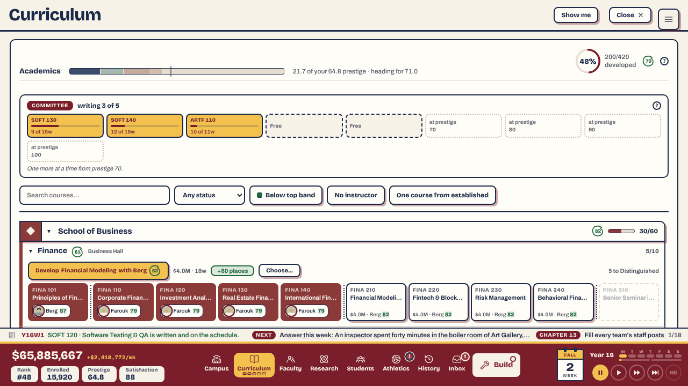

At 1280×720 the first course appears 528 px down a 610 px window. Above it:

- **The committee's locked seats.** Four dotted boxes, "at prestige 70 / 80 / 90 / 100", are drawn from year 2 on ([`s1-curriculum-year-2.png`](img/s1-curriculum-year-2.png)), and at year 15 the ninth box wraps to a row of its own. The sentence under them, "One more at a time from prestige 70", repeats the first box. Show the earned seats and one stub, "next at 70".
- **Four readouts in the head**: the pillar bar and its line, a 48% ring, "200/420 developed", and a grade mark. The ring and the fraction are one fact.
- **A filter row** of a search, a select and three toggles, always open. It can fold behind one "Filter" control until used.

In the grid, every undeveloped cell of a program repeats the same foot, "$4.0M · Berg 82": the price and the best teacher are the row's, not the cell's, and the row's own Develop line already says both. With cells that carry only their code and name, some 200 cells at year 15 lose a line each, and the cells that differ (a course with no teacher, a blocked one) stand out.

### S-2. Faculty

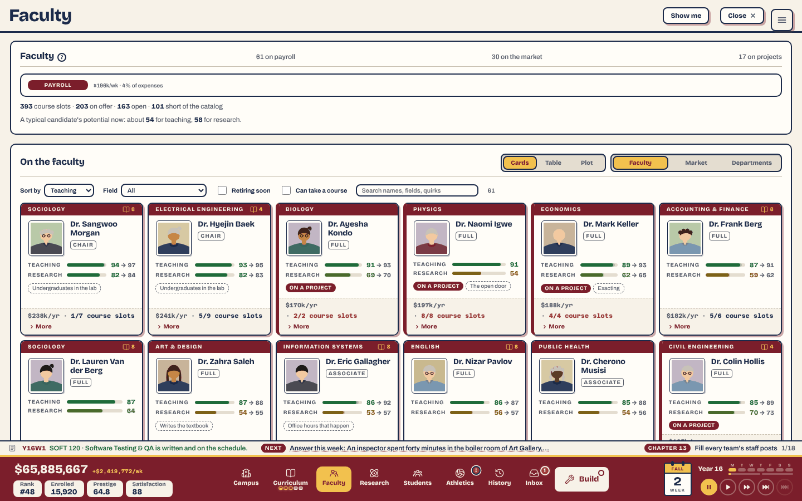

The head panel is four lines of summary before the first person:

- "61 on payroll · 30 on the market · 17 on projects";
- a PAYROLL meter that reads "4% of expenses", so it always looks empty;
- "393 course slots · 203 on offer · 163 open · 101 short of the catalog", four numbers whose words need the help to tell apart;
- "A typical candidate's potential now: about 54 for teaching, 58 for research."

Each belongs to one view. The slots line is what Departments draws as bars; the candidate line is about the Market; payroll is a Treasury line. Keep the first line, and move the others to the view they describe.

The two switches side by side (noted before) are also in the wrong order: how to look (Cards / Table / Plot) comes before what to look at (Faculty / Market / Departments), and Departments silently drops the first switch. Put *what* first, and draw *how* only for the views that have it.

### S-3. Research

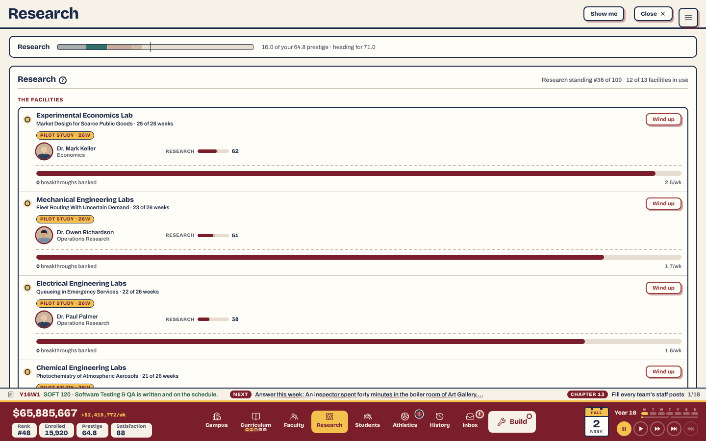

A lab takes 170 px, so four of thirteen fit. Each says its length three times: "25 of 26 weeks", the chip "PILOT STUDY · 26W", and a full-width bar. The scholar's research score has its own bar a row above the progress bar, in the same maroon, so two bars of one colour mean two different things.

**Change.** One line a lab: name, topic, scholar and score, one progress bar with "25/26w", the output rate. The stage chip, breakthroughs banked and Wind up open with the row. All thirteen labs then fit one screen, and the one that is idle (the fact a player comes for) is no longer three screens down.

### S-4. Students

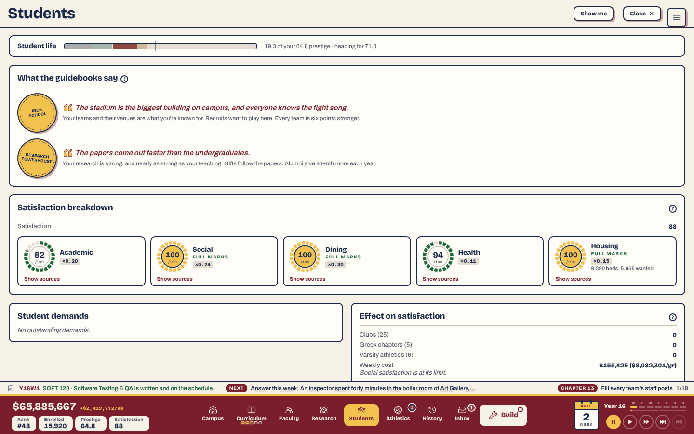

- The guidebook's seals take the top 250 px. They change rarely; satisfaction, which changes weekly and is what the dock's chip opens this tab for, starts below them. Swap the two.
- "Effect on satisfaction" is three rows of 0 and the line "Social satisfaction is at its limit." When every row is 0, the line alone is the panel.
- The weights ("×0.20") are on every dial's face in the mono. They are the depth behind the breakdown, and "Show sources" is already the door to it.

### S-5. Athletics

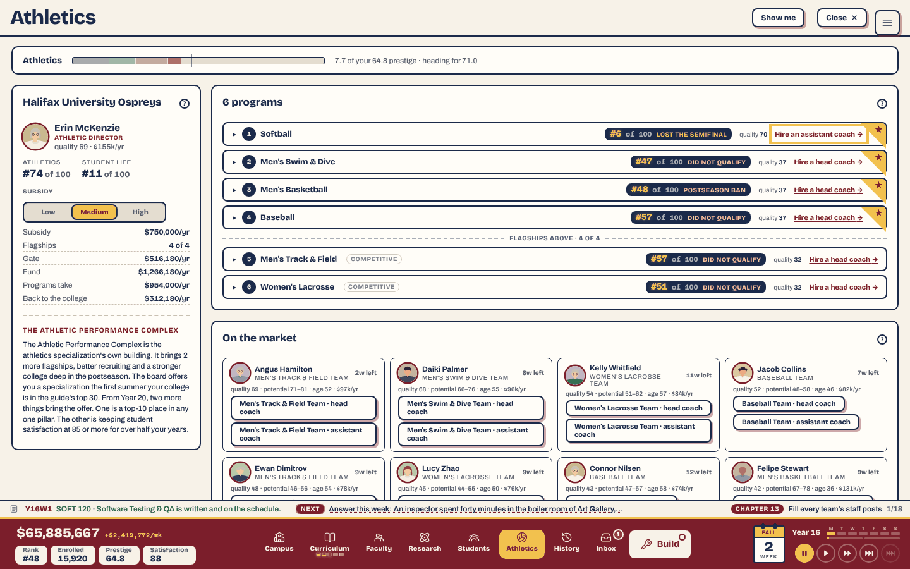

- The side panel carries about 90 words on the Athletic Performance Complex, a building the college can only have after choosing the athletics specialization, which the board has not yet offered. It can wait for the offer.
- A program's row has five things after its name: a rank chip, its postseason result, "quality 37", a hire link and the flagship star. The result is last season's and could be the chip's tooltip.

### S-6. The rest

- **History › Prestige** uses the left half of a 1,400 px panel, and "By year" is a 325 px chart in a panel four times as wide. The chart can sit beside the pillars, and the screen then needs no scroll. [`u1-pillar-in-history.png`](img/u1-pillar-in-history.png)
- **The objectives drawer** lists three "Unlocked:" milestones as paragraphs above "Next milestone", and "Read again" is below the fold. Next first; the unlocked ones as names. [`s9-objectives-drawer.png`](img/s9-objectives-drawer.png)
- **The build menu's head line** repeats "15,920 enrolled" and "satisfaction 88", which are in the dock 60 px below it. What the dock does not have is the line's use: beds against enrolled, and the campus's weakest part.
- **The Inbox while the clock waits** keeps its search, five filters and the letters list beside the year's review, and a "Show me" button above it. During a stop the list has one row that matters; the reading pane could take the width.

---

## Part 3. Where the systems meet

### Working together

- **One slot.** Build, a tab and the objectives drawer share one place: pressing J with the build menu open closes the menu and opens the drawer. Nothing stacks.
- **A building in hand folds the menu** to a one-line strip, labels the neighbours on the map, and puts the keys in a strip at the top. The three systems (menu, map, keyboard) each give way. [`i1-pickup-menu-folds.png`](img/i1-pickup-menu-folds.png)
- **The Inbox drops the ticker's NEXT** while it is open, and the summer's note lifts the toasts above itself.
- **The pillar colours** (navy, teal, brick, ochre) are the same on History, the four tab heads and the specialization's page, and the page's four panels are the best single screen in the game for seeing systems side by side ([`u1-pillar-at-the-specialization.png`](img/u1-pillar-at-the-specialization.png)).
- **Selecting a building** fades the others, so its panel and its place read as one thing.

### In each other's way

#### I-1. A grounds tool leaves the build menu at full height

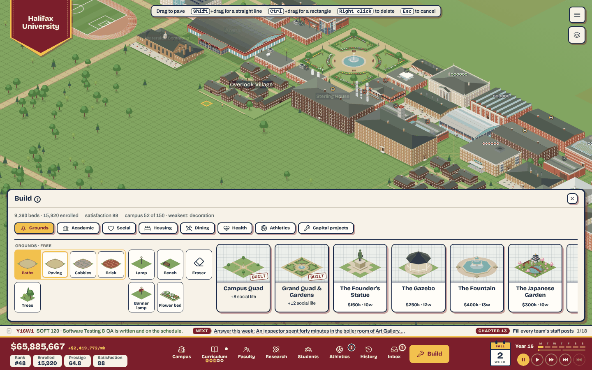

With Paths armed, the menu keeps its 432 px: 48% of a 900 px window and 60% of a 720 px one, over the ground the player is about to draw on. A building in hand folds the same menu to about 110 px. Two kinds of placing, two behaviours.

**Change.** An armed grounds tool folds the menu to the same strip, with the tool's tray of styles in it.

#### I-2. Toasts land on an open tab

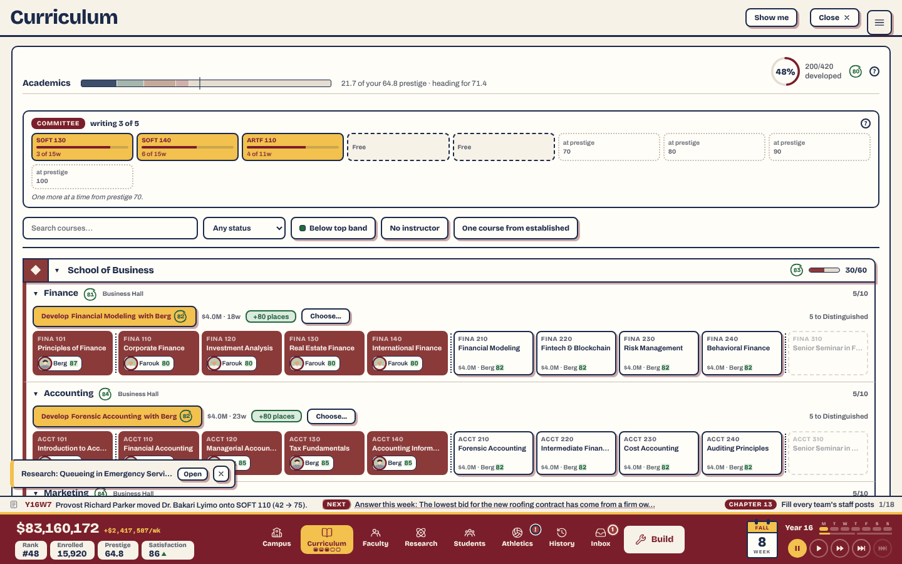

Toasts stack at the bottom left, above the ticker, whatever is open. Over a tab they cover content: here, the teachers on two Accounting courses. (The stylesheet's comment says "at the right"; the rule says left.) By the stylesheet, the same corner is also the tab walk's and the log popup's; those were not seen together.

They are also cut at 360 px, so three that arrive together read alike: "For your next college: Tudor architecture…", "…Italianate architec…", "…Second Empire ar…" ([`i2-three-toasts-alike.png`](img/i2-three-toasts-alike.png)). The word that differs is the one cut.

**Change.** While a tab is open, a toast goes into the ticker's line, which is already the place for "what just happened", or under the tab's header on the right. Toasts of one kind in one week merge ("3 architectures for your next college").

#### I-3. The main menu button floats on every tab's header

The hamburger is the map's corner button, and it stays when a tab opens. It sits 8 px lower than "Show me" and "Close", straddling the header's rule, on every tab; during a stop it is beside "Answer to go on". It reads as a third header button that missed the row. Either seat it in the header's row when a tab is open, or move it to the dock.

#### I-4. The admissions button covers what the class will do

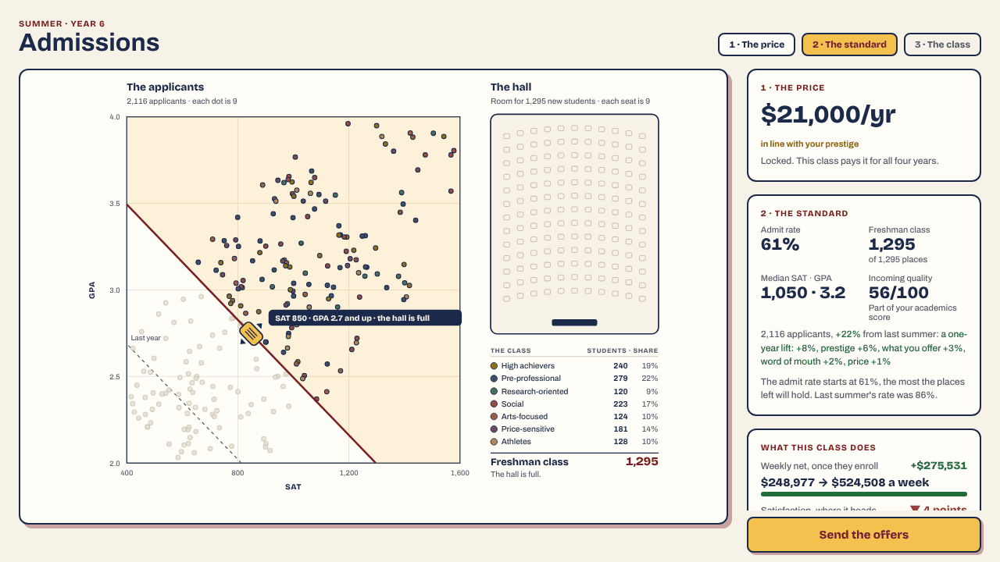

"Send the offers" is fixed at the foot of the right column. At 1440×900 it cuts the line about the handle. At 1280×720 it covers *What this class does* from its second line: the satisfaction and beds forecasts, the two readouts that tell the player the cost of the class they are about to admit. The column scrolls, but nothing says so, and the button is the thing the eye lands on.

**Change.** *What this class does* above *The standard*'s prose (it is the consequence; the prose is the method), or the button inside the flow under the cards.

#### I-5. Map marks do not hold a size

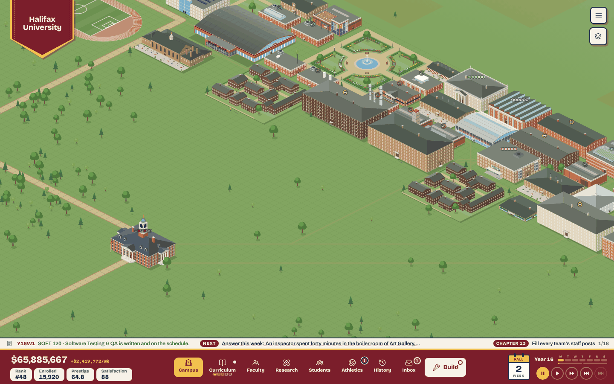

The marks on roofs (a hall's program pips, a lab's ring, a full residence's ring) are drawn in the map's own units. At the view a year-15 campus opens on, a pip is about 5 px and a lab's icon cannot be read; they are grey specks. Two steps in they are right ([`i5-marks-two-steps-in.png`](img/i5-marks-two-steps-in.png)). Four steps in, a label is 80 px tall ([`i5-marks-four-steps-in.png`](img/i5-marks-four-steps-in.png)).

So at the zoom where the whole campus is in view, which is where a glance across systems would be most useful, three systems' marks are present and none can be read. The lab's ring also takes its school's colour, so a Business lab's ring is red (noted before; still so).

**Change.** Clamp the marks to a range on screen (about 14 to 28 px). Below the zoom where they would crowd, draw one mark a building: the thing that most wants attention there.

#### I-6. The pennant and the panel share the top-left corner

The pennant covers 150 × 135 px of the map for the whole run, and it is where a year-15 strip campus put its stadium. A building's panel opens over it, which is right. This is only worth a change if the pennant can step back once the college is named in the player's head: smaller after year 1, or drawn on the dock's left end.

#### I-7. A bad state is drawn quietly on the band

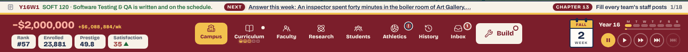

In the crisis save the funds figure is negative, in a pale pink on the maroon band, with the weekly net beside it in gold. Satisfaction 35 is the one figure in a strong red, because its chip is cream. The map is unchanged. The limit above applies (the save is forced), but the drawing is what it is: on the default palette the band's "bad" has less contrast than its "good". This is the review by subtraction's E-10 seen from the dock; a negative funds figure could take the cream chip the four stats have, where the paper red already works.

#### I-8. The funds tooltip stays over the Treasury it opened

Clicking the funds figure opens the Treasury, and the pointer is still on the figure, so its tooltip stays up over the foot of the expenses column and over the ticker until the mouse moves ([`i8-funds-tooltip-over-treasury.png`](img/i8-funds-tooltip-over-treasury.png)). A tooltip should close on its own button's click.

---

## Keep

- **The register**: the panel, the offsets, three faces, one scale. Nothing in 264 captures looks borrowed.
- **The one-slot rule** and the folding build menu.
- **Status lines that name the blocker beside the control**: "ECON 120 needs MATH 120", "5 to Distinguished", "+80 places" on Develop.
- **The admissions page.** The applicants, the line, the hall filling and the class table are one picture of four systems (price, prestige, places, cohorts), and it still teaches itself.
- **The specialization's page**: four pillars, four colours, one layout, each with where it stands and what it adds.
- **Faculty › Departments.** One bar a department for offered, open, catalogue and supply: the densest honest picture in the game, and it needs no prose.
- **Treasury's operating budget.** Three figures, one chart, three levers, each expense a bar. It is the model for S-2 and S-3.
- **Plan 124's band**: two marks with two meanings read correctly at year 15, apart from U-7's ring.

## What this review did not do

- It did not change the game or write a plan. The ten above are ordered, not sequenced.
- It did not read the phone layout, the Final Report page or the title page.
- It did not measure a player. The pixel heights and word counts are measurements; "overwhelmed" is the reviewer's reading of them.
