# Devlog draft · UniSchool 0.3.1

*A draft for the itch.io devlog, for the owner to edit and post with the
0.3.1 upload. It covers everything merged since the 0.3.0 build
(`7deabcf`, PRs #454 to #461, 11 to 13 November): the performance work,
the seasons, the trophy case, the new title screen and theme, the hall
doors and redrawn buildings, sixteen new things to build, the sandbox
changes, and Plan 127 (College, Institute, University, PR #462). The
full list is in [`changelog.md`](changelog.md). The pictures are in [`devlog-0.3.1/`](devlog-0.3.1/), drawn
by the game's own art in the Georgian set (`npm run sheet`). Nothing here
claims more than the build does.*

---

## UniSchool 0.3.1: more to build

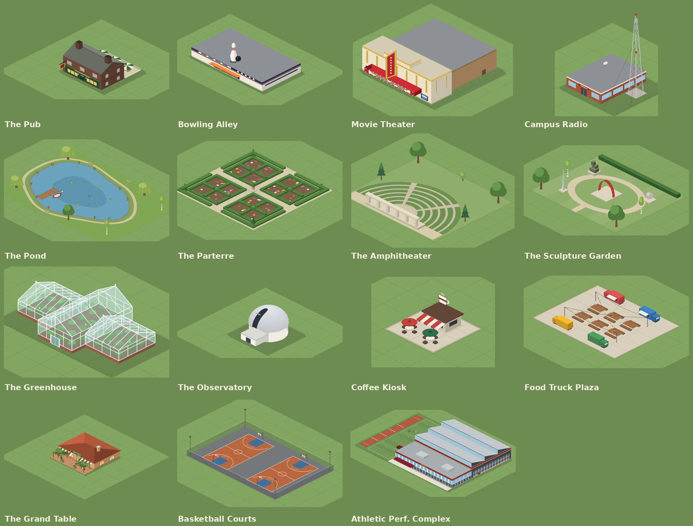

### Thank you

0.3.0 was an update of taking things out. This one puts things in. After
it went up, one of you asked for more to place on campus besides
decorations, and another asked why the college always has to be called
College. Both are in this update.

Your saves come with you: a 0.3.0 college opens in 0.3.1, and it gets
every new building, locked until it qualifies, like a new run would.

### Sixteen new things to build

**Somewhere to go in the evening.** These raise social satisfaction, like
the Student Center, and cost a little more per seat so they give you a
choice without undercutting it.

- **Campus Radio**: a small brick studio with an ON AIR light, under a
  lattice mast with red lights on top. It opens at the first
  commencement, and Media Studies' four advanced courses are taught
  there, so you have to build it before you can teach them.
- **The Pub**: a two-storey house in your campus's brick and roof, with a
  green front, a hanging sign and a beer garden out the back. It opens
  at *A town's worth*.
- **The Bowling Alley**: a long shed with a navy fascia and a giant pin
  on the roof. It opens at *A town's worth*.
- **The Movie Theater**: a brick auditorium behind a cream lobby, with a
  lit marquee and a blade sign. It opens at *A small city*.

The four are on the build menu's Social tab.

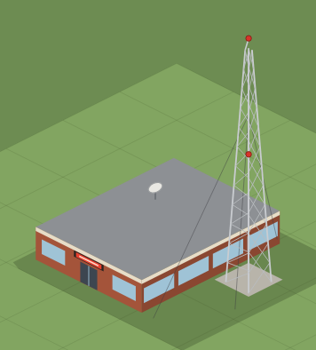
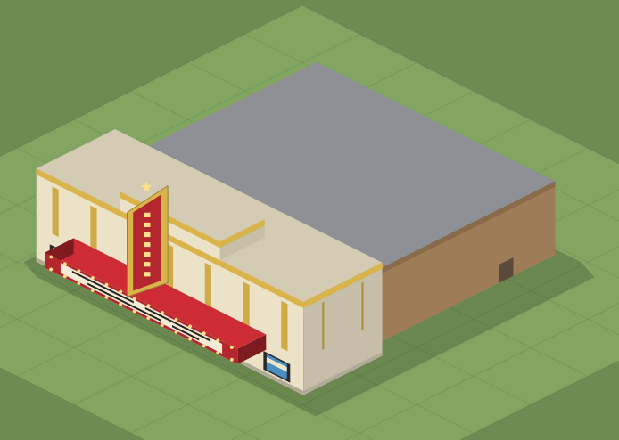

**Gardens.** They're placed like the other amenities and add beauty, and
each opens at a milestone.

- **The Parterre**: box hedges clipped into knots on gravel, with
  flowers, a sundial and yew cones. It opens at the first commencement.
- **The Amphitheater**: grass terraces on stone risers, stepping down to
  a stage with a colonnade. It opens at *A town's worth*.
- **The Sculpture Garden**: a red steel arch, bronzes, a stone sphere and
  a steel needle on plinths round a gravel loop. It opens at *A regional
  name*.
- **The Pond**: the biggest of them, with reeds, lily pads, ducks,
  willows, and a jetty with a rowboat. It opens at *A small city*.

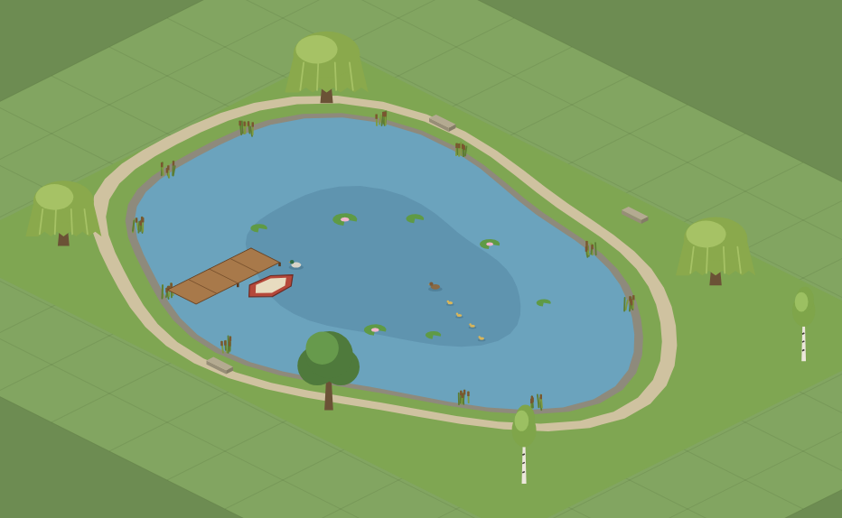
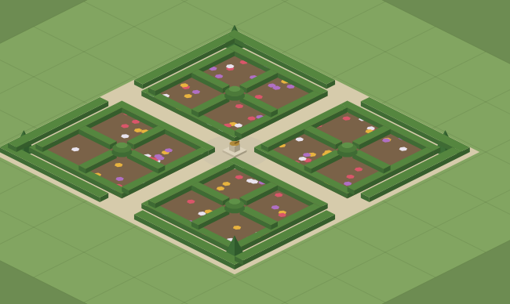

**Two showpieces for distinguished sciences.** These are the first
buildings that a program opens, not a milestone. Its "distinguished"
news names the building.

- **The Greenhouse**: a white-framed glasshouse of palms and orchids,
  for a distinguished Environmental Science.
- **The Observatory**: a white dome with its slit open over the door,
  for a distinguished Aerospace Engineering.

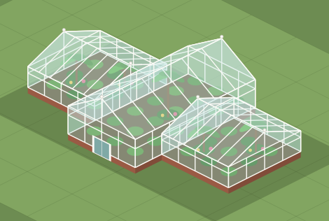
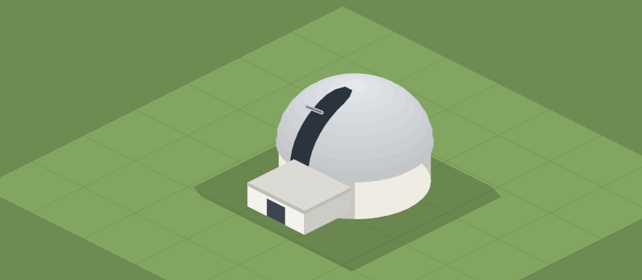

**Two more places to eat.**

- **The Coffee Kiosk**: a counter under a striped awning, with two café
  tables and a cup sign on top. It's the cheapest way to feed students,
  and it opens after the first dining hall.
- **The Food Truck Plaza**: four trucks round a paved square of picnic
  tables under string lights. It opens after the Hilltop Cafeteria.

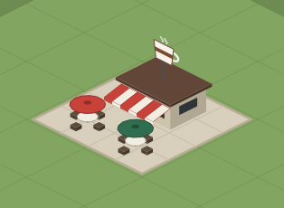
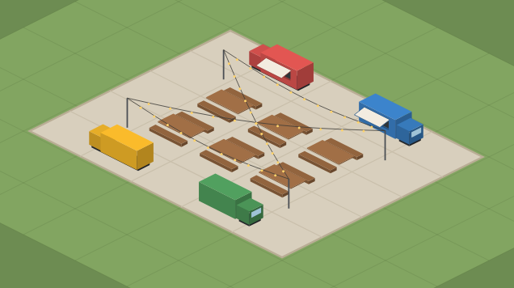

**Basketball Courts**: two outdoor courts with real line markings, hoops,
a fence and floodlights. They raise health satisfaction and open after
the gym, on the Health tab.

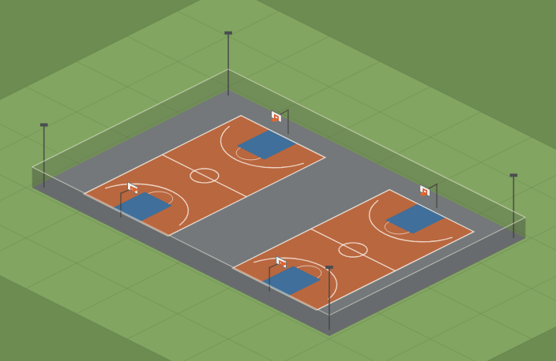

### The full list

| Building | Size | Cost | What it does | Opens |
|---|---|---|---|---|
| Campus Radio | 3×3 | $250k | Social, 600 students; teaches Media Studies' advanced courses | First commencement |
| The Pub | 3×3 | $300k | Social, 600 students | A town's worth |
| Bowling Alley | 7×4 | $520k | Social, 1,000 students | A town's worth |
| Movie Theater | 5×5 | $820k | Social, 1,600 students | A small city |
| The Parterre | 5×5 | $200k | Beauty 0.9 | First commencement |
| The Amphitheater | 7×6 | $700k | Beauty 1.2 | A town's worth |
| The Sculpture Garden | 6×5 | $450k | Beauty 1.1 | A regional name |
| The Pond | 10×7 | $600k | Beauty 1.8 | A small city |
| The Greenhouse | 5×3 | $450k | Beauty 1.4 | Environmental Science distinguished |
| The Observatory | 3×3 | $550k | Beauty 1.4 | Aerospace Engineering distinguished |
| Coffee Kiosk | 2×2 | $180k | Dining, 150 places | After the first dining hall |
| Food Truck Plaza | 5×4 | $1.1M | Dining, 1,000 places | After the Hilltop Cafeteria |
| Basketball Courts | 6×4 | $450k | Health, 1,200 students | After the gym |
| The Grand Table *(redrawn)* | 3×3 | as before | Dining, 600 seats | After the Hilltop Cafeteria |
| Athletic Performance Complex *(redrawn)* | 13×9 | as before | As before | Athletics specialization |

*Changed in name only:* Commons Cafeteria is now the **Hilltop
Cafeteria**, Old Well Commons is **Old Well Hall**, and Waterside Commons
is **Waterside Market Hall**. Three dining halls were called "commons".
A save gets the new names, and a hall named for a donor keeps the
donor's name.

### Dining, sized for a real campus

The dining halls together used to serve 47,050 students, so the last two
were never needed below about 52,000. The chain now serves what a 40,000
student campus needs, counting the grocery and the towers' shops. Every
dining hall, the kiosk included, is needed by the time you reach 40,000,
and you add storeys to go past that. Bigger halls still cost more per
place.

In a save, what you've built stays as it is. Halls you haven't started
take the new seats, price and order, and the kiosk and the trucks join
the list.

### Two buildings redrawn

- **The Grand Table is a trattoria** now, not another dining hall. It's a
  small one-storey stucco house on a 3×3 plot, with tall arched windows,
  a green, white and red awning under a TRATTORIA sign, a pizza oven's
  chimney, and a terrace with tables under a pergola of vines and string
  lights. It still seats 600 and costs the same. A Grand Table you've
  already built shrinks in place, keeping its front edge and the way it
  faces, and the land it frees is yours.
- **The Athletic Performance Complex**, redrawn from scratch. One of
  you said it looked like a plain building with a track on the roof,
  which didn't make much sense, and you were right. It's now what a
  college performance center is made of: a speed field with sprint
  lanes, hurdles and tackling sleds; a training hall with a sawtooth
  roof and an indoor sprint straight behind glass; and a performance
  wing in the college's colours with ATHLETICS across the front.

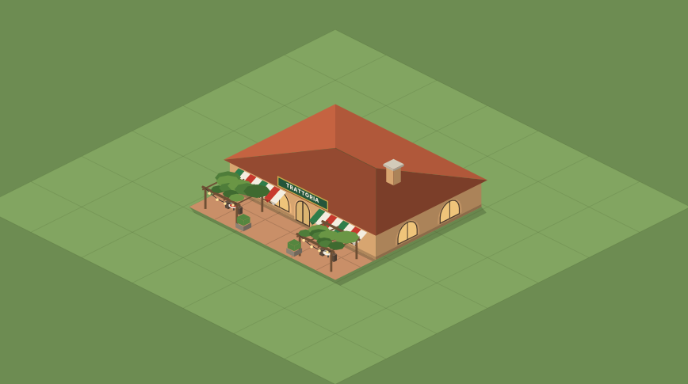
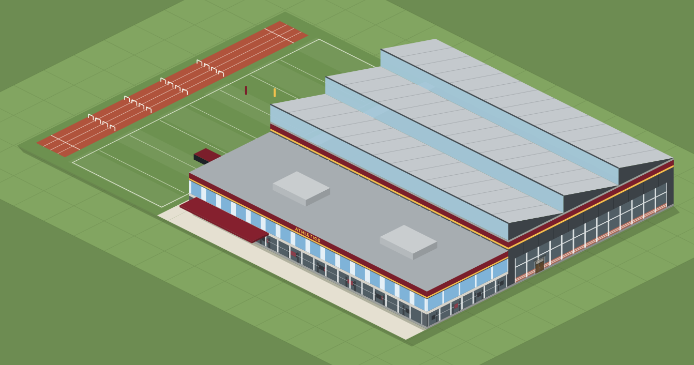

### Doors that look like doors

- **Every academic hall's side and back doors** are now nearly the size
  of the front door, on the same floor and steps. They used to be a
  small door and a service hatch a third of its size.
- **Italianate halls** have arched doors on all four sides.
- **Art Deco halls** finally have a door in the recess at the front.
- **Modern halls'** doors are at ground level, with glass doors in a
  steel frame. They used to stand a storey up and looked like they were
  floating.
- **Modern Founders Hall** is symmetrical, with the carillon in the
  middle of the roof and the sun fins on every side.
- **The Mission library** has its arcade on every side and its doors at
  ground level inside it. The **Tudor library**'s windows no longer sit
  on top of its doors.

### A new title screen, and the theme all the way through

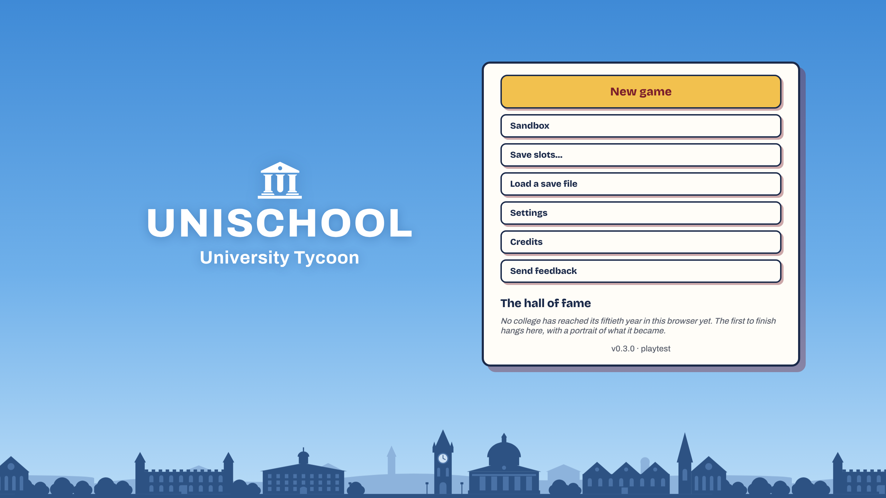

The game is now **UniSchool: University Tycoon**. The title screen is a
clear sky over a campus skyline: a battlemented hall, a domed library,
the clock tower, a chapel spire. The same sky sits behind the founding,
the hall of fame, settings and credits.

**The title theme keeps playing during a run**, at about a third of its
volume, fading between the two levels.

### The trophy case

The Athletics tab's trophy case was a list. Now it's a case: a brass
tally of your national titles, and one cup for each team on wooden
shelves. Each title adds a band with its year engraved to that cup's
base, so the team that's won most stands tallest. It shows before your
first title too, with empty spots on the shelf.

### Faster, again

- **Closing a tab late in a run is instant.** The map used to freeze at
  the moment you opened a tab, then repaint the missed weeks in front of
  you, which took nearly a second of stutter. Now it keeps up quietly
  while the tab is open.
- **The tabs' figures are worked out once a week.** The Students tab
  used to work out the same satisfaction breakdown about twenty times
  each week. In a year-45 save, a week's redraw of Students and
  Athletics takes less than half the time, and History about half.
- **A full stadium is quicker to draw.** Its crowd is about 2,600
  shapes, and it's now drawn once and reused, so a season change on the
  stadium is about four times faster.
- **The seasons move every three weeks**, not every week. Each change
  repaints every tree and snowy roof, which you could feel on a big
  campus. Snow still comes and goes over two steps, and the leaves turn
  over four.

### Sandbox

- **Everything is open from the start**: every tab, office, building and
  course, from week 1.
- **No objectives, letters or milestones.** The milestones are still
  reached, quietly, so everything they open is open. Decisions that
  need you (events, the summer, the charter) still come.
- **You place Founders Hall yourself**, for free, before the clock
  starts. It isn't placed for you any more.
- The style pickers match the rest of the game.

### Fixes

- **The summer review's rank was a year behind.** It compared you with
  last summer's prestige and often said "held" when you'd moved up. It
  now shows the rank this summer gives you, and who you passed.
- **Walkers no longer walk over the Triumphal Gate's stonework.** They
  show through the arches and go behind the walls.
- **The football stadium's corner tower is gone.** It drew wrong at some
  camera angles.
- Build tiles no longer show "#1", "#2" on the gym, the pool, the halls
  and the dining halls. The names already tell them apart.

### College, Institute or University

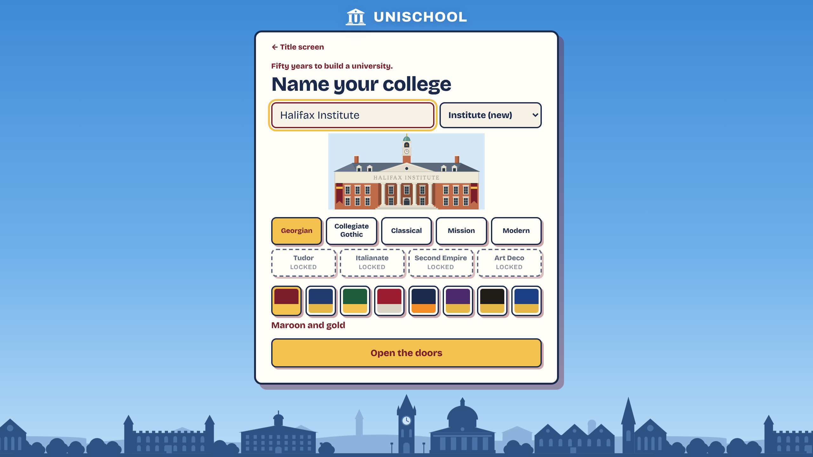

Until now every college opened as **X College** and could become **X
University** with its first research lab. One of you asked why it has to
say College at all: what if you want to be an Institute? Now you can.

- **There are three titles: College, Institute and University.** They're
  equals, not steps. An Institute is a research or technical college, not
  an almost-University.
- **In a run, the board offers Institute with your first research lab,
  and University with your first graduate program.** Each comes as a
  letter that offers the new title or keeping the name you have. The
  Institute letter still carries the one chance to rename the college.
  University comes later than it used to, at Year 15 at the earliest.
- **You choose the title when you found the college**, from a list beside
  the name. Your first college can only be a College. Institute and
  University show as locked, with what earns them, and once you've earned
  a title in any run, every college after can open with it. A sandbox has
  all three open, but earns nothing for your other runs.
- **Your saves and unlocks carry over.** A college that already took the
  old charter keeps its name. If you'd unlocked Second Empire by winning
  the old charter, Institute starts unlocked.

### What's next

The playtest runs to mid-December. If something here doesn't work the
way I've said, the **Report a bug** button and the form in the menu are
the quickest way to tell me.
